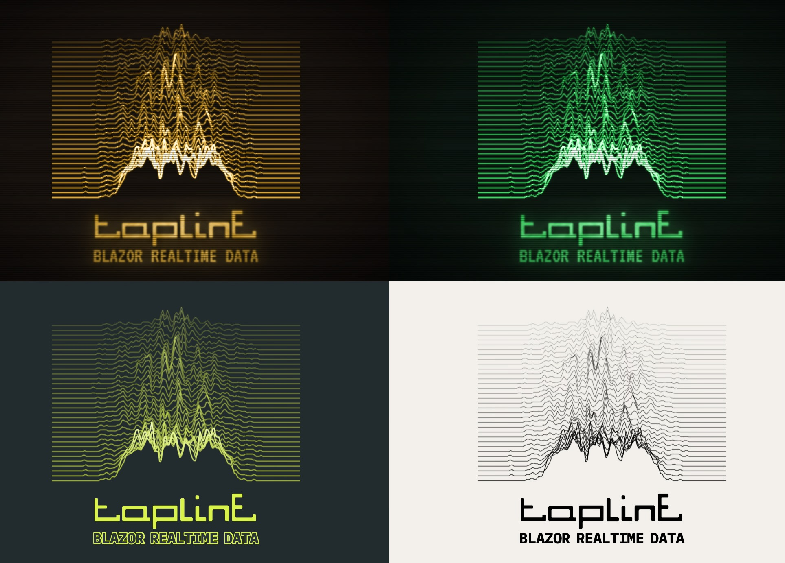

# Tapline — Real-time, last-mile data distribution for .NET

[](https://www.nuget.org/packages/Tapline) [](https://github.com/markhammond/tapline/actions/workflows/ci.yml)

Targets .NET 10.

**Tapline** is a transport-agnostic, zero-allocation real-time fan-out engine for .NET. It unifies shared state distribution and ordered messaging into a cohesive client layer, maximizing the throughput of your edge infrastructure while maintaining a (relatively) simple application integration model.



Experience it for yourself:
```bash
dotnet run -c Release --project samples/BlazorRealtime.Sample
```
Then open `http://localhost:5898` and turn the speaker on. How it works, and what it measures, is in
[its README](samples/BlazorRealtime.Sample/README.md).

From streaming music and L2 order books to live pivot tables and activity feeds, Tapline shapes real-time delivery
around priority, freshness, and backpressure.

## Speed, Cost, and Scalability. With Tapline, You Can Choose All Three.

Tapline dynamically adapts to network traffic and topology changes, providing the architectural foundation for zero-downtime failover.

- **Transactional Across Sources:** A watch over multiple data sources only ever sees complete, atomic units of work. Clients always see a guaranteed valid version or an explicit error with a degraded state chosen by the application.
- **BBR-Inspired Flow Control:** Frames are prioritized via weighted classes, conflated, and ack-clocked. Traffic is automatically steered to the shortest queue.
- **Smart Payload Split:** Large payloads travel out-of-band via HTTP (passing an in-band handle), mitigating head of line blocking and ensuring the primary control plane remains lightning fast.
- **Zero Unsolicited Data:** Everything a client receives is explicitly tied to a subscription. Every subscription is strictly bounded both in memory and in the maximum time it may go unacknowledged.

## Great Power... Without^H^H^H Less Responsibility

Tapline lets you inject custom logic into the heart of the beast. Running user-defined code on a high-velocity hot path
is usually a recipe for runaway loops, security holes and GC spikes; Tapline runs it sandboxed, so you get the
computational reach without the architectural heart pangs.

- **Isolated WebAssembly Transducers:** Supply dynamic data-shaping and fold functions as WebAssembly modules, a fold's state kept by the router and finalized into what subscribers see (a VWAP from its sums). A strict fuel budget restricts their environment, ensuring you can run untrusted or complex computations without endangering the host process or risking runaway execution.
- **Baked-in or Dynamic Integration:** Transducers can be natively hardcoded for peak velocity or injected dynamically to bridge specialized backend engines on the fly.
- **Zero-Allocation Guardrails:** Because Tapline operates with zero allocations per frame in a steady state, your custom transducers will not induce garbage collection stutter or compromise throughput.

## Making Blazor Dance

Blazor Server was built to keep a form in lockstep with its user, not a live feed with its audience. Ask it to stream
without discipline and it stumbles over its own feet:

- **Every update is a re-render.** A change of data becomes a component render, a server-side diff and a render batch,
  per client: a lot of machinery to say that one number changed.
- **One shared pipe for everything.** A circuit is a single SignalR connection. Pour a feed into it and the user's clicks queue
  behind the feed.
- **No pacing.** SignalR sends what it's given. A slow client's buffers fill, and what finally arrives is old news,
  while memory climbs on the server.
- **Everything deflated.** Each message is compressed, which costs most for the small, frequent ones a feed is made of.
- **Reconnects drop the thread.** A circuit that blinks comes back with nothing in hand.

Tapline teaches it the steps, on the circuit you already have:

| Plain Blazor          | With Tapline |
|-----------------------|---|
| Re-rendering for data | Binary records go straight to a replica in the page; Blazor renders the page, not the data |
| One shared pipe       | Frames are interleaved with Blazor's own messages, never reordering them, in priority lanes so what matters goes first |
| No pacing             | Flow control measures each client's path from its acks and caps what's in flight; every client gets the latest state, conflated, never a backlog |
| Deflating everything  | Small frames skip compression, and so does content a provider declares incompressible |
| Reconnects            | Subscriptions are held for a client that drops, and resume exactly where it left off |

For the full routine, open the BlazorRealtime sample's waveform: music and moving pictures, streamed live over
one circuit and kept in step. The server plays a MIDI arrangement and computes a field of ridge lines that moves to it,
60 frames a second, encoded once for every viewer. The notes ride a high-priority lane and the browser plays them; the
ridges fill what bandwidth is left, blended so the motion stays smooth however few frames get through, and shown in time
with the music. Cap the link and the picture thins out while the music plays on.

## Quick start

**Host the router** in a Blazor Server app (`Program.cs`):

```csharp
builder.Services.AddRazorComponents().AddInteractiveServerComponents();
builder.Services.AddBlazorRealtime();                    // the circuit transport, and the router it serves
// ...
app.MapBlazorRealtime();                                 // the out-of-band and module endpoints
```

**Publish.** A table holds fixed-size keys and rows; an update is all or nothing, and each subscriber is sent what
changed:

```csharp
[StructLayout(LayoutKind.Sequential, Pack = 1)]
public readonly record struct Level(byte Side, long Price);

var book = publisher.Table<Level, long>("book:BTC-PERP");
using (var u = book.BeginUpdate())
{
    u.Set(new Level(0, 6_499_950), 120);
    u.Delete(new Level(1, 6_500_050));
    u.Complete();
}
```

**Subscribe from a page.** The server binds a tap on the circuit's outlet; the page subscribes to it, and is sent a
replica of the table, kept current:

```razor
@inject Outlet Outlet
@inject Publisher Publisher
@inject IJSRuntime JS
@code {
    Tap? _tap;

    protected override async Task OnAfterRenderAsync(bool first)
    {
        if (!first) return;
        _tap = Outlet.Tap(Publisher.Table<Level, long>("book:BTC-PERP"), "book:BTC-PERP");   // step 1: bind
        await JS.InvokeVoidAsync("bookView.attach", _tap.Binding);                             // step 2, in the page
    }
}
```

```js
window.bookView = { attach: binding => tapline.subscribe(binding, state => render(state.rows)) };
```

**Subscribe from .NET** over MagicOnion:

```csharp
var connection = new TaplineStreamConnection(GrpcChannel.ForAddress("http://localhost:5902"));
connection.Connected += (outletId, nonce) => { /* step 1 on your server, then connection.Client.Subscribe(binding, handler) */ };
await connection.RunAsync(stopping);
```

A service of many subscribers goes through a data provider, which decides who may subscribe and to what. The rest:
[Clients](docs/client.md), [Data providers](docs/provider.md), [Transports](docs/transports.md).

## Samples

- [BlazorRealtime](samples/BlazorRealtime.Sample/README.md) — animation synchronized to streaming music.
- [BlazingOrderBooks](samples/BlazingOrderBooks.Sample/README.md) — streaming order books with delta-based conflation.
- [PivotTable](samples/PivotTable.Sample/README.md) — a live position viewer using idiomatic SQL.
- [ActivityFeed](samples/ActivityFeed.Sample/README.md) — privacy preserving feeds.
- [SignIn](samples/SignIn.Sample/README.md) — passkeys and OPAQUE as pluggable authentication modules.

## Batteries included

Four packages. A server takes `Tapline`, a .NET client `Tapline.Client`; the two that bring Wasmtime are taken only as
needed: `Tapline.Wasm` by a server, `Tapline.Client.Opaque` by a client.

| Package | For |
|---|---|
| `Tapline` | the router hosted in ASP.NET Core, over a Blazor Server circuit's own connection or MagicOnion (gRPC); data providers in a process of their own; sign-in by modules (passkeys, passthrough, your own); the viewer and the browser client (`tapline.js`) |
| `Tapline.Client` | the core (sources, message topics and mailboxes, outlets and the router, `Publisher`) and the .NET client, over MagicOnion or whatever carries its frames |
| `Tapline.Wasm` | folds, their finalizers and stale-data functions as WebAssembly modules, sandboxed and fuel-bounded; password sign-in by OPAQUE (RFC 9807) |
| `Tapline.Client.Opaque` | a .NET client's password sign-in by OPAQUE |

`Tapline` depends on `Tapline.Client`, and `Tapline.Wasm` on `Tapline` and `Tapline.Client.Opaque`. What each
contains: [Packages](docs/architecture.md#packages).

## Vocabulary

- **Source** — shared state (a `LastValueSource`, a `Table<TKey,TRow>`). Never queues per client. Healthy or faulted.
- **Tap** — one client's position (cursor) on a source: `var tap = outlet.Tap(source);` — its `Id` tags the source's
  records on the wire; dispose to close. Subscribing is two-phase ([architecture](docs/architecture.md#two-phase-subscribe)).
- **Outlet** — one per client, its session on a transport (with BlazorRealtime, a Blazor circuit's, DI-scoped): weighted
  scheduling, credits, heartbeats.
- **Message topic** — an ordered stream of messages (Nchan's channel): every subscriber gets every one, in order.
- **Mailbox** — one subscription's own messages: `tap.TryPost(bytes)`.
- **Lane** — a scheduling class (High, Normal, Low) a tap may be bound into instead of Streaming: `outlet.Tap(source, lane: Lane.High)`.

## Documentation

- [Clients](docs/client.md) — using Tapline from Blazor and from a .NET client.
- [Architecture](docs/architecture.md) — how Tapline behaves, and why: subscribing, scheduling, flow control,
  transactions, out-of-band delivery, messages, bounds and the router's own state.
- [Data providers](docs/provider.md) — Tappy, the provider protocol: writing a provider, signing users in, tables, folds
  and the custom functions Tapline runs for you.
- [Transports](docs/transports.md) — what carries Tapline's frames; MagicOnion as the end-to-end reference.
- [Observability](docs/observability.md) — the router viewer, for production support.
- [Wire format](docs/wire-format.md) — the records inside a frame.
- [Tests](tests/README.md) — what the test suite verifies, and how to run it.
- [Roadmap](docs/roadmap.md) — designs accepted but not built yet.
- [Caveats](docs/architecture.md#caveats) — known limits, and what to keep in mind.

## Food for thought

Projects that challenged conventional wisdom, inverted the typical solution, and shaped Tapline:

- [**Redis**](https://github.com/redis/redis) — _the_ data structure server: sandboxed scripting, transactional
  watches, incremental rehashing and probabilistic expiry, to name a few.
- [**Nchan**](https://github.com/slact/nchan) — a scalable, flexible pub/sub server with a delectable API.
- [**Cap'n Proto**](https://github.com/capnproto/capnproto) — ludicrous speed, and time-traveling RPC.
- [**Phoenix LiveView**](https://github.com/phoenixframework/phoenix_live_view) — rich, real-time UIs rendered on
  the server, only the diffs sent.
- [**SEDA**](https://dl.acm.org/doi/10.1145/502059.502057) — the staged event-driven architecture.
- [**Stream**](https://github.com/GetStream) — activity feeds as an API.
- And numerous mad-science experiments.

## License

Tapline is under the [Eclipse Public License 2.0](LICENSE), except password sign-in by OPAQUE
(`Tapline.Client.Opaque` and `Tapline.Authentication.Opaque`), which is Apache-2.0 (the crates built into its
WebAssembly module are listed in its
[THIRD-PARTY-NOTICES.md](src/Tapline.Authentication.Opaque/THIRD-PARTY-NOTICES.md)), and the
[BlazorRealtime](samples/BlazorRealtime.Sample/LICENSE.md) sample, which is CC BY-NC-SA 4.0.
