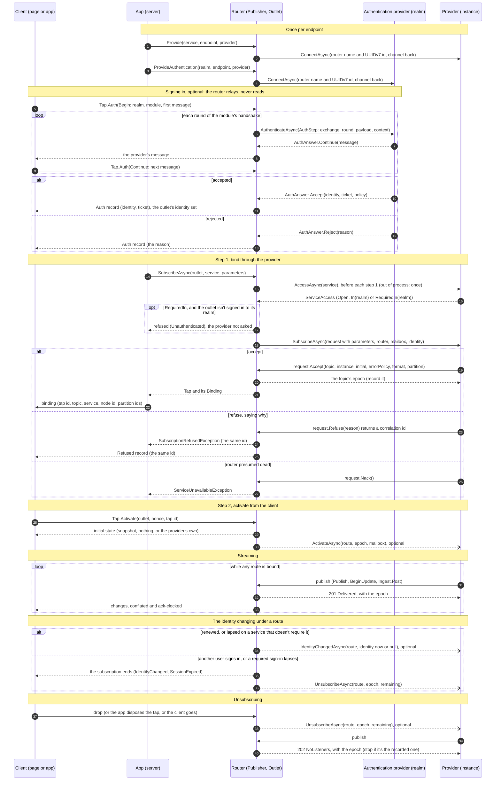
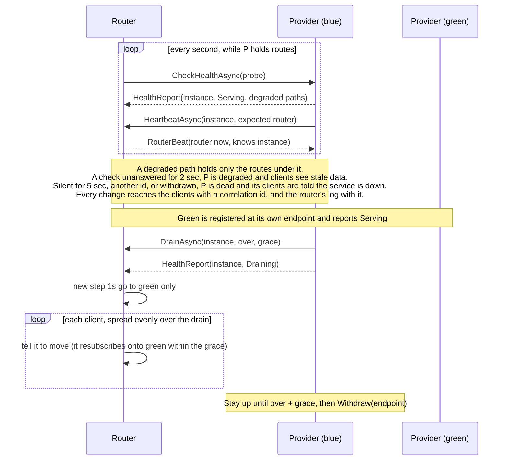

# Tappy: A Field Manual for Tapline Data Providers

**Tappy** is the protocol between a Tapline router and the data providers behind it: how a provider registers, admits
or refuses a subscription, publishes, answers health checks and leaves. Tapline is the library; Tappy is the contract a
provider keeps with it, and the practices that give clients the consistency and freshness they're promised. This manual
is Tappy's: the flow, a skeleton, and the rules that keep a provider correct and its subscribers current, with their
reasons. The reference that follows them says exactly what the router does at each step, for when a rule isn't enough.

A **Data Provider** owns the execution of topics behind a logically named **service boundary**, dictating on a per-subscription basis exactly how downstream clients consume state.

The **Tapline Router** acts as the high-throughput intermediary: it binds active routes, handles high-density fan-out of the provider’s published updates (applying BBR-inspired ack-clocking, conflation windows, and multi-hop session resumption), and enforces topological health monitoring.

```text
    ┌─────────────────┐           ┌────────────────┐           ┌──────────────┐
    │  Data Provider  │ ──Posts──►│ Tapline Router │ ──Lines──►│  Subscribers │
    │ (Owns Services) │           │ (Ack-Clocked)  │           │  (Replicas)  │
    └─────────────────┘           └────────────────┘           └──────────────┘
```

## The Ingestion Axiom: Every Service is a Provider
In Tapline, **every service is represented by a Data Provider**: subscriptions to a service go through its provider,
which admits or refuses each one, so the Router maintains authority over lifecycle hooks, demand-driven compute and
access control. There are no unsolicited side channels: **every single subscription is explicitly initiated by a
solicited request**, so nothing reaches a client that it didn't ask for.

An app may also tap a source it owns directly (`outlet.Tap(source)`): a subscription all the same, asked for by its
client, but outside any service. No provider admits it, and no service's access, health or drain applies to it. The
samples tap side topics so: the order books' alerts, and the pivot's statistics and house drawdown.

---

## Topological Primitives & Domain Boundaries

Tapline defines clear isolation boundaries between network addresses, logical clusters, and routing cursors:

| Primitive | Runtime Representation | Structural Ownership & Bounds |
| :--- | :--- | :--- |
| **Client** | `tapline.js` or `Tapline.Client` | Holds an in-memory replica of each active subscription, addressed by the Router's allocated *Tap ID*. |
| **App** | Host Process (Blazor Circuit / gRPC Service) | The server-side host of a client's session. Manages the client's `Outlet` and triggers targeted subscription requests on its behalf. |
| **Router** | Core `Publisher` Engine | Manages virtual routing tables, epoch counters, canonical topic states, and atomic client delivery cursors. |
| **Provider** | Extended `IDataProvider` (`ProviderInstance`) | Owns the underlying data source lifecycle, topic states, and individual route acceptances. |

*   **Service & Service Path:** A top-level string literal identifier (e.g., `"quotes"`) containing a single path segment without slashes. Providers can break down a service into specific sub-paths called **Partitions** (e.g., `quotes/lse`, `quotes/eu/fx`). Health is told per service path.
*   **Endpoint & Instance:** The network boundary where the router reaches a provider. This can be configured as an in-process memory boundary (`ProviderEndpoint.InProcess`) or a distinct remote network address. The router encapsulates this path entirely; clients never see it. An **Instance** pairs a stable name with a unique identifier drawn at random at every initialization (`ProviderInstance.Start`). A process restart yields a new ID.
*   **Node ID & Router Instance:** The internal router-assigned index for a provider instance (`TapBinding.NodeId`, a UUIDv7). This is the only identifier leaked to a client—providing sufficient mapping to track node failure or degradation without exposing structural network placement. Conversely, a **Router Instance** utilizes a time-ordered UUIDv7; of two matching names, the chronologically newer ID indicates the active, live router.
*   **Route & Epoch:** A **Route** (`RouteId`: pairing an outlet and a tap) represents a single subscriber's binding to a topic, held explicitly by the provider instance that accepted it. It acts as a dedicated virtual circuit, carrying no isolated frame stream of its own; instead, the provider posts to the topic, and the router handles high-density, client-conflated fan-out. The only unshared component is the subscriber's private **Mailbox**. An **Epoch** is a per-topic counter that ends when the topic's final route detaches; a subsequent bind opens a clean epoch, instructing the provider when to cease production.
*   **Correlation ID:** A time-ordered UUIDv7 assigned to every distributed mutation (refusals, structural drops, state degradation). It is stamped onto every internal log across hops, offering a single traceable vector across the system.

## The Subscription Lifecycle

The initialization of a streaming pipeline is broken down into a multi-phase, end-to-end handshake:



1. **Register.** `publisher.Provide(service, endpoint, provider)`. The first time the router sees an endpoint, it
   introduces itself (`ConnectAsync`): its identity and a channel back (`IRouterChannel`), for your heartbeats and your
   drain. A realm's authentication provider registers the same way, for its realm
   (`ProvideAuthentication(realm, endpoint, provider)`).
2. **Sign in, if the client does.** The client sends its realm, the module and the module's first message; the router
   relays each round to the realm's authentication provider (`AuthenticateAsync`, an `AuthStep`) and its answer back,
   reading neither. Accepted, the connection has an identity, and the client a ticket to resume with
   ([Signing users in](#signing-users-in)).
3. **Step 1.** The app asks the router for a subscription. The router asks you what access the service needs
   (`AccessAsync`: before each step 1, or out of process once, until your link reconnects), and refuses a service that requires a sign-in to a connection not signed in to its realm, without
   asking you. Otherwise it sends one serving endpoint (the least loaded of two picked at random: Health, below) a
   `SubscribeRequest`: the parameters, the router
   asking, the subscriber's mailbox, and its identity if it's in the service's realm. You do one of three things:
   - **Accept** it onto a topic, in a partition of the service if you partition it. `Accept` binds the route and
     returns the topic's epoch.
   - **Refuse**, saying why. `Refuse(reason)` returns a correlation id that the router and the client also log.
     `RefuseUnauthenticated()` and `Forbid()` say so to the client: sign in, or not allowed.
   - **NACK** a router you presume dead.

   Nothing streams yet. The app hands the client the binding.
4. **Step 2.** The client registers a handler for the tap id, then activates it. Its first record is the initial state
   you chose at step 1. You're told of the activation afterwards (`ActivateAsync`), but only need it if you send the
   initial state yourself.
5. **Streaming.** A topic's bound routes are its **listeners** (a route between its two steps counts). Every publish is
   answered **201** (`Delivered`) while the topic has a listener, and **202** (`NoListeners`) once it has none. Both
   carry the topic's epoch.
6. **The identity changing.** A renewal, or a lapse on a service that only sees identities, carries the route on and
   tells you (`IdentityChangedAsync`). Another user signing in, or a required sign-in lapsing, ends it, told to you as
   an unsubscribe ([When the identity changes under a route](#when-the-identity-changes-under-a-route)).
7. **Unsubscribing.** The router removes the route first, then tells you asynchronously (`UnsubscribeAsync`, with the
   routes `Remaining` on the topic). Your next publish is answered 202 if none are left.

---

## Top-Level Liveness & Cooperative Draining

Liveness monitoring and service lifecycle transitions execute alongside active data paths via isolated channels:



## In-process or out-of-process

Every Tappy interaction is a message carrying plain data and ids, so nothing in the protocol depends on sharing a
process. And so, by design, the flow is the same either way:

| Message | Direction | In process, it's | It carries |
|---|---|---|---|
| Connect | router → provider | `IDataProvider.ConnectAsync` | the router's name and id; the channel back |
| Auth step | router → authentication provider | `IAuthenticator.AuthenticateAsync` | exchange, realm, module, round, payload, context; back: continue, accept, reject or redirect |
| Access | router → provider | `IDataProvider.AccessAsync` | service; back: open, in a realm, or required in one |
| Subscribe (step 1) | router → provider | `IDataProvider.SubscribeAsync` | service, parameters, router, the subscriber's mailbox and identity |
| Accept, Refuse, NACK | provider → router | `request.Accept` / `Refuse` / `Nack` | topic, instance, initial state, error policy, format, partition; back: epoch, route |
| Activate (step 2) | router → provider | `IDataProvider.ActivateAsync` | route, instance, topic, epoch, mailbox |
| Publish | provider → router | `Publish`, `BeginUpdate`, `Ingest.Post` | the data, versions, checksums; back: 201, 202 or 507, with the epoch |
| Mailbox | provider → router | `Mailbox.TryPost`, `Send`, `Ready`, `TryRendezvous` | one subscriber's messages |
| Identity changed | router → provider | `IDataProvider.IdentityChangedAsync` | route, the identity now (or null: lapsed) |
| Unsubscribe | router → provider | `IDataProvider.UnsubscribeAsync` | route, epoch, routes remaining |
| Health check | router → provider | `IProviderHealth.CheckHealthAsync` | probe; back: instance, status, router refused, degraded paths, draining until, load |
| Heartbeat | provider → router | `IRouterChannel.HeartbeatAsync` | instance, expected router; back: router now, knows instance |
| Drain | provider → router | `IRouterChannel.DrainAsync` | instance, over, grace |
| Move (rebalance) | provider → router | `IRouterChannel.MoveAsync` | instance, partition or route, over, grace, reason; back: how many, the move's correlation id, or why not |

**Out of process: `Tapline.MagicOnion.Providers`.** Your provider runs in its own process, unchanged, and routers reach
it at its address over MagicOnion: one gRPC channel per router, carrying two streams.

- **The topics' stream.** Your topics are your own process's, run by its own router. A router that reaches you is a
  client of that router, so your topics reach it as any client's do: snapshots, then conflated deltas, checksummed and
  resumed across a reconnect. A topic it accepts onto is bound once on its session with you, however many of its
  routes share it. The router mirrors it into a copy of its own, a table of your key and row sizes (`Source.Layout`) or
  a value, and binds its routes to that once its first state is applied.
- **The control stream** carries the rest: step 1 and its answer, the routes' notices, health checks, your heartbeats
  and drains, and your subscribers' mailboxes.

```csharp
// your process: its router, the topics' stream, and the links (MagicOnion and an HTTP/2 port are the app's)
builder.Services.AddMagicOnion();
builder.Services.AddTaplineProviderLink(new ProviderEndpoint(new Uri("https://practice-blue:7443")), sp => myProvider);
app.MapTaplineProviderLink();

// the router's
var provider = publisher.ProvideRemote("practice", new Uri("https://practice-blue:7443"));   // dispose it as the router stops
```

What stays as it is in-process, and what changes:

- **Your code doesn't change.** You accept onto your own topics and post to them as in process. Your folds run at your
  own router, so nothing has to cross. Your posts are answered there, at once. Your epochs are your topics' own: an
  epoch ends when the last router's tap on the topic goes, and the unsubscribe you're told carries the routes left at
  every router.
- **Your mailboxes are relayed after your state.** Each operation carries the topic's version as it was when you
  called it. The router delivers it once its copy has that version, after what's applied, so a rendezvous comes after
  the change it names, as in process. `TryPost` answers `true` while the link is up: it can't know at once that the
  router's mailbox is full.
- **Refusals keep their correlation id.** The router refuses with the id you minted, so one id is in your log, the
  router's and the client's.
- **A break isn't a death.** The topics' stream resumes its session and carries on; the control stream is opened again.
  Your health checks go unanswered meanwhile, so the router treats you as late: degraded past `ProviderDegradedAfter`,
  dead past `ProviderTimeout`. The routes' notices aren't lost: an end while the stream's down is told once it's open
  again.
- **Registered before you run** (blue/green's green, say), you're sent no step 1 until your link is up (the router's
  `RemoteProvider` is an `IReachableProvider`): the service's other endpoints take them meanwhile, none waiting out
  `SubscribeTimeout` on you. You're reached as soon as you're up: `ProvideRemote`'s channel backs off reconnecting from
  a quarter of a second up to five seconds, not gRPC's two minutes (its `GrpcChannelOptions`, `channel`, say
  otherwise), and once your link is up you're probed at once, so clients waiting on the service hear it's up.
- **Started again at your endpoint,** you're greeted once the router's Tapline stream is bound to a session of yours (a
  new one): never with the one it had of the process before. A control stream whose hello names a session you don't
  hold ends with `FailedPrecondition`, saying so, and the router opens it again once it has one.
- **Ends are told as in process.** A route the router closes without telling you, because of your own drain or because
  your instance was deemed dead, is let go at your end too, untold. A step 1 the router gave up on before you answered is
  let go once you accept, as an unsubscribe. A NACK refuses the router at your endpoint, as in process.
- **Health** can also be served over HTTP, for a cluster's service registry: `GET /livez` (200 whenever you answer) and
  `GET /readyz?router={name}:{id}&expect={name}:{id}` (200 when you serve that router, 503 with the report otherwise). A
  registry then stops sending new subscribers to a draining instance without taking it for dead.
- **What can't cross yet:**
  - topics other than tables and values: message topics and watches;
  - an `IngestGroup`'s units as one: its topics arrive as separate taps, so a watch at the router could see part of a
    unit;
  - stale-data functions (`ErrorPolicy.Static` and `ErrorPolicy.ReplayLast` cross, needing no function);
  - barriers: `Source.Barrier()` hurries the taps at your own router (the link's among them), not the subscriptions at
    the routers that mirror your topic. A subscriber's `MinInterval`, its `Hurry()` and its lane are its router's, set
    there by its app, and work as in process;
  - out-of-band records: values over 64 KB, and records larger than a frame (1 MB by default). Everything else travels
    in band: the link's stream sends whatever fits a frame (`OutOfBandThreshold` 0), so a table's snapshot of hundreds
    of kilobytes crosses whole.

Out-of-process, the network sits inside every timeout below, step 1's above all. Keep step 1 to one round trip.

## A provider, step by step

A shared last-value topic per symbol, produced only while it has listeners:

```csharp
public sealed class QuotesProvider : BackgroundService, IDataProvider
{
    sealed class Topic(LastValueSource source, string name)
    {
        public readonly LastValueSource Source = source;
        public readonly string Name = name;
        public long Epoch;                                   // what Accept last returned
        public bool Live;                                    // producing for it
    }

    static readonly ErrorPolicy Stale = ErrorPolicy.ReplayLast("quotes interrupted"u8.ToArray());

    readonly Publisher _publisher;
    readonly ILogger<QuotesProvider> _log;
    readonly RouterSessions _routers;
    readonly Lock _gate = new();
    readonly Dictionary<string, Topic> _topics = [];

    public ProviderEndpoint Endpoint { get; } = ProviderEndpoint.InProcess("quotes-blue");
    public ProviderInstance Instance { get; }

    public QuotesProvider(Publisher publisher, ILogger<QuotesProvider> log)
    {
        (_publisher, _log) = (publisher, log);
        Instance = ProviderInstance.Start("quotes-blue", Endpoint);          // a new id at every start
        _routers = new RouterSessions(() => Instance)
        {
            Lost = (router, routes) => _log.LogInformation("Router {Router} presumed dead: {Count} routes forgotten", router, routes.Length),
        };
    }

    ValueTask IDataProvider.ConnectAsync(IRouterChannel router, CancellationToken ct)
    {
        _routers.Connected(router);
        return default;
    }

    ValueTask IDataProvider.SubscribeAsync(SubscribeRequest request, CancellationToken ct)
    {
        if (!_routers.Admits(request.Router)) { request.Nack(); return default; }   // a router presumed dead
        if (request.Parameters is not { } symbol || !IsListed(symbol))
        {
            var id = request.Refuse($"No such symbol: '{request.Parameters}'.");
            _log.LogInformation("Refused '{Symbol}' (correlation {Id})", request.Parameters, id);
            return default;
        }
        lock (_gate)
        {
            var topic = TopicFor(symbol);                                    // shared: one per symbol
            topic.Epoch = request.Accept(topic.Source, Instance, topic.Name, InitialState.Snapshot, Stale);
            topic.Live = true;
        }
        _routers.Accepted(request.Router, request.Route);
        return default;
    }

    ValueTask IDataProvider.UnsubscribeAsync(Unsubscription notice, CancellationToken ct)
    {
        _routers.Ended(notice.Router, notice.Route);                         // stopping waits for a 202
        return default;
    }

    ValueTask<HealthReport> IProviderHealth.CheckHealthAsync(HealthProbe probe, CancellationToken ct)
        => new(new HealthReport(Instance, ProviderStatus.Serving, _routers.Refuses(probe.Router)));  // a struct: from memory, at once

    void Answered(Topic topic, PublishResult result)                        // every publish's answer
    {
        if (result.HasListeners) return;
        lock (_gate)
            if (topic.Epoch == result.Epoch) topic.Live = false;            // a 202 for the epoch last accepted on
    }

    protected override async Task ExecuteAsync(CancellationToken stop)
    {
        await WarmUpAsync(stop);
        _publisher.Provide("quotes", Endpoint, this);                       // once it can serve
        while (!stop.IsCancellationRequested)
        {
            foreach (var (topic, quote) in Ticks())                         // only topics that are Live
                Answered(topic, topic.Source.Publish(quote));
            _routers.HeartbeatRouters();                                    // heartbeats go both ways
            await Task.Delay(TickInterval, stop);
        }
    }

    Topic TopicFor(string symbol)                                           // under _gate
    {
        if (!_topics.TryGetValue(symbol, out var topic))
            _topics[symbol] = topic = new Topic(_publisher.LastValues<string>("quotes")[symbol], $"quotes:{symbol}");
        return topic;
    }
    // IsListed, WarmUpAsync, Ticks and TickInterval: the feed's own.
}
```

The checklist, in order:

1. Draw a `ProviderInstance` at start. Keep a `RouterSessions`.
2. Implement `SubscribeAsync`: NACK routers you presume dead, validate, refuse with a reason, accept onto a shared
   topic (in its partition, if you partition), record the epoch, and mark the route accepted.
3. Implement `CheckHealthAsync` from memory, naming the paths you can't serve properly now if you partition.
4. Stop a topic on a 202 for its recorded epoch. Resume with whole state.
5. Post each change as it's yours, with versions. Leave rates, lanes and caps to the app; a state no subscriber may skip
   gets a barrier, and an event none may miss, a message.
6. Heartbeat your routers. Handle `Lost`.
7. Register once you can serve. To leave, drain, then withdraw.

## Rules of thumb, and why

### Identity

- **Draw a new instance id at every start, and never persist it.** The router recognises a restart only by a new id. It
  then closes the old instance's routes and tells their clients the service is down, so they resubscribe onto the new
  one. Reusing an id would leave clients streaming from routes nobody holds.
- **Give each instance a stable name and its own endpoint.** An endpoint's readiness is whatever its instance last
  reported, so two instances can't share one. Blue/green is two names, two endpoints, one service.
- **Your clients know you by node id, not by instance.** The router gives each instance a node id of its own, a UUIDv7,
  and clients see only that. The router logs the two together, so a client's report leads to your instance in the
  router's log, and from there, by instance id, to yours.

### Registering

- **Register once you can serve, and report `NotServing` whenever you can't** (warming up after registering, say, or
  failing). Step 1 goes only to endpoints whose last report serves, and `NotServing` is alive but not ready, which isn't
  down: your routes stay, and no client is told the service is down. The waveform station registers only once it has
  caught up.
- **Name a service in one segment.** A service path's first segment is the service, and the rest is its partition, so
  `Provide` refuses a name containing `/`.

### Step 1

- **Answer within `Publisher.SubscribeTimeout` (5 s), and honour the cancellation token.** Late, the subscriber is told
  the service is unavailable and then waits for an "up" notice rather than retrying. An accept that arrives after the
  step ended is refused, and its route is closed. So decide quickly, and do slow work after accepting: fill the topic
  later. For a table accepted empty, the client gets an empty snapshot and then deltas. To let it wait for the first
  real answer, hand it a rendezvous (below), as the PivotTable sample does. Or, when the first state takes well within
  the deadline, post it, wait until it's applied (`WhenApplied`), and accept then: the subscriber's snapshot is whole.
  The practice sample opens a person's topic so, accepting every step 1 that waited for it at once.
- **Expect concurrent step 1s.** They aren't serialized (notices are). Guard your topic bookkeeping: a lock around
  `Accept` and the epoch you record from it.
- **Refuse with a reason, and log the correlation id `Refuse` returns.** The same id goes into the router's log
  (`publisher.SubscriptionRefused`) and reaches the client with the refusal: the browser logs it to its console
  (`tapline.onRefused`), and a .NET client raises `Refused` with it. One needle for three haystacks. A refusal without a
  reason, or returning without accepting, gives the app null and leaves no trace anywhere.
- **Don't throw for a bad request.** A throw ends step 1 as a failure: the app gets the exception, not a reason it can
  show, and a route you'd already accepted is closed and told to you as an unsubscribe.
- **NACK a router you presume dead** (`RouterSessions.Admits` false). A router that restarted leaves its old process
  behind for a while, and that zombie still sends requests. Router ids are time-ordered, so you can tell the live router
  of a name without asking anyone. A NACK makes the zombie close what it held with you and raise `RefusedBy`, which its
  host can act on.
- **Share topics.** Map equal requests to one topic by a canonical key: a shared topic is published once and fanned
  out, while topics of the subscriber's own cost per subscriber. The PivotTable sample keys its topics by the statement's
  logical digest and its bound values, so two pages asking alike share one.
- **Bound what a subscription costs, and refuse with a reason when you're full** (memory, time, upstream capacity). The
  PivotTable sample refuses when its memory budget, or its share of each second, is spoken for.

### Who's subscribing

- **Declare each service's access** (`AccessAsync(service)`): `ServiceAccess.Open` (the default) sees no identity;
  `ServiceAccess.In(realm)` serves anyone and sees the identity of a subscriber signed in to its realm;
  `ServiceAccess.RequiredIn(realm)` serves only them — the router refuses everyone else before you're asked
  (`Unauthenticated`). Out of process, the router asks once a service and keeps your answer until your link
  reconnects: a declaration that changes takes effect then.
- **Read `request.Identity`, and decide what it's worth.** It's null for an anonymous subscriber, one signed in to
  another realm, or one whose identity has lapsed; otherwise it says who (`UserId`, `Realm`), which session, which
  authentication module asserted it, and whether that module says it's `Insecure` — a passthrough module takes any
  user id as given. The router passes all of it on and decides nothing more: you may refuse an insecure identity
  (`RefuseUnauthenticated`), refuse a user who isn't allowed this topic (`Forbid`), or give a signed-in user more
  bandwidth or fuel than an anonymous one.
- **Check the user against the parameters.** A topic per person (`home:{id}`) is only private if you refuse a
  subscriber whose `UserId` isn't allowed that id: the parameters are the client's to choose.
- **Expect the identity to change.** When another user signs in on the connection, or the one signed in signs out, the
  router ends the subscriptions you were shown the old identity on (`FaultCode.IdentityChanged`), and you're told as
  for any unsubscribe. A renewal of the same user ends nothing.

### Signing users in

An authentication provider is a data provider that also implements `IAuthenticator`, registered for its realm
(`ProvideAuthentication`, or `ProvideRemoteAuthentication` out of process). A realm has one authentication service,
offering every module of the realm; run several instances of it if you like, but keep them interchangeable — the same
modules, one ticket key — since any of them may get a sign-in's first message. The router relays a client's sign-in to it
one message at a time, as an `AuthStep`, and never reads the messages. Most realms needn't implement one:
Tapline.Authentication's `AuthenticationService` is one, made of modules (passkeys, passthrough, your own), handing
each proven user to your backend (`OnAuthenticated`) — and doing what follows for you.

- **Keep your state by `step.Exchange`**, a UUIDv7 the router mints per sign-in. Round 0 is the client's first message,
  and every message of an exchange comes to the provider that answered round 0. Forget an exchange that goes quiet: a
  client may cancel, or be gone, without telling you.
- **Bind the proof to `step.Context`**, the connection's `tapline/1 {realm} {outletId} {nonce}`, which its client
  knows too. A proof made for another connection then fails. OPAQUE takes it as its `context`; a challenge-response
  module MACs it.
- **Answer within `AuthTimeout`** (10 s). After that the client is told sign-in is unavailable, and a late answer is
  dropped.
- **Assert only your own realm**, with your module's name, and say `Insecure` if the proof is worth nothing
  (passthrough). The router refuses an identity of another realm. On a renewal (`step.Renewal`, with `step.Current`)
  it refuses a different user: keep the session id and move the expiry.
- **Say little in a refusal.** The reason goes to the client as you wrote it. Limit the rate of failures yourself: the
  router relays one exchange at a time per connection, but doesn't count failures.
- **Issue a ticket** (`AuthTickets`, HMAC-SHA256 under your key) so the client can resume on a new session without
  being asked again; take it back under module `ticket`. Share the key among a realm's providers if any of them should
  take another's tickets.
- **Say how the session ends** (`AuthAnswer.Accept(identity, ticket, policy)`): an `ExpiresAt`, and a `SessionPolicy`
  — `Silent` (the client renews with its ticket: take a ticket with `step.Renewal` as a renewal and give a later
  expiry), `Reauthenticate` (ask for a fresh proof), or `Fixed` (it ends then; the router refuses renewals and tells
  the client your reason). To have a renewal done elsewhere, answer `AuthAnswer.Redirect(router, ticket)` with a ticket
  that router's provider takes: the client moves only to a router it knows.

### When the identity changes under a route

- **Renewed or lapsed, the route carries on: you're told** (`IdentityChangedAsync`, an `IdentityChange`: the identity
  now, or null and `Lapsed`). A service that requires a sign-in isn't told of a lapse: its route ends
  (`FaultCode.SessionExpired`), told as an unsubscribe. A service that merely sees identities may lower what it gives
  a subscriber gone anonymous. `request.Identity` stays as step 1 saw it.

### Describing what you publish

A client that knows your payloads from a description, not from types compiled in, can read any topic you add, from
any language, and nothing breaks when you add a figure or a field. Tapline carries the bytes; what they mean is yours
to say.

- **Offer a describe call beside step 1:** what a subscription would stream, without subscribing, or why it can't be
  served. The router has no such message, so it's your app's call. The PivotTable sample's `IPivotService.DescribeAsync`
  asks its provider in process; a provider out of process needs a call of its own.
- **Describe the payload field by field:** the key's and the row's widths and, for each field, its offset, type, width,
  scale, the value that means none, its unit and what it's made from. Name the records you keep for yourself and what
  their fields mean, rather than leaving clients a convention: the pivot names its clock cell, a watermark and the time
  it was posted. Write values a double can't hold as text (the pivot's none, `long.MinValue`), or JSON readers in
  JavaScript round them.
- **Check and prepare a describe as step 1 does, from the same cache.** It's the same request, answered short of
  binding: refuse it with the same reason, and keep what you prepared for the subscription that follows. The pivot
  prepares a statement once, whichever of the two asks first.
- **Make the description, and the `PayloadFormat` you give at `Accept`, from one declaration checked against your
  structs at startup.** The pivot declares its cells' labels and figures once (`Pivot.Labels`, `Pivot.Figures`), checks
  them against `PivotKey` and `PivotCell` as the type initializes, and makes both the shape and the viewer's format from
  them. The router's viewer, your clients and your structs then can't disagree.
- **Keep a topic's shape fixed for its life.** A client may decode with a description it read before subscribing, so a
  different shape is a different topic. The pivot keys its topics by their statement, so a shape can't change under a
  route.
- **Let a request in short form be turned into its canonical one.** The pivot answers the statement a page's address
  asks for (`StatementAsync`), so a client can describe and subscribe by the statement itself, and clients asking alike
  still share a topic.

### Epochs: the rule to get right

- **Record the epoch `Accept` returns, per topic. Stop producing on a 202, or on an `Unsubscription` with `Remaining`
  0, only if it carries that epoch.** Stopping races new subscribers. Suppose the 202 is decided, then a new subscriber
  is accepted, and only then do you act on the 202: you'd stop with a listener. An epoch ends atomically with binding,
  so a 202 from an older epoch crossed a new subscriber and is stale. In a simulation of 400 rounds, this rule never
  left a provider stopped with a route bound. Stopping on any 202 did, 25 times; stopping on any notice of none left,
  38 times in 200.
- **When you resume, publish whole state first.** While stopped you published nothing, but your own state moved on, so
  a delta computed now would apply to a table that missed the gap. A snapshot re-bases it, and deltas follow. The
  market feed posts the whole book when a stopped topic is accepted again. The PivotTable sample posts its whole answer
  whenever `Accept` returns a new epoch, so the table starts each epoch resynchronised with its view.

### Initial state

| Topic | Choose | Because |
|---|---|---|
| A table | `InitialState.Snapshot` | the table's own snapshot; deltas follow from its version |
| A value that changes often | `None` or `Snapshot` | `None` skips a first frame that the next change would make stale |
| A value whose snapshot you compute | `Provider`, then `Mailbox.Send(snapshot, asOf)` | the topic is held for that subscriber until you've sent it |
| A message topic that needs history | `Provider`, then `Mailbox.TryPost` each, then `Mailbox.Ready(through)` | history then live, never interleaved, nothing twice |

With `Provider`, send it from `ActivateAsync` within `OutletOptions.BindTimeout` (30 s), or the subscription ends with
`NoInitialState`.

### Publishing

- **Pick the write path for the rate and the shape.**
  - `LastValueSource.Publish`: whole values, conflated per key.
  - `Table.BeginUpdate()` … `Complete()`: transactional row changes at moderate rates. Then call `Acknowledge()` for the
    201/202.
  - `Table.Ingest(fold)`: high-rate feeds, or folds you don't want on your thread. A post copies and returns (about
    40 ns for 8 deltas), and the router conflates and folds off your thread. An update instead holds the table's lock,
    fold included, so readers wait for it and it waits for them.
  - `IngestGroup`: units of work spanning several sources, applied atomically, so a watch never sees part of one.
  - `MessageTopic.Publish`: ordered events, never conflated.
- **Give versions, and a checksum where you can** (`expectedUpstream`, `upstreamVersion`, `expectedChecksum`). The
  router checks the chain and the resulting state. A gap or a wrong state then faults the topic, and its clients see
  your stale-data policy and an error, instead of diverging silently.
- **On `507` (the staging is full) or a `StreamFaultException` (the topic is faulted), post a snapshot.** A snapshot
  supersedes whatever is staged, and it's the only recovery from a fault: deltas are refused until one is applied.
- **Never wait on subscribers, and don't conflate for them.** The router conflates per client: a slow client gets
  fewer, fuller deltas, always ending on the latest state. Publish at your source's pace (Latency, below).

### One subscriber's messages

- **Use the mailbox for one subscriber, never for everyone** (`TryPost`, `Send`). To give everyone the same, publish to
  the topic.
- **When `TryPost` returns false, don't wait.** The mailbox is full, so the subscriber isn't keeping up; mailboxes are
  bounded per client. Drop the message, or answer the request without it.
- **Answer a request with a rendezvous, not a message:** `Mailbox.TryRendezvous(correlation, seq)`, or
  `TableIngest.TryRendezvous(mailbox, correlation)` for staged posts. The client's await then resolves only once its
  replica includes your change. A "done" message could overtake the data it describes.

### Latency: who sets the pace

How stale a subscriber's state is gets decided in four places, and only the first is yours: how soon you post a change;
the router's flow control, steering by what the path and the client take; what the app chose for that subscriber (a
rate, a lane, a cap); and the client, acknowledging what it has applied. Post promptly, and shape your topics so that
each of the others does the right thing.

- **Post a change as soon as it's yours, and never hold one back to spare subscribers.** A turn's changes are one post,
  made as the turn ends, not on a timer. The router conflates per client: a fast client is sent every change as fast as
  it acknowledges them, while a slow path, a capped client or a busy page is sent fewer, fuller deltas, always ending on
  the latest state. Batching at your end makes every subscriber as stale as your batch, and saves the slow ones nothing.
- **A subscriber's rate is its app's to choose, not yours.** `Tap.MinInterval` holds one subscription's state to a
  record per interval at most, then sends the state as it stands, whatever changed meanwhile conflated into it. Each
  subscriber has its own, whatever others of the topic take, so one topic serves a dashboard at a second and a trader
  at full speed: don't make a topic per rate. The app asks it at step 1 (`SubscribeOptions.MinInterval`, set on the
  route as it binds), or sets it on the tap later: the PivotTable sample's service takes one with each subscription
  (`minIntervalMs`). A message topic's stream isn't held by it, nor is the subscription's mailbox, except for an entry
  ordered after the subscription's own state, which waits for that state.
- **Read the subscriber's limits to choose what to serve, never when to post.** `SubscribeRequest.Limits` shows the
  rate asked at step 1 and its connection's cap in bytes per second (the client's `bwlimit`, or the server's cap): a
  capped client may be better served a lighter shape (fewer levels, coarser buckets) on a topic of its own kind,
  shared with others like it. Zero is "none". They're as step 1 saw them: a rate set on the tap later, or a cap moved,
  isn't told again. New limits are added as members whose zero is "none", and a router or link that doesn't know one
  leaves it zero, so read what's there and treat the rest as unlimited.
- **When a client waits for its own change, have its tap hurried.** A client that made a change and awaits it shouldn't
  wait out its interval. Once the change is applied (`WhenApplied`), `tap.Hurry()` sends its state at once, and the
  interval applies again after. A rendezvous alone resolves once the client has the state it follows, which the
  interval may hold back. The PivotTable sample's tokens go so: posted, applied, then hurried
  (`PivotService.WaitAsync`).
- **A state no subscriber may skip by its own rate gets a barrier.** A day's close, a settlement, a rebalance: once it's
  the source's (an update completed, an ingest's post applied), `Source.Barrier()` sends every subscription its state as
  it stands, each one's `MinInterval` notwithstanding. A barrier lifts the interval and nothing else: a client behind a
  slow path, over its rate cap or busy may still be sent that state conflated with what followed. If each subscriber
  must see it as such, it's an event (next).
- **An event no subscriber may miss is a message, or a row that stays.** A crossing that comes and goes between two of a
  client's frames is lost to conflation if it's only ever a state. A message topic is never conflated: every subscriber
  is sent every message, in order, at its own pace, from a bounded buffer (`OverflowPolicy`: by default a subscriber
  that falls behind is ended, never silently short). Or keep the event in the state as a row of its own that stays: the
  PivotTable sample's drawdown keeps the hour's episodes, so a breach that closed before a client looked is still there.
- **Order a message after the state it's about** (`After`, or `After.Current(source)` right after the publish). Each
  subscriber is sent it only once it has that state, which goes first, in the same frame, if the subscriber is behind:
  past its rate cap (overdrawn, rather than delay the message) and past an overdue acknowledgement. A fill after the
  position it changed; an alert after the level it names.
- **Say which of your topics are urgent; the app binds them.** The lane is chosen as the app subscribes
  (`SubscribeAsync(outlet, service, parameters, lane: Lane.High)`), not by you at `Accept`. A tap on High gets the larger
  share of a saturated path (16 to the bulk's 4), isn't held by its client's rate cap, frame cadence or pacing, and is
  made way for on a slow path. It's still a tap: conflated, deltas, snapshots. Alerts and small, urgent state belong
  there; a bulky topic there takes the room the lane keeps. The market sample's page binds its alerts topic on High.
- **Expect state to wait while a client is busy, and messages not to.** A client acknowledges a frame once it has
  applied it. One unacknowledged past `OutletOptions.AckOverdue` (50 ms) and three round trips means the client is busy
  (a long task, a collection, a frozen tab). Until it acknowledges, state waits, conflating as ever and then sent as one
  record each, the newest, while message topics and mailboxes keep going within the outlet's `Window`. So don't publish
  state as messages to hurry it: whole states as messages pile up at a busy client, to be applied all at once and out of
  date, and overflow its buffer.
- **Keep snapshots compact.** A capped client (`StreamingBytesPerSecond`, or per user, `SetStreamingRate`) may take its
  budget negative for a snapshot, and its changes then wait until time repays it. Apps size the burst to the largest
  snapshot, so a large one costs every new subscriber, and every one resynchronised after a fault. Split a topic whose
  snapshot is large into ones subscribed as needed, or send large values out of band (`Delivery.OutOfBand`).
- **Measure staleness where your subscribers see it.** A clock cell (the time you posted, in the state) or a watermark
  lets a client tell how old what it shows is, through every hop: the PivotTable sample names both in its description.
  Steer by a high percentile (p99.5), not the mean: what a subscriber notices is the worst frame in a while. The router's
  view of each client (`outlet.MinRtt`, `SmoothedRtt`, `DeliveryRate`, `StateHolds`) says whether the staleness is the
  path's, the client's, or yours.

### Versions: the latest, or every one

- **Read your upstream at its latest.** A provider fed by a standing view, a cache or a poll needs only the latest at
  each turn, and the changes since its last read: the router sends each subscriber the latest anyway, so a version you
  skip is one no subscriber was sure to be sent. The PivotTable sample drains each of its standing views at its latest
  every refresh (ChalkQL's `ViewVersions.Latest`).
- **Read every version only where something acts on each one:** a dispatcher that must see an entry added and removed
  between two reads, or a log of each version made available. The upstream then holds what you haven't read (ChalkQL's
  `ViewVersions.Every`, its backlog bounded: past it the view is made again, and its readers are sent it whole), so read
  it promptly.
- **Never let your loop wait on a slow consumer.** Hand each version's changes on through a `BatchPipe<T>`: a fixed set
  of reusable batches between your loop and a reader at its own pace, over lock-free rings, allocating nothing. It
  absorbs the reader's jitter as many batches deep as it has; past that it holds the loop back rather than buffer
  without end, and counts it (`Waits`, `WaitedMs`, `MaxInFlight`). Size it so that it never does in steady state. The
  practice sample's dispatch views publish every version through one each, and its access log is written through
  another.

### Notices

- **Treat `ActivateAsync` and `UnsubscribeAsync` as hints, and keep them short.** They're relayed asynchronously, one at
  a time per endpoint, in order: a route's activation comes before its end, but an unsubscribe can arrive after a later
  subscribe. A slow handler delays every notice behind it. Each goes to the instance recorded on the route, not to the
  service: with several instances, each hears of its own routes alone. Stop on 202s, or act on an unsubscribe only under the epoch
  rule above.
- You aren't told of the routes of an instance the router deemed dead (its successor never held them), nor of those
  your own drain let go (you asked for it). A drain the router makes on request (below) is different: what it lets go
  is told to you, as unsubscribes.

### Health

- **Answer `CheckHealthAsync` from memory, at once, allocating nothing.** `HealthReport` is a struct: build it
  at each check from what you hold, as the skeleton does, and keep anything it points to (degraded paths) per state. It's asked every second per router while you hold routes. Leave a check unanswered for two seconds from
  when it was asked (one that fails counts as unanswered) and you're degraded: your clients are shown stale data. Five
  seconds without any answer, and you're dead: every route closed, every client told the service is down. Only paused
  (a debugger, a machine too loaded to run you), you answer again, serving: the router takes you back as a new node —
  what it closed stays closed, and its clients, told the service is up, subscribe again. A pause of the router's own
  isn't counted against you: the time it didn't run doesn't pass for you.
- **Report who you are now** (after a restart, the new instance), your status, `RouterRefused` for any router you
  NACK (`RouterSessions.Refuses(probe.Router)`: a router you presumed dead is told once, then taken back), and the service paths you can't serve properly now (`DegradedPaths`, under Partitions below). `NotServing`
  degrades your whole node; a degraded path, only the routes under it.
- **Report your load, if you run more than one instance** (`HealthReport.Load`): normalized, 0 idle and 1 at capacity,
  more when over it, by a measure of your own (CPU, a queue's depth, subscribers against what you can serve).
  `LoadMeter` measures the commonest: your work over the time that passes, per worker, smoothed. Time each unit of work
  (`using var busy = meter.Measure();`, or `AddTicks` for a span timed already) and report `meter.Load` at each health
  check. The samples do so: the pivot's and the practice's
  loops, the waveform station's frames, and the order books' message handling. The router
  sends each step 1 to the least loaded of `Publisher.ProviderChoices` (2) of the service's serving instances, picked at
  random. Two random choices spread subscriptions far better than the least loaded of all, which, with loads a moment
  old, would send every step 1 to the same instance. An instance that hasn't reported, or not within `ProviderTimeout`,
  counts as idle, so a new one (green, in a blue/green deploy) fills first. While none of a service's instances reports a
  load, step 1s go to each in turn. The viewer shows each endpoint's load.
- **Expect your recoveries to be held if you flap.** The first time you degrade, you recover at your first healthy
  answer. Degrade again within `ProviderFlapWindow` (5 min) and the router holds the recovery until you've answered
  healthy for `ProviderRecoverHold` (2 s), doubling for each degradation after that, up to `ProviderMaxRecoverHold`
  (1 min). Each degraded path is held the same way. A provider on the edge doesn't flip its clients back and forth, and
  degrading is never held: clients see trouble at once.
- **Every change your clients are told carries a correlation id.** The router mints a UUIDv7 for each change it tells
  them (degraded, recovered, down, draining, drained, up), sends it with the notice, and raises
  `Publisher.ServiceHealthChanged` with it. Tapline.AspNetCore logs each, naming your node and instance:
  `Provider node … (quotes-blue at inproc://localhost/quotes-blue (…)) degraded, quotes/lse (to its clients
  quotes/9c1e…): reported quotes/lse degraded; 3 clients told (correlation …)`. Clients receive the id with the notice
  (`onProviderState`'s `correlationId`; a .NET client's `ProviderChange.Correlation`) for their own logs, so a support
  search can start from either end. Log your side by instance id and path. One id a change: a drain's notices
  (draining, then drained) share one, as a death's do.
- **Know what clients see.** A degraded node or path marks the subscriptions under it degraded on each client: in the
  states and messages it hands over (`tapline.providerOf`, a `Subscription.Provider`), and in a .NET client's health
  check for the service (`TaplineClient.ServiceHealthCheck`). A partition's ids, not its names, appear there.
- **Heartbeat your routers.** Call `RouterSessions.Connected` in `ConnectAsync`, `Accepted` and `Ended` per route, and
  `HeartbeatRouters()` every second or so. Clean up in `Lost`. Liveness goes both ways: a router that restarted, went
  silent or forgot you leaves you holding routes nobody reads.

### Partitions

- **Partition when parts of your service fail on their own.** An upstream per region, a shard per desk: accept each
  subscription into its partition, `request.Accept(…, partition: "lse")`. When one part can't be served properly, name
  its path in your health report: the service, then the partition (`quotes/lse`), the service as the router asked for
  it (`request.Service`). Only the routes at or under that path are degraded (held, shown your stale data), and
  the rest of your node streams on. Leave the path out of a later report and they recover. Without partitions, the only
  way to say part of you is unwell is `NotServing`, which takes your whole node out of step 1 and degrades every route.
- **A parent covers its children.** `quotes/eu` covers `quotes/eu/fx` and `quotes/eu/rates`; `quotes` alone covers every
  route of the service on your node, and none of your other services'. Name the narrowest path that's wrong. A partition
  is at most 255 bytes of UTF-8, its segments separated by `/`, none empty.
- **The names are yours; clients see ids.** Each segment reaches clients as an HMAC, keyed at random each time the
  router starts: stable through the router's run, meaningless to another router or after a restart. So name partitions
  however suits you (a desk, an upstream). The names stay with you and the router (its log, its viewer), and clients
  never persist the ids.
- **One partition per topic.** A shared topic serves one partition: accepting it into another, or into none, throws. A
  topic outside any partition may still serve several services.
- **Partitions scope health, not placement.** A drain retires a whole instance, one way; there's no drain per partition.
- **Keep the degraded paths per state.** Remake the list when a part fails or recovers, never per probe:

```csharp
volatile string[]? _down;                                            // remade as an exchange's feed drops or returns

void FeedsChanged()
{
    string[] down = [.. _feeds.Where(f => !f.Up).Select(f => $"quotes/{f.Exchange}")];
    _down = down.Length == 0 ? null : down;
}

// at each check
new HealthReport(Instance, ProviderStatus.Serving, _routers.Refuses(probe.Router), DegradedPaths: _down);

// in step 1: each exchange a partition, so one exchange's feed failing holds its subscribers alone
topic.Epoch = request.Accept(topic.Source, Instance, topic.Name, InitialState.Snapshot, Stale, partition: exchange);
```

### Stale data

- **Give an `ErrorPolicy` at `Accept`.** It decides what subscribers see while you're degraded (or a path of yours is),
  once you're deemed dead, or when a topic faults: a fixed state, the last value again, or a function of the state the
  router holds (say, the top of the book with sizes zeroed). The router applies it, because its state is the authority.
- **Make the function portable if the browser should apply it too** (a WebAssembly module, `Tapline.Wasm`). The page
  then shows it while the router itself is out of reach. A C#-only function runs at the router alone.

### Leaving: drain, and blue/green; rebalancing: moves

- **Drain to leave** (`RouterSessions.DrainAsync(over, grace)`), report `Draining`, and keep serving the routes you
  hold until `over + grace`. Then withdraw or stop. A drain is one way. The router moves your clients one at a time,
  evenly over `over`, so there's no stampede. Each subscribes again elsewhere and lets yours go once the new one
  streams (make before break, within `grace`). The router caps the grace at a minute (`MaxDrainGrace`).
- **For blue/green,** start green at its own endpoint and wait until it reports `Serving`. Then drain blue, and
  withdraw blue once it's drained. New subscriptions go to green from the moment blue drains. A new instance at a
  drained endpoint (another id, serving) takes step 1s again.
- **A router may drain your node itself.** Its operators can drain a node on request, to move its clients by hand or
  take it out of rotation: the router's viewer offers a form for it (`POST /ops/tapline/nodes/{nodeId}/drain`, with
  `MapTaplineDrain()`), or `publisher.DrainNode`. It's your drain without your asking: no step 1s to you from that
  router, your clients moved one at a time, and what they still hold after the grace let go and told to you as
  unsubscribes. It's one way at that router: you stay draining there, whatever you report, until another instance
  answers at your endpoint (a restart). Keep serving what you hold meanwhile.
- **Move some subscriptions to rebalance** (`RouterSessions.MoveAsync(partition, route, over, grace, reason)`, asking
  the routers that hold them): a partition's (null: all of yours at that router), or one route. Unlike a drain, you keep
  serving, on that router too. The router moves them one at a time, evenly over `over`. Each subscription's client is
  told to move it, with the grace: it subscribes again, placed by load (Health, above), and lets yours go once the new
  one streams. With two picks it lands back on you only when you're the less loaded of the pair, so report your load
  first. What a client still holds when the grace runs out is closed (`FaultCode.Moved`) and told to you as an
  unsubscribe. Subscriptions made within `MoveDwell` (30 s) stay put, so one just moved isn't moved again. A move is
  taken only if another instance serving the service there is less loaded than you by `MoveMargin` (0.1) or more, so
  instances loaded alike don't hand subscriptions back and forth; if you report no load, any other instance will do.
  Each router answers how many it will move, with the move's correlation id, or refuses, saying why: you're draining, no
  other instance serves the service there (nowhere to go), none is less loaded by the margin (nowhere better), or
  nothing of that partition or route is there.
- **A router may move your subscriptions itself.** `publisher.MoveNode`, or its ops endpoint (`POST
  /ops/tapline/nodes/{nodeId}/move?partition=&over=1s&grace=5s&reason=`, with `MapTaplineDrain()`): your move without
  your asking, for rebalancing by hand, under the same margin. You keep serving; what clients let go after the grace is told to you.
- **Routers drain too.** When a router's host stops, or it's drained on request, it tells its clients to move to
  another router. You see each subscriber subscribe again through the other router (a new route, through step 1 as
  ever). Its old route ends as an unsubscribe if the first router lets its session go before it stops, or else among the
  routes `Lost` reports once that router is gone. There's nothing to do: the epoch rule keeps you producing while either
  route is bound.

### Observability and cost

- **Give a `PayloadFormat` at `Accept`,** made from the declaration you describe your payloads by (above), so the
  router's viewer can decode them. A view URL must be on your own host.
- **Keep what's personal out of the router's viewer.** A format's `Retention` caps what the viewer keeps of a topic's
  records: `RecordRetention.None` keeps their metadata alone (when, how big, what version). The router still holds the
  topic's state to route it. A view URL then renders what an operator may see, on your own host, from your own
  records, and the viewer frames it sandboxed: the practice sample's renders a person's newest activity as that person
  may see it, and who was shown it.
- **Log the ids that cross hops:** refusal correlation ids, your instance id, the router's, and the paths you report
  degraded, so one search finds every log. The router's viewer shows your instance with its node id, the routes you
  hold, the paths you've reported degraded, and each subscription's partition, by name and by the ids its client sees.
- **Keep the steady state allocation-free.** Posts copy, so reuse your key and row arrays. Make health reports once per
  state. Keep closures and LINQ off the publish path.

## A topic per person, with work shared

Choose a person's topic in step 1 as one of their own when what each person is shown must be exact, logged and
revocable, and compute it once for everyone shown the same: the practice sample's pattern
(`samples/ActivityFeed.Service`).

- **What a topic of their own gives you:**
  - **An access log.** Every post to it is to one person, so who was shown what is a query over your posts. The router
    may conflate a version away before a slow client gets it, so the log says what was made available, erring on the
    side of saying too much.
  - **Revocation within a post.** When a person's entitlements change, move their topic to what they may see now and
    post its whole state. The router sends the client what changed, deletions included: no route ends, nothing is
    subscribed again, and no fault code is needed.
  - **Composition.** Their feed, their own tasks and their badge are one table, so one action's changes are one post: one
    frame, and one rendezvous covering all of it.
- **Share the work by entitlement class.** People who hold exactly the same grants are shown exactly the same rows:
  compute those once (the practice's: a standing view per class) and fan its changes out to each member's topic, each
  reading it with a cursor of its own. If one part of a topic starts over (a view reset), post every part whole.
- **Put a person's own rows beside the class's,** in the same post: their tasks, their status row. Key the topic by a
  part, then a number, so each part can be posted and checked on its own: a table's checksum is the sum of its rows', so
  a topic's is its parts' added.
- **Too many people for a view each?** Prepare their statements once, from a context's shape, and run them per person:
  when they open their feed (its snapshot), and once for each change that concerns them (that row, or its deletion).
  Their topic exists only while they're subscribed.
- **Check each topic against an oracle:** its statements run whole, as its principal, plus its own rows, by count and
  checksum. Send a topic that differs its whole state again, and say so.
- **Size its log for one person.** A home topic of a few hundred rows declares a few thousand entries
  (`new Table<TKey, TRow>(name, logCapacity)`). Past its horizon a client gets a snapshot, which for a topic that small is
  cheap.
- **Mind what it costs at the router:** a copy of each person's state, and each change applied once for every member's
  topic. A practice's staff are nothing; thousands of staff each entitled to hundreds of rows are gigabytes, and then a
  watch over shared topics, with a member per person, is the shape.
- **Use a shared topic where nobody is personal:** a waiting room's screen (its tickets), a manager's statistics (counts
  and means), a dispatcher's pending entries (a push token, and a text that says nothing personal). One copy, however
  many subscribe.
- **People who aren't there have no topic.** Reaching them is a server-side subscriber's job (a dispatcher, holding a
  shard of pending entries, reporting each with a rendezvous), not a topic each.

## When things go wrong

| What happens | What the router does | What you do |
|---|---|---|
| Step 1 takes longer than 5 s | the subscriber is told the service is unavailable, and waits for "up" | answer faster; report `NotServing` while you can't |
| You throw in step 1 | the route is closed and told to you as an unsubscribe | refuse with a reason instead |
| A publish is answered 202 | nothing | stop, if it carries the epoch you recorded |
| `507 Full` from an ingest | the post is refused | back off, or post a snapshot |
| The topic faults (version gap, checksum, failed fold) | clients get your stale data and an error, then resubscribe; deltas are refused | post a snapshot |
| Part of your service can't be served (one upstream down) | the routes under the path you report are held, shown your stale data; the rest stream on | name the path in `DegradedPaths`; leave it out once it's healthy |
| You flap between healthy and not | recoveries are held: 2 s the second time within 5 min, doubling up to 1 min | fix the cause; don't toggle a path report by report |
| A subscriber's interval would skip a state it must see | nothing: its state is sent when the interval's up, conflated | `Source.Barrier()` once that state is applied |
| A client is busy (its acknowledgement overdue) | state waits, conflating; messages go | nothing; publish state as state, not as messages |
| A subscriber falls behind a message topic | it's ended (`Overflowed`), by default | size the buffer for your bursts; or choose `Skip` or `Refuse` |
| A router restarts (newer id) | the new one connects and introduces itself | `RouterSessions` presumes the old one dead (`Lost`); NACK it |
| You restart (new id) | the old instance's routes close, and their clients are told the service is down | start clean: no routes, no epochs |
| You're slow to answer health checks | degraded once a check has gone unanswered for 2 s, dead after 5 s without an answer; answering again, taken back as a new node | keep `CheckHealthAsync` in memory |
| You drain | clients move to another instance, one at a time | report `Draining`; stay up until `over + grace` |
| A router drains your node on request | no more step 1s to you from it; your clients move; what they leave behind is told to you as unsubscribes | keep serving what you hold; a restart is taken again |
| A router drains (its host stopping) | its clients move to another router | nothing: they subscribe again there; their old routes end as unsubscribes, or in `Lost` |
| No instance is left serving | subscribers wait for "up", told once the service's quorum serves, each at a jittered moment | come back; the router finds you by probing |

## Defaults

| Setting | Default | Where |
|---|---|---|
| Step 1 deadline | 5 s | `Publisher.SubscribeTimeout` |
| Step 2 deadline (bind, and a provider's initial state) | 30 s | `OutletOptions.BindTimeout` |
| Health check interval | 1 s | `Publisher.ProviderHeartbeatInterval` |
| Degraded after | 2 s | `Publisher.ProviderDegradedAfter` |
| Dead after | 5 s | `Publisher.ProviderTimeout` |
| A recovery held after flapping, at first and at most | 2 s, 1 min | `Publisher.ProviderRecoverHold`, `ProviderMaxRecoverHold` |
| Flapping counted within | 5 min | `Publisher.ProviderFlapWindow` |
| Drain grace learnt from a health report alone | 5 s | `Publisher.DrainGrace` |
| Longest drain grace | 1 min | `Publisher.MaxDrainGrace` |
| Service up | one instance serving, each client within 1 s | `Publisher.ServiceUp`, `SetServiceUp` |
| Router heartbeat, and presumed dead after | 1 s, 5 s | `RouterSessions.HeartbeatInterval`, `Timeout` |
| A refusal's reason | first 1,024 bytes | `SubscribeRequest.Refuse` |
| A partition | 255 bytes of UTF-8 at most | `SubscribeRequest.Accept` |
| A mailbox snapshot | 64 KB at most | `Mailbox.Send` |
| Ingest staging, and deltas folded per turn | 1 MB, 4,096 | `Table.Ingest(fold, capacityBytes, maxDeltas)` |
| A subscriber's minimum interval | none | `SubscribeOptions.MinInterval`, `Tap.MinInterval` |
| An acknowledgement overdue (state waits, messages go) | 50 ms | `OutletOptions.AckOverdue` |
| Frames unacknowledged, at most | 64 | `OutletOptions.Window` |
| A client's rate cap, and its burst | none, 256 KB | `OutletOptions.StreamingBytesPerSecond`, `StreamingBurstBytes` |
| Frame cadence | none | `OutletOptions.MaxFramesPerSecond` |
| A message topic's overflow | the subscriber ended | `OverflowPolicy.Fault` |

Tapline.AspNetCore runs the router's health checks off the outlets' heartbeats, and logs every change in your health
with its correlation id. Without it, call `publisher.HeartbeatProviders()` every second yourself, and log
`publisher.ServiceHealthChanged`.

## Worked examples

- `samples/BlazorRealtime.Sample/Waveform/WaveformStation.cs`: shared value and table topics, the epoch rule, NACK,
  cached health reports, a drain, a simulated restart, and blue/green (`WaveformDeployment`).
- `samples/BlazingOrderBooks.Sample/MarketFeedHandler.cs`: tables fed through an ingest with versions and a WebAssembly fold,
  507, faults and wire gaps recovered by snapshot, whole state on resuming, payload formats with view URLs, and an
  alerts message topic its page binds on High.
- `samples/PivotTable.Sample/PivotProvider.cs`: topics created per request and shared by a canonical key, refusals
  with reasons (bad statements, budgets), a describe call (a statement's shape, field by field, without subscribing)
  sharing step 1's checks and cache, the viewer's format made from the same checked declarations, a rendezvous for the
  first answer, standing views drained at their latest with checksums, recovery from a faulted table, and a whole
  answer on a new epoch. Its service (`PivotService.cs`) sets each subscriber's minimum interval, and hurries a
  subscription once the change its client's token names is applied.
- `samples/PivotTable.Headless`: a client that decodes with none of the provider's types. It describes a statement,
  subscribes, and reads the cells by the shape alone.
- `tests/Tapline.Tests/HealthTests.cs` (`PartitionedProvider`): a minimal provider in partitions, a topic per partition,
  reporting the paths it can't serve.
- `samples/ActivityFeed.Service/PracticeProvider.cs`, a provider in another process, reached over the link:
  - a topic per person, fed by the class's standing views with a cursor each, their own rows beside them;
  - patients by one shaped plan, run per open and per change;
  - entitlement changes as a move to another class's views, and one snapshot;
  - shared topics where nobody is personal;
  - a rendezvous on each of the actor's routes;
  - partitions by site, and a site falling behind reported as its path, degraded;
  - `ReplayLast` while it's down;
  - a view URL, and `RecordRetention.None` for what's personal;
  - an oracle for every topic;
  - dispatch views read at every version, each through a `BatchPipe`, and an access log written through another.
- `samples/ActivityFeed.Dispatcher`: a server-side subscriber holding shards of pending entries. It acts on each once,
  reports it with a rendezvous, and is sent every pending entry when it starts again.
- `samples/ActivityFeed.Headless`: a verifier that spawns the provider, the router and the dispatcher. It checks each
  persona's rows as they arrive and kills the dispatcher, and then the provider, to show nothing is lost.

---

## Reference: the protocol, Nchan-style

What the router does at each step, exactly. The guide above says what to do about it.

A **data provider** (a station, a feed — `IDataProvider`) owns topics and answers subscriptions to its service; the
realtime server is the router between it and the subscribers. The router knows nothing of a service until a provider
registers it, at its **endpoint** — the address the router reaches it at: `publisher.Provide(service, endpoint,
provider)`, the endpoint `ProviderEndpoint.InProcess(name)` (`inproc://localhost/{name}`) in this process, or a
provider's own address (`tcp://10.0.0.7:7400`) in another, the provider argument then a client for that connection. A
service may have several endpoints, and an endpoint several services. A provider runs as an **instance**
(`ProviderInstance`): a stable name, its endpoint, and an id drawn at random when it starts
(`ProviderInstance.Start(name, endpoint)`) — a restart is a new id. The router is one too (`RouterInstance`): a
stable name and a **time-ordered** id — a UUIDv7, so of two
ids of one name the newer is the live one (`Supersedes`). The identity is a `RouterInstance` service: one the app registers is used as is (name and id — from an
orchestrator, or for tests); else its name is `TaplineOptions.RouterName` — set in code (`AddTapline(o => …)`), or in
configuration (the `Tapline` section: appsettings, or `Tapline__RouterName` in the environment; code wins); else this host's
name and the first port it's configured to listen on (`RouterNames.Default`: `--urls`, `ASPNETCORE_URLS`, Kestrel's
endpoints, `ASPNETCORE_HTTP_PORTS`), e.g. `my-laptop:5898` — the same across restarts of one server, different for two
on one machine — or the host's name alone when no port is configured. Not a network address, which changes with the
network and can repeat across hosts; in production, name the router (a StatefulSet pod's name, or as the service
registry knows it). Registering introduces the router to the provider
(`ConnectAsync`: its identity, and a channel back — `IRouterChannel`), and every message it sends names it.

1. **Step 1 through the provider.** `publisher.SubscribeAsync(outlet, service, parameters)` sends one of the service's
   endpoints (the least loaded of two picked at random, by the loads they report; each in turn while none does) a
   `SubscribeRequest` — the parameters, and the subscriber's **mailbox** — and it accepts it
   onto a topic, `request.Accept(topic, instance, initial)`, or refuses it — doesn't accept, refuses saying why
   (`request.Refuse(reason)`, below), or, for a router it presumes dead, `request.Nack()` (see below). The router sends
   step 1 only to endpoints serving it (by their health:
   not draining, not refusing this router) and reached: a provider over a link of its own says whether its link is up
   (`IReachableProvider`), and one that isn't gets none, nor counts as up for a service clients wait on; once it's
   reached again, it's probed at once. The topic is any source: a
   **shared** one, every subscriber the same data, published once (the fan-out sources always do), or one of the
   subscriber's own. Accepting binds the route and returns the topic's **epoch**. The answer names the instance
   holding the route — name, endpoint and id; usually itself, at the endpoint the request came to, or another the
   router reaches (an instance answering for the service's shared address) — and the router records it on the route
   (`tap.Provider`), with the route's id (`request.Route`: outlet and tap). The answer may also say how the topic's
   payloads are laid out (`format:`, for the router's viewer: [Observability](observability.md)). The client gets the binding: the router's
   tap id, the topic, this node's address (`OutletOptions.Endpoint`) and the instance's **node id** — a transient id
   the router allocated for it (`TapBinding.NodeId`, a UUIDv7) — nothing of the instance itself.
   **Partitions.** A provider may accept a subscription into a partition of its service — `request.Accept(topic,
   instance, partition: "eu/fx")`: a path under the service, narrowing it — and health is then told per service path
   (below). The client sees the service by name and the partition as ids (`TapBinding.Partition`): each segment an HMAC,
   16 hex digits, chained from the service's and the segments before it, keyed at random as the router starts — so a
   partition's ids begin with its parent's, are the same throughout the router's run, and mean nothing to another
   router, or to this one restarted (`publisher.PartitionId(service, partition)` says them, for logs). The rules:
   [Partitions](#partitions).
   **Refused, saying why.** `request.Refuse(reason)` refuses with a reason — the client's criteria aren't valid, say,
   or there's no room for another topic — and returns a correlation id (a UUIDv7) minted for it: the provider logs it,
   the router raises `publisher.SubscriptionRefused` (Tapline.AspNetCore logs it as a warning), and the client is sent it
   (a `Refused` record, resent until acknowledged), which the JS client logs (`console.warn`, once per id) and hands to
   `tapline.onRefused({ correlationId, service, reason, kind })`. The same id in all three logs: a needle for each
   haystack. The subscriber's `SubscribeAsync` throws `SubscriptionRefusedException` (its `Refusal`: the reason and the
   id). Without a reason, refusing is as not accepting is: `SubscribeAsync` returns null, nothing logged or sent. A
   refusal has a **kind** (`RefusalKind`), told to the client: `Refused` (the provider's reason), `Unauthenticated`
   (`request.RefuseUnauthenticated()`: sign in, then subscribe again) or `Forbidden` (`request.Forbid()`: signed in, not
   allowed) — the last two told even without a reason. `Elsewhere` (`request.Refuse(RefusalKind.Elsewhere, reason,
   null)`) says another of the service's instances serves it, not this one — a writer's alone, say: the router asks the
   next instance it hasn't, in the same step 1 (placement by load never decides it), and tells the client only if every
   one says so. The activity feed's followers find the writer this way.
   **Who the subscriber is.** A connection (an outlet) has at most one identity — `outlet.Identity`, a
   `ClientIdentity`: a user of a realm, the session, the authentication module that asserted it and whether that module
   says it's insecure, when it was proved and when it lapses, and any claims. The host sets it from the transport's user
   as its client connects (`OutletOptions.Identify`: given ASP.NET Core's `HttpContext.User` behind a Blazor circuit or
   a MagicOnion stream, it returns an identity or null), or anyone does with `outlet.SetIdentity(identity)`. A provider
   declares each service's access (`AccessAsync(service)`: `ServiceAccess.Open`, the default; `ServiceAccess.In(realm)`;
   `ServiceAccess.RequiredIn(realm)`), and the router acts on it before step 1: a required service is refused to a
   connection not signed in to its realm, or lapsed (`Unauthenticated`, the provider not asked); otherwise the request
   carries the identity (`request.Identity`) if it is in the service's realm, and nothing if not — an open service sees
   none, a provider never sees another realm's. What it's worth, and what happens when it changes: [Who's
   subscribing](#whos-subscribing). Step 1 carries the identity out of process too. A client can also sign in
   through the router: see [Signing in](#reference-signing-in).
2. **Step 2, the client** activates it, as before (a route never completed expires: `BindTimeout`) — and the router
   relays it to the instance holding the route: `ActivateAsync(Activation { Route, Instance, Topic, Epoch })`, after
   the route is live (the client doesn't wait on it). Optional: the route counts from step 1.
3. **Initial state** — the provider's policy, accepting the subscription. `InitialState.Snapshot` (default): the
   topic's state, written by the library from the topic — a table's snapshot, a last value's latest (none until one is
   published). `InitialState.None`, for a whole-state topic (a last value): nothing — the first record is the next
   change after step 1. A message topic has no state: its subscribers start at its next message either way. The provider may send the
   subscriber its own snapshot, `request.Mailbox.Send(bytes)`: that subscriber's alone, its first record, followed by
   the topic's changes from then on, nothing older (on a shared topic too; to give everyone the same, publish).
   `InitialState.Provider`: the provider declares at step 1 that it sends the initial state itself, and sends it once
   it has step 2 — the `Activation` it is relayed carries the subscriber's `Mailbox` — however late. Until then the
   router holds the topic for that subscriber at its step-1 position, so the initial state always goes first and the
   topic follows from where it leaves off, never reordered, nothing twice:

   ```csharp
   // step 1
   request.Accept(trades, instance, initial: InitialState.Provider);
   // step 2 (IDataProvider.ActivateAsync)
   foreach (var m in recent) notice.Mailbox.TryPost(m);   // a message topic: its recent messages, from the provider's store…
   notice.Mailbox.Ready(through: lastSeq);                // …running through topic message lastSeq: the topic goes on after it
   notice.Mailbox.Send(snapshot, asOf: version);          // (a last value: its snapshot, as of that version — the changes it covers not after it)
   ```

   Not done within the bind timeout after step 2, the subscription ends (`FaultCode.NoInitialState`, the client told).
   A last value or a message topic only (a table's initial state is its snapshot).
4. **201 / 202.** A publish is answered — `LastValueSource.Publish` returns it; after a table update, `Acknowledge()` —
   `Delivered` (201) while any route is bound to the topic (one between its two handshakes counts), else `NoListeners`
   (202): stop producing for it.
5. **Unsubscribing.** `tap.Dispose()`, the client's `drop`, an orphan expiring or the connection ending: the router
   removes the route first, then tells the instance holding it, asynchronously — `UnsubscribeAsync(Unsubscription {
   Route, Instance, Topic, Epoch, Remaining })`. Optional: a provider may ignore it (the default) and wait for its next
   publish's 202.

A route that ended before its step 2 (an orphan) is told only its end; the order notices come in: [Notices](#notices).

**Health, Healthz-style.** A provider implements `IProviderHealth.CheckHealthAsync(HealthProbe { Router, Expected })`,
answering a `HealthReport`: **liveness** — it answers at all, with its instance (another id than expected: it
restarted); **readiness** — `Serving` (takes new subscriptions: `Ready`), `Draining` (holds its routes, takes none,
letting them go; with `DrainUntil`) or `NotServing` (takes none — starting, or failing; its routes stay) — the last two
alive but not ready, which is **not down**; and **whether it serves the router asking** — `RouterRefused`, a NACK, for a
router it presumes dead (`Serves`: ready, and not refusing it). Out of process, liveness and readiness are served over
HTTP too, for a cluster's service registry ([In-process or out-of-process](#in-process-or-out-of-process)). The router
checks the instances holding its routes, probes the endpoints of services its
clients wait on and those not serving (to see them back, or a new instance there), and sends step 1 only to an endpoint
whose last report serves it.

**Liveness: heartbeats both ways, and service down.** While an instance holds routes, the router checks its health
every `ProviderHeartbeatInterval` (1 s), one check at a time (Tapline.AspNetCore drives it with the outlets' heartbeats:
`publisher.HeartbeatProviders()`). The router deems the instance **dead** when its answer carries another id (it
restarted), when an answer to step 1 carries a new id at its name and endpoint, when it hasn't answered with its own id
for `ProviderTimeout` (5 s), when its endpoint is withdrawn (`Withdraw(endpoint)`), or when it refuses this router.
Then it removes every route the
instance held — without telling the endpoint, whose successor never held them — closes their taps
(`Tap.Completion`: `FaultCode.ServiceDown`), refuses the dead id from then on, and tells each client the service is
down: a `Service` record naming the node id, at the head of the next frame (as a heartbeat, without credit), kept
until a frame carrying it is acked and sent again after a reconnect. The JS client fails every subscription bound with
that id (`onError`, `ServiceDown`), calls `tapline.onServiceDown(nodeId, correlationId)`, and fails at once any later
subscribe with it.

**Degraded — late or unhealthy, not gone.** Between serving and dead there is degraded: an instance holding routes
that leaves a health check unanswered for `ProviderDegradedAfter` (2 s) from when it was asked (a check failing is
unanswered too; a check not yet sent never counts), or that reports itself not serving. It
recovers when it answers healthy again; past `ProviderTimeout` (5 s) it is dead, as above. Each client with routes
through it is told — a `Service` record (degraded, then recovered), sent once per change, ahead of the records it
applies to — and shown each route's stale data; the routes stay, their streams held. Recovered, they go on: a table
from a snapshot, a value from its current one, a message stream from where it was (what was published meanwhile, in
order). The JS client attaches the provider's state to every state and message it hands over (`{ provider:
'serving' | 'degraded' | 'draining' | 'down' }`, `tapline.providerOf(id)`) and calls `tapline.onProviderState(nodeId,
state, { scope, correlationId })`.

**Degraded in part: service paths.** A provider can say what it can't serve properly — `HealthReport.DegradedPaths`: a
service, or a partition of one (`svc/eu`) — and only the routes it holds at or under each path are degraded, their
clients told with the scope as they see it (`svc/5c2f…`: the service, then the partition's ids); the rest stream on.
A path left out of a later report recovers — routes degraded by nothing else (not the node, not another path) go on.
A client subscribing into a degraded path is told at once (its route streams the topic as it is). The router's viewer
lists each instance's degraded paths, and each subscription's partition (names and ids).

**Stale data: the provider's policy, the router's state.** A provider hands the router a stale-data policy with each
route it accepts (`request.Accept(topic, instance, errorPolicy: …)`):

| Policy | Shown while degraded, and before the error when gone |
|---|---|
| `new ErrorPolicy(payload, degrade)` | The state through the provider's function: e.g. the order book's top, sizes zero (prices known, liquidity not). A value or message is one entry (no key, its bytes the row). |
| `ErrorPolicy.Static(state, payload)` | A fixed state: a value, a message, or a table's rows (count × key \| row). |
| `ErrorPolicy.ReplayLast(payload)` | The last value or message again (a table: its state as it is) — a message flagged stale (`Wire.FlagStale`), not a new one. |

The router runs it on the state it holds — the authority, whatever a client might do itself — when the provider is
degraded (then holds the stream), when it is deemed dead (then the error, `ServiceDown` with the payload, then the
service-down notice), and when the topic faults (then the error). Reliably, in that order: queued as notices are, until
acknowledged, again after a reconnect. Dead while degraded, the stale data isn't sent twice.

**The page applies it too — only while the router is out of its reach.** Each subscription's binding carries its
policy (`TapBinding.Stale`: the kind; a fixed state, base64; a function's module id) — a function only if it has a
portable form, a WebAssembly module (`IPortableDegradeFunction`; `Tapline.Wasm`, below); one only the router can run
isn't in it. The page fetches the module as it subscribes (`GET /_tapline/module/{id}`, served while a subscription
bound with it is: content-addressed, checked against its id, cached immutably) and applies nothing until it can't hear
the router. When its connection closes — timed out on the router's own traffic, or dropped — each subscription that
has received something is handed its stale view: a copy (the replica untouched), flagged `{ stale: true, provider:
'unreachable' }` — a table's rows through the provider's function, the fixed state, or the last value or message
again (to `onMessage`, numbered as the last). Bound again, each gets its real state back before the router goes on.
No grace period: the connection's own timeout is the threshold. What the page shows meanwhile is the provider's
policy over the last state the router sent it; the router's remains the authority. Watches are the router's only.

**WebAssembly stale-data functions (`Tapline.Wasm`).** `WasmDegradeFunction.FromBytes(wasm)` (or `FromText(wat)`)
is an `IDegradeFunction` like any other — hand it over in an `ErrorPolicy` — whose module the router runs under
Wasmtime and the page runs as is. The module imports nothing and exports:

```
memory                                    its linear memory
buffer(size: i32) -> i32                  where the host puts size bytes of entries (it grows its memory to fit)
degrade(at: i32, count: i32, keySize: i32, rowSize: i32)
entries  count × ( u32 flags | key | row )     as IDegradeFunction: flags bit0 = present; rows rewritten in place
```

Each application is bounded by `WasmLimits`: `Fuel` (50 M by default, tens of milliseconds) and `MemoryBytes` (64 MB).
One that fails — a trap, its fuel out, its memory full, a buffer outside its memory — is counted (`Failures`), its
instance discarded, and the subscriber shown what a throwing function gives: an empty stale table (a value or message:
none). Applications run concurrently, each in an instance of its own from a small pool (one per processor kept), so the
function must be pure: the browser runs it in a fresh one. A module is checked when loaded — valid, at most 1 MB,
importing nothing, exporting those three of those types — else `ArgumentException`. The top of a 400-row book takes
1.3–1.4 µs an application in WebAssembly, copying the entries in and out included (the same function in C#, warm:
0.7–0.8 µs);
compiling a module, 1–1.5 ms, once.
An instance without routes isn't heartbeated (its death is learned when it next answers, or a heartbeat would find
it); nothing is kept per route beyond the route.

The provider heartbeats its routers too — `IRouterChannel.HeartbeatAsync(instance, expectedRouter)`, answered with the
router there now and whether it still holds this instance's routes. `RouterSessions` does the provider's side: it
keeps, per router name, the newest instance seen and the routes it holds here, heartbeats it while it holds any
(`HeartbeatRouters()`), and presumes a router **dead** when a newer one of its name appears (a restart — or a zombie's
successor), when it is silent past `Timeout`, or when it no longer knows the instance — handing the provider its routes
to clean up (`Lost`). From then on it refuses that router (`Admits` false): NACK its step 1s (`request.Nack()`), report it
refused, ignore its notices — and the router, refused, closes what it held there (its clients told down) and raises
`RefusedBy`: a router refused by its providers has been superseded, and its host may want to stop it. Router ids being
time-ordered, a provider tells the live router of a name from a presumed-dead one without asking anyone. A router
presumed dead that is in fact the newest of its name — silent for a while, a partition, a pause — finds out at its next
health check (`Refuses`: refused, once), closes what it held, and at the check after is admitted afresh, with no routes:
alive after all. Superseded, it stays refused. Neither side counts its own pause against the other: called long after
the last time (more than half the timeout), `HeartbeatRouters` — and the router's own sweep — takes the gap for its own.

**Drain — one way — make before break — and blue/green.** A provider leaving (a deploy) drains:
`IRouterChannel.DrainAsync(instance, over, grace)` to each router (`RouterSessions.DrainAsync(over, grace)`), and it
reports `Draining` — alive, not ready, not down. It can't be taken back: the router sends it no more step 1s whatever it
reports later, keeps checking its health (it isn't deemed dead for draining), and moves its clients over `over`,
**evenly, one at a time** in a random order, the last at the end. Each, at its turn, is told to **move** — a `Service`
record "draining" naming the instance's node id and the `grace` — and keeps its subscriptions there meanwhile:
**make before break**. The client subscribes again (step 1 goes to an instance ready: the new one), and lets the old
subscription go once the new one streams — `tapline.replace(oldId, newBinding, onState)` does exactly that: the new
one activated, the old one streaming on until the new one's first state, then dropped. Old and new are told apart by
their tap ids — allocated by the router at step 1, each subscription its own, never reused for one client — so during
the overlap nothing mixes, and the client needs no ids of its own. Whatever a client still holds on the instance when
its grace runs out is closed: a `Service` record "drained" — those subscriptions fail with `FaultCode.ServiceDrained`
and `tapline.onServiceDrained(id)` is called (subscribe again now). No grace: that is all a client gets, at its turn
(break before make). The drain already spreads the clients out, so neither way waits for an up notice (should no
instance take them, step 1 finds the service unavailable, and they wait for up from there). The provider should stay
up until `over + grace`; the router caps the grace (`MaxDrainGrace`, a minute) and, for a drain it learns of only from
a health report, uses `DrainGrace` (5 s). A client's own unsubscribe of the old subscription is relayed as any; what the
router closes is not (the provider asked for it).

**Service up — and no stampede.** A client told a service is down (or whose step 1 found it unavailable) is then
*waiting* on it, and should not resubscribe until told it is **up**: a `Service` record naming the service — no
instance — and `tapline.onServiceUp(service)` (the binding carries the name: `TapBinding.Service`). While clients wait,
the router probes the service's endpoints (a heartbeat to whoever is there), and tells them once its
`ServiceUpPolicy` is met: `Quorum` endpoints serving (default 1), or `Grace` after the first came up, whichever is
sooner — and then each client at a random moment within `Spread` (jitter; default 1 s)
(`publisher.SetServiceUp(service, new ServiceUpPolicy(Quorum: 3, Grace: 10s, Spread: 5s))`). So a crowd of clients
neither lands on the first instance back nor arrives all at once. Only the waiting clients are told, once; a client
that subscribes again stops waiting; a client that goes stops waiting.

The router's endpoint table and the provider's router table are small, read on every message and written rarely —
registering, withdrawing, a router appearing — so both are copy-on-write (frozen dictionaries): swapped under a lock,
read without one.

**Step 1 that fails leaves nothing behind.** The provider has `SubscribeTimeout` (5 s) to answer step 1. No instance to
ask (none registered, or all withdrawn — the service is known, but down) or none answering in time:
`ServiceUnavailableException`, and the client waits for up. A provider that accepted and then got stuck, threw, or
whose caller cancelled: the route is closed at once and told to the provider as an unsubscribe — not left to expire
(and count as a listener) for `BindTimeout`; an accept after step 1 ended is refused. An accept for a client gone
meanwhile binds nothing (a closed tap) and is told as an unsubscribe; a bind racing a client's end can't leave a route
behind (the route is added under the outlet's lock, which the dispose takes).

## Reference: signing in

An identity can also come from an **authentication provider**: a data provider that signs a realm's users in
(`IAuthenticator`), registered for its realm — `publisher.ProvideAuthentication(realm, endpoint, provider)`, in
process; `publisher.ProvideRemoteAuthentication(realm, address)` over MagicOnion (a provider that serves services too:
`ProvideRemote`, then `ProvideAuthentication` with the `RemoteProvider` it returned). Its link is a data provider's —
introduced, health-checked, reached. A realm has **one authentication service**, which signs in by every module the
realm offers; the client names the realm and the module, never the provider. It may run as several instances
(registered at several endpoints), each sign-in going to the next eligible one: they must be interchangeable — the same
modules, a ticket key shared — so of one kind (the same type in process; over a link, the operator's word). Another
kind for a realm that has one is refused.

A sign-in is a **handshake** the router relays without reading it: the client sends `Tap.Auth(outletId, nonce, bytes)`
(over MagicOnion, `ControlKind.Auth`) carrying `AuthMessages` — `Begin` (an exchange number, realm, module, the
module's first message, a renewal flag), `Continue` (the next), `Cancel` — and the router hands each to the realm's
provider as an `AuthStep`: the router, the exchange (a UUIDv7, the provider's key for its state between messages), the
realm and module, the round, the payload, the connection's **context**, the identity it has now, and whether it's a
renewal. The provider answers `AuthAnswer.Continue(message)` (relayed to the client), `Accept(identity, ticket)` or
`Reject(reason)`. Accepted, the router sets the connection's identity — as the provider asserted it, module and
`Insecure` flag with it — and tells the client in an `Auth` record: the identity as JSON and the provider's ticket.
One exchange at a time per connection, in order; a `Begin` ends the one before. The router refuses an identity of
another realm than asked, a renewal that isn't the same user's or that has nothing to renew, a provider that doesn't
answer in time (`Publisher.AuthTimeout`, 10 s: "unavailable"), and messages over 16 KB; it raises `Publisher.SignIn`
(who, or why not) for its log. A different user signing in ends what was shown the old one (`IdentityChanged`); a
renewal ends nothing.

**The context** is `tapline/1 {realm} {outletId} {nonce}` (UTF-8): the outlet's nonce is known only to its client and
the router. A module that can binds its proof to it (OPAQUE's `context`, a passkey's challenge), so a handshake relayed
to another connection fails.

**Passthrough** — the client says who it is, and it's taken as given: `publisher.ProvidePassthrough(realm,
PassthroughAuthenticator.AcceptAnyCredential)`. Any other value throws: it is never on by accident; it is allowed in any
environment. Its identities are module `passthrough` and `Insecure`, wherever they go — each provider decides what
that's worth. The payload is the user id. It issues tickets and takes them back (module `ticket`). With
Tapline.AspNetCore it can come from configuration instead, by realm, on only when `Enable` says
`AcceptAnyCredential`:

```json
"Tapline": { "Authentication": { "Passthrough": {
  "default": { "Enable": "AcceptAnyCredential" },
  "north":   { "Enable": "AcceptAnyCredential", "Lifetime": "08:00:00", "Renewal": "Fixed",
               "Reason": "the practice's rule" }
} } }
```

— or one variable, `Tapline__Authentication__Passthrough__default__Enable=AcceptAnyCredential`. A realm without
`Enable` is kept, off; any other value, or a blank realm, stops the app starting. Each realm in force is logged at
startup (a warning) and listed on the viewer's router page ("Sign-in realms"), its service named `passthrough-{realm}`.
A realm always has a name: no realm is an open service's, which sees no identity.

**Tickets.** `AuthTickets` issues and checks them for a provider: who (realm, user, session, module, insecure), when
signed in, until when, MACed with HMAC-SHA256 under the provider's key — opaque to the client and the router. A key
shared by a realm's providers lets any of them take another's tickets. A client presents its ticket (module `ticket`)
to resume on a new session — after a reconnect to a router that lost its session, or on another router — the same
sign-in, its session id kept.

**Clients.** .NET: `client.SignInAsync(realm, module, message, next, renewal, cancellationToken)` → `SignInResult
{ Accepted, Identity, Ticket, Reason }` (`next` answers each of the provider's messages, for a module of several);
`client.Identity`, `client.IdentityChanged`, `client.SignInContext(realm)`, `client.ResumeAsync()`; bound to another
outlet, the identity is lost with the session and the ticket presented again by itself
(`TaplineClientOptions.ResumeSignIn`). Browser: `tapline.signIn(realm, module, message, { next, renewal, signal })` →
`{ accepted, identity, ticket, reason }`, `tapline.identity`, `tapline.onIdentity`, `tapline.signInContext(realm)`,
`tapline.resume()`, `tapline.resumeSignIn`. Each `Auth` record is taken once (a continue for the round awaited, the
end of the exchange awaited): they're resent until acknowledged, as Service records are.

**Expiry and renewal.** A provider's acceptance carries a `SessionPolicy`: how the session may be renewed
(`RenewalPolicy`), how long before its `ExpiresAt` its client is warned (default: a quarter of its lifetime, at most 5
minutes), and why (a fixed session's rule). A host sets one with the identity: `outlet.SetIdentity(identity, policy)`.

| Policy | |
|---|---|
| `Silent` | The client renews with its ticket when warned; no one is asked. Passthrough's default. |
| `Reauthenticate` | A fresh proof by the same user renews it (`SignInAsync(…, renewal: true)`). The default. |
| `Fixed` | It ends when it lapses (a compliance rule); the router refuses a renewal, saying why. A sign-in after is a new session. |

The router warns once, ahead, in a `Session` record (resent until acknowledged): when it lapses, the policy, the reason,
a correlation id. A renewal is a handshake on the same connection: the same user and session, a later expiry; every
subscription carries on, and the providers shown the identity are told (`IDataProvider.IdentityChangedAsync`, an
`IdentityChange`). Unrenewed, it lapses: subscriptions to services that require a sign-in end
(`FaultCode.SessionExpired`, their providers told as for any end); the others carry on, anonymous, their providers
told (`Lapsed`); the client is told in a `Session` record that it ended. A provider may answer a renewal with
`AuthAnswer.Redirect(router, ticket)`: renew on another router. The client moves only to a router it already knows:
Tapline.MagicOnion's `TaplineRouters` moves to the one of that `Name`, make before break, presenting the ticket on the
new connection before the app subscribes there (it carries the last sign-in's ticket on any move, a drain's too); a
browser page decides for itself (`tapline.onRedirect`). Clients: `SessionExpiring`, `SessionEnded`,
`RenewalRedirected`, `TaplineClientOptions.RenewSilently`; `tapline.onSessionExpiring`, `tapline.onSessionEnded`,
`tapline.renewSilently`. The router logs each sign-in and refusal (Tapline.AspNetCore: `Publisher.SignIn`).

### Mechanisms and your backend — Tapline.Authentication

`AuthenticationService` is a realm's authentication service made of **modules**, each one way of proving who you are
(`IAuthModule`: a name the client asks for, and the rounds of its handshake). A module ends with a user it proved
(`AuthenticatedUser`: who, by which module, insecure or not); it never says what that user may be. The service hands
every proven user — on each sign-in, each resume by ticket and each renewal — to **`OnAuthenticated`**, the backend's
say: add claims, set the session's lifetime or policy, return null (not allowed) or throw `SignInRefusedException`
(why). It keeps each sign-in's state between rounds (`ModuleStep.State`, forgotten after `ExchangeTimeout` of quiet),
issues and checks its own tickets (module `ticket`: a resume keeps the session until the ticket's end; a renewal by
ticket only under a silent policy), and counts failures — a connection's, and a user's when the module knows it
(`MaxFailuresPerConnection`, `MaxFailuresPerUser`, `FailureWindow`): past them, it waits.

```csharp
var passkeys = new PasskeyOptions { RelyingPartyId = "example.com", Origins = ["https://app.example.com"] };
publisher.ProvideAuthentication(new AuthenticationService("north")
{
    Modules =
    {
        new PasskeyModule(passkeys, store),
        new PasskeyRegistrationModule(passkeys, store) { Enroll = (token, step, ct) => invitations.RedeemAsync(token, ct) },
        AuthModules.Sequence("passkey+code", new PasskeyModule(passkeys, store), new MyCodeModule(codes))
    },
    OnAuthenticated = async (user, step, ct) => await accounts.DecideAsync(user, ct) // claims, a refusal, a policy
});
```

**Passkeys** (WebAuthn). `PasskeyModule` (`passkey`): the client's first message is empty — any passkey of the site
the browser offers — or `{"userId": "…"}`; the module answers with the request's options (JSON, bytes base64url: for
`navigator.credentials.get`), the client with the assertion. It checks the challenge — this sign-in's, and bound to
the connection (its second half is the start of SHA-256 of the context) — the origin (`PasskeyOptions.Origins`), the
relying party, the user's presence (and verification, when `UserVerification.Required`), the signature (ES256 on
P-256, or RS256 of 2,048 bits or more) and the counter (never back). `PasskeyRegistrationModule` (`passkey-register`)
adds one — for the user signed in to the realm, or, for an anonymous client, whoever `Enroll` says its first message
(an invitation, a recovery code) is for — with attestation `none`, and signs in by it. Passkeys live in your store
(`IPasskeyStore`: credentials by id and by user, a stable random handle per user; `InMemoryPasskeyStore` for samples
and tests). In the browser: `tapline.signInWithPasskey(realm, { userId })` and `tapline.registerPasskey(realm,
{ enrollment })` — call them from a click (Safari wants a user's gesture near the prompt). Passkeys are for browsers;
a headless client signs in otherwise.

To try them: [SignIn.Sample](../samples/SignIn.Sample/README.md) offers passkeys and OPAQUE passwords in a realm of its own, and a
service that requires a sign-in. ActivityFeed.Sample signs its clients in by passthrough.

**Composing.** `AuthModules.Sequence(name, …)` runs modules in turn in one sign-in — two factors — each proving the
same user (a later one sees the earlier's: `ModuleStep.Previous`); its messages are framed `u8 stage | message`, and
the identity's module is the stages' names joined by `+`, with all their claims. Your own module is a class with a
name and a `StepAsync`: an LDAP bind, a code sent by mail. `PassthroughModule` is passthrough as a module.

**Passwords, by OPAQUE** — Tapline.Authentication.Opaque. OPAQUE ([RFC 9807](https://www.rfc-editor.org/rfc/rfc9807.html))
is a password login in which the server never learns the password: the client stretches it (Argon2id, 64 MiB, 3 passes
— some hundreds of milliseconds, on the client alone) and the router relays KE1, KE2 and KE3. `OpaqueModule`
(`opaque`) signs in; `OpaqueRegistrationModule` (`opaque-register`) sets a password — for the user signed in (changing
theirs), or for whoever `Enroll` says an enrollment token is for — and signs in by it. Your store (`IOpaqueStore`) keeps
the server's setup (its secret, shared by a realm's instances) and each user's password file (as sensitive as a
password's hash). A login is bound to the connection's context. No such user is answered as any other user, and a wrong
password fails at the client, which just gives up — so each login begun counts against its user until it succeeds
(`ModuleAnswer.AttemptBy`), and too many make them wait.

```csharp
var opaque = OpaqueCrypto.Load(); // once: compiling the module takes a moment
service.Modules.Add(new OpaqueModule(opaque, store));
service.Modules.Add(new OpaqueRegistrationModule(opaque, store) { Enroll = (token, step, ct) => invitations.RedeemAsync(token, ct) });

// a headless client (Tapline.Client)
var result = await client.SignInWithPasswordAsync(opaque, "north", "alice", password);
```

In a page, the password must stay in the page: a plain form whose script signs in — never an interactive Blazor input,
whose values go to the server over its circuit — with the package's scripts, served as static web assets:

```js
import {signInWithPassword, registerPassword} from './_content/Tapline.Authentication.Opaque/tapline-opaque.mjs';
const result = await signInWithPassword(tapline, 'north', userId, password); // { accepted, identity, reason, … }
```

Serve them under a strict Content-Security-Policy: a host that served other code could still read what's typed.
opaque-ke ([github.com/facebook/opaque-ke](https://github.com/facebook/opaque-ke)) was reviewed by NCC Group in 2021, at
v0.5.0, for WhatsApp's encrypted backups; that review does not cover opaque-ke 4.0.1, which the package uses, nor the
package's own code, which has not been reviewed. Its module is built reproducibly from
`src/Tapline.Authentication.Opaque/wasm` (Rust, `build.sh`); the package is Apache-2.0, provided strictly on an "AS IS" BASIS, WITHOUT WARRANTIES OR CONDITIONS OF ANY
KIND, either express or implied, and lists the crates built into its module in `THIRD-PARTY-NOTICES.md`.

## Reference: tables, folds and ingest

A table holds fixed-size unmanaged keys and rows (use `[StructLayout(LayoutKind.Sequential, Pack = 1)]`). The library
knows nothing about markets; an L2 order book is just:

```csharp
[StructLayout(LayoutKind.Sequential, Pack = 1)]
public readonly record struct Level(byte Side, long Price);

var book = publisher.Table<Level, long>("book:BTC-PERP");
using (var u = book.BeginUpdate())                       // all-or-nothing; one sequence number
{
    u.Set(new Level(0, 6_499_950), 120);                 // absolute
    u.Delete(new Level(1, 6_500_050));
    u.Fold<long, Add<long>>(new Level(0, 6_499_900), -5); // relative: folded into the canonical row, deleted at zero
    u.Complete();                                        // publish; disposing without Complete rolls back
}
```

**Send state, not operations.** Folds run once, on the server, against canonical rows. Each tap then receives "every
row changed since my cursor, with its current contents", so any number of updates squash to at most one entry per row,
and the browser needs only a generic upsert/delete replica — never the fold.

Finding those rows costs the server no more than a snapshot would. Close behind, it walks the change log from the cursor;
once that walk would cost more than one pass over the rows (4 × slots + 64 log entries), it makes that pass instead and
picks the rows changed since the cursor (each row records its last change; a deleted row keeps its key while its delete
is on the log). So a slow or rate-limited client still gets a delta — a busy book's hot levels, not all of it — and a
snapshot only when it is no bigger, or past the log's horizon (64 Ki changes by default).

Folds come in two forms:

- **Compile-time** — `IRowFold<TRow,TDelta>` with a `static abstract` `Fold` (e.g. `Replace<T>`, `Add<T>` for any
  `INumber<T>`). Bound at JIT time: inlined, zero allocation.
- **Runtime / sandboxed** — `IBatchFold`, called **once per batch** over two packed little-endian regions:
  ```
  rows    rowCount × ( u32 flags | row )        one per distinct key; flags bit0 = present (clear to delete)
  deltas  n × ( u32 rowIndex | delta )          in publish order; repeated keys compose inside the call
  ```
  If the fold throws (trap, fuel exhausted), the whole update rolls back and the table faults (below).

**WebAssembly folds (`Tapline.Wasm`).** `WasmBatchFold.FromBytes(wasm)` (or `FromText(wat)`) is an `IBatchFold` (metered: `IMeteredFold`) whose
module runs under Wasmtime on the router alone — unlike a stale-data function, it never goes to the page. The module
imports nothing and exports:

```
memory                                    its linear memory
buffer(size: i32) -> i32                  where the host puts size bytes: the rows, the deltas right after them
fold(at: i32, rowCount: i32, rowSize: i32, deltaCount: i32, deltaSize: i32)     rows rewritten in place
```

Each fold is bounded by `WasmLimits` (fuel, memory) and checked when loaded, as a stale-data function is. One that
fails — a trap, its fuel out (`FoldBudgetExceededException`), its memory full — is counted (`Failures`), its instance
discarded, and the update rolls back with the table faulted (`FoldFailed`); through an ingest, fewer posts are tried
first (below). Tables folding at once each take an instance of their own from a small pool,
so the fold must be pure. Against C# (`Add<long>` both ways, warm): a call's fixed cost is about 120 ns (C#: 5 ns),
copying in and out included; 64 deltas over 32 rows fold in 0.2 µs (C#: 0.15 µs); a whole update of 64 deltas takes 1.7 µs either
way (2.1 µs with the compile-time fold, a delta at a time). **No GC cost:** a fold allocates nothing in steady state, nor
does a stale-data application. Instances are pooled, calls are typed (nothing boxed), and a module's memory is native,
outside the GC heap. Only making an instance (at load, when folds run concurrently, after a failure) and a failure's
trap allocate.

**Staged posts — the provider never waits on a fold.** An update holds the table's lock while it runs, fold included,
so readers wait for it and it waits for readers. `book.Ingest<TDelta>(fold)` hands the writing to the router instead (a
table's ingest is a group of one: below):

```csharp
var ingest = book.Ingest<long>(WasmBatchFold.FromText(wat));          // or BatchFold.Of<long, long, Add<long>>()
ingest.Post(keys, deltas, expectedUpstream: msg.PrevSeq, upstreamVersion: msg.Seq);   // 201/202, or 507: full
ingest.PostSnapshot(keys, rows, upstreamVersion: snap.Seq);          // supersedes everything staged
```

- **No tearing.** A post copies its payload into the staging buffer the providers fill and returns (about 40 ns for
  8 deltas); the provider may reuse its own buffers at once. The router takes the whole buffer, swapped for the one it
  drained last, under a lock held only for a post's copy or the swap. From then on the router reads that buffer alone,
  so it never reads memory a provider may be writing, and a post is never split across updates.
- **Conflated.** The router drains on the thread pool. Everything posted while it was busy is folded in one call
  outside the table's lock; the result is applied as one update (one version), the lock held only for that — so a
  fold's cost, a WebAssembly one's fuel included, keeps neither readers nor providers waiting.
- **Taking turns.** One update folds at most `maxDeltas` (4,096 by default; whole posts, at least one; a snapshot's
  rows count). Past that, the router applies what it has, gives its thread back, and goes on later, so a busy table
  takes turns with the router's other work. It falls behind knowingly: its staging fills, then posts are refused. A
  full slice through the WebAssembly `Add<long>` fold takes about 70 µs.
- **Sized by fuel.** A WebAssembly fold is metered (`IMeteredFold`): each call returns the fuel it used. The router
  keeps a running measure of fuel a delta (`FuelPerDelta`) and takes only as many posts as fit `sliceFuel` (a million
  by default, or half the fold's fuel if less). No estimate is asked of the provider: the meter is exact, and the
  module's own. Fuel counts instructions, not time — straight-line code about 0.05 ns a unit, a tight loop nearer 0.5
  — so a million is 50–500 µs. `Add<long>` uses about 31 a delta.
- **Halving.** When a slice's fold fails — out of fuel (`FoldBudgetExceededException`), out of memory, a trap — the
  router folds half its posts, and half again, until they fold; nothing was applied meanwhile, as the fold is pure.
  Those are applied and the rest wait for the next slice (`Halvings` counts them). Only a post that fails on its own
  faults the table (`FoldFailed`), after the posts before it.
- **Superseded.** A snapshot carries the *supersedes* flag: what is staged before it is dropped unread, and so is a
  batch the router has taken but not applied. A snapshot posted before the router gets to the last one overwrites it.
- **Bounded.** At most the capacity (1 MB by default) is staged at once. A post that doesn't fit is refused (507): back
  off, or post a snapshot, which fits whenever it fits the capacity, since it replaces what is staged.
- **Checked as an update is.** The upstream chain is checked as the router drains: the posts before a broken link are
  applied, then the table faults (`VersionMismatch`) and the rest are dropped. A conflated batch's postcondition is its
  last post's checksum, because the states in between are never made. While the table is faulted, deltas are refused
  until a snapshot is posted; applied, the snapshot is the recovery.
- **The only writer.** A table with an ingest refuses `BeginUpdate`, `BeginRecovery` and transactions.

A drain of four posts (32 deltas, the C# fold) takes 1.2 µs. (These three were measured on a busy machine — load
average 28, where the WebAssembly call above took 185 ns rather than 117 — so about 1.6× their quiet-machine time.)
Posting and draining allocate nothing in steady state:
the staging buffers are swapped, not made, and the router's scratch is kept — with a metered WebAssembly fold too.
`Batches`, `LargestBatch`, `FuelPerDelta`, `Halvings`, `Superseded`, `Refused` and `Dropped` say how the router keeps up.

The sample's order books are fed this way, behind a `market` data provider (its `book`, `book-accelerated` and `mark`
topics). A feed handler reads a simulated venue's two feeds off a ring (every fill printed at once; the depth
conflated per interval, 20 ms by default), keeps the L2 book, and posts each depth update's net level changes as it
comes — the exchange's own sequence numbers, no netting of its own — and the router folds them in WebAssembly. The
accelerated book is a second table: the same book seen through the prints the depth has yet to catch up with, posted
on every print and reconciled on every depth update, so a page may subscribe to either. On 507, or a fault, the
handler posts the whole book instead; a gap on the wire fails the topics and a venue snapshot recovers them. Answered
202 for the epoch it last accepted a subscriber on, it stops posting; the next subscriber has the whole book posted
first. In step 1 it gives each topic's format: layouts for the books' keys and rows and the mark, and a view URL
served by an HTTP server of its own, started on a port the OS allocates (see [Observability](observability.md)). The page's stats
line shows what the handler measures; the [sample's README](../samples/BlazingOrderBooks.Sample/README.md) describes the feed.

**A fold that keeps a state of its own: finalize.** Some rows are a ratio of sums: a volume-weighted average price is
the sum of price × size over the sum of size. Neither the ratio nor its parts conflate by themselves (an average can't
be added to), but the sums do. `table.Ingest<TState, TDelta>(fold, finalizer)` folds a state per key, kept by the
ingest at the router, and an `IBatchFinalizer` makes of each state the row the table holds. Only the rows are sent,
their changes and snapshots checksummed as any table's; the state never is.

```csharp
var vwap = publisher.Table<Level, VwapRow>("book:vwap");                    // rows: size, average price
var ingest = vwap.Ingest<Sums, Sums>(fold, finalizer);                      // states: size, price × size, summed
ingest.Post(levels, changes, expectedUpstream: chain, upstreamVersion: seq); // changes to the sums
ingest.PostSnapshot(levels, states, upstreamVersion: seq);                  // the states whole: the recovery
```

- **Once per batch, after the fold,** over one entry per key the batch touched (and, with a snapshot, one per key of
  it), packed little-endian:
  ```
  entries  count × ( u32 flags | state | row )    flags bit0 = state present; the row zeroed, to be written
  ```
  An absent state's row is absent. The finalizer is pure, as a fold is, and fails as a fold does: halving, then the
  table faults (`FoldFailed`), recovered by a snapshot of states.
- **Nothing sent unless a row moves.** A state that changes while its row doesn't (a sum nudged, the average rounding
  the same) publishes nothing.
- **Compile-time or WebAssembly.** `BatchFinalizer.Of<TState, TRow, TFinalize>()` takes an `IRowFinalizer` (a static
  `Finalize`, inlined). `WasmBatchFinalizer.FromText(wat)` (or `FromBytes`) runs a module exporting `memory`, `buffer`
  and `finalize(at, count, stateSize, rowSize)`, bounded by `WasmLimits` as a fold is. One module may export both
  `fold` and `finalize`.
- **What it costs.** An ingest without a finalizer: a reference field, null, tested where a slice gathers a new key
  and where each of its steps begins; its path is otherwise the plain one, and its drains time as before. With one:
  the states, kept beside the table, and a call per batch; finalizing allocates nothing in steady state.
- **Single-table ingests only,** for now: a group doesn't join a table with a finalizer ([roadmap](roadmap.md)).
- **One key at a time.** A finalizer sees the keys a batch touched, in no order: a row built from the rows before it (a
  running total, a cumulative book) is the provider's to compute and post, for now
  ([roadmap](roadmap.md#whole-table-finalizers-running-totals-at-the-router)).
- **The only writer, still.** The states are the ingest's: a table with a finalized ingest is written through it alone.
- **A table that has rows needs its states first.** The router can't make states from rows (an average has no sums),
  so an ingest made over a table with rows refuses deltas (`InvalidOperationException`) until a snapshot of states is
  posted (`AwaitingStates` says so). Over an empty table, deltas are taken at once: every state is absent, and known.

The order books sample's VWAP shapes are built this way (its README, "Shapes").

**Groups — units of work across sources, members coming and going.** An `IngestGroup` stages units spanning several
sources — tables, each folded with its own fold, and last-value sources — and the router applies each slice of them as
one transaction across the members it touches:

```csharp
var account = new IngestGroup();
var pos = account.Join(positions, BatchFold.Of<long, long, Add<long>>());
var bal = account.Join(cash, BatchFold.Of<long, long, Replace<long>>());
var mark = account.Join(marks["BTC"]);
using (var unit = account.Begin(expectedUpstream: msg.PrevSeq))
{
    unit.Post(pos, [new Holding(acct, sym)], [+2]);
    unit.Post(bal, [acct], [balance - cost]);
    unit.Publish(mark, markBytes);
    unit.Complete(upstreamVersion: msg.Seq);                 // staged whole: Delivered/NoListeners, or Full (507)
}
var reserve = account.Join(reserves, add);                    // later — staged, in order with the units
account.Leave(reserve);
```

- **Transactional.** Each member's part is folded outside its lock; the slice is applied under the touched members'
  locks, taken in lock order and never waited for, so a watch never sees part of a unit. Everything the table's ingest
  does applies by unit: conflation, taking turns (a unit's deltas, rows and values against `maxDeltas`; each metered
  member's call within half its budget), halving across members, refusal, and one upstream chain for the group. A
  broken link, or a unit that fails on its own, faults every member; a member's postcondition is its last part's
  checksum. `BeginSnapshot()` stages the whole state of the members it names (`Rows`, `Publish`): it supersedes the
  units staged before it, and recovers a faulted group.
- **Membership is staged.** `Join` and `Leave` are records in the staging, applied in order with the units — never
  superseded or dropped. A group is a member's only writer from its join until its leave is applied: direct updates,
  transactions and other ingests are refused. Joins queue: a source whose writer is leaving it can be joined at once,
  by another group or the same one again, and the joiner's units wait (no thread held) for that leave to be applied.
  `TableIngest.Close()` lets a table go the same way. A leave applied, the source is written alone again.
- **One lock domain.** A group's members are written together, so watches read them together — and read anything else
  apart ([Watches and transactions](architecture.md#watches-and-transactions--coherent-sets-of-objects)). A table's own
  ingest, a group of one, is no domain at all.

Units of three parts (a table's deltas, a table's set, a value) allocate nothing in steady state.

**A pipe for a slow reader — `BatchPipe<TBatch>`.** A producer that mustn't lose or conflate anything — a standing view
publishing every version, each drained into a batch of its own — handed to a reader at its own pace: posting each to an
ingest, logging it, sending it. A fixed set of reusable batches goes round: the producer rents a free one
(`RentAsync`), fills it and `Publish`es it (or, with nothing to send, `Unrent`s it for its next rent); the reader reads
them in order (`ReadAsync`, `ReadAllAsync`) and `Return`s each. The producer waits only when every batch is with the
reader, so the pipe absorbs a reader's jitter, as deep as it has batches, and past that holds the producer back rather
than buffering without end (`Waits`, `WaitedMs`, `MaxInFlight` say how often and how far). A batch keeps the room it
grew to; going round allocates nothing. One producer, one reader: give each reader its own. Underneath are two
`SpscRing`s (below): free batches one way, full ones the other, no lock.

**Lock-free rings — `SpscRing<T>` and `SpscByteRing`.** One writer, one reader, no lock, in managed code. Each party's
cursor sits on a cache line of its own and each caches the other's, reading it afresh only when the ring looks full or
empty. `SpscRing<T>` holds items, a power of two of them: `TryWrite`/`TryRead` never wait, `WriteAsync` waits for room
(back-pressure), and `ReadAsync`, `WaitToReadAsync` and `ReadAllAsync` wait for an item until the writer's `Complete`.
A slot is cleared as it's read. `SpscByteRing` holds variable-length messages, written and read in place: the writer
`TryClaim`s room (a span), writes into it and `Commit`s; the reader `TryRead`s a message where it lies and `Release`s it.
A message never wraps (a pad fills the ring's tail), each is 8-byte aligned behind an 8-byte record of the ring's own,
and the buffer is pinned and 64-byte aligned, so a reader may cast a message in place. Full, a claim fails and counts
it (`Dropped`), as a socket buffer drops. Its reader waits on a thread of its own (`Park`, its spinning first its own
policy) or as a task (`WaitToReadAsync`).

Either side's wait spins a moment (never yielding), then raises a flag, fences and looks again; the other side, having
moved its cursor, fences and takes the flag down. A wake runs off the waker's thread, on the pool. A wake can find the
ring not ready, the waiter having taken what was moved on a look of its own before it raised the flag; it then raises
the flag again, and the wait goes on unseen. Waits allocate nothing: a million items through eight slots, both sides
waiting across threads, allocate a few kilobytes process-wide.

## Reference: making custom functions safe

A custom fold can throw, run out of fuel, or simply be wrong; an upstream can drop a message. Tapline's answer is that
**state only moves between valid versions, and anything else is an explicit, terminal error with a safe fallback the
app chose** — the library never needs to know what the data means.

**1. Transactions.** Changes apply to the rows immediately (readers are locked out) and are recorded in an undo log;
`Complete()` writes the change log, disposing without it rolls back exactly (rows, checksum, count, new slots). Rows
that end where they started aren't published, so a net no-op update doesn't advance the version or wake anyone.

**2. Pre- and postconditions.** Updates can say which state they apply to, and what state they must produce:

```csharp
using (var u = book.BeginUpdate(expectedUpstream: msg.PrevSeq))   // only on top of the message it follows
{
    foreach (var d in msg.Deltas) u.Fold<long, Add<long>>(d.Level, d.Qty);
    u.Complete(upstreamVersion: msg.Seq, expectedChecksum: msg.Checksum);   // optional: provider's checksum of the result
}
```

There are two versions on purpose. `Version` is Tapline's wire sequence — strictly increasing, one per published update;
tap cursors and client replicas depend on it never going back. `UpstreamVersion` is the input's own numbering (exchange
sequence numbers, a provider's versions) used for preconditions; it may jump, and may restart at recovery (an exchange
reconnect) without disturbing a single cursor. Each version remembers the upstream version its publish gave (a source
keeps its last 64; nothing is kept for a source whose publishes give none), and the viewer hands it back to the
provider's view, so the provider can find what it published by its own numbering. The checksum is the same
order-independent row hash the clients verify, so a provider that keeps its own Tapline table can supply it — catching a
wrong fold before any client sees its result.

**3. Faults.** A failed precondition (`VersionMismatch`), a failed postcondition (`ChecksumMismatch`), a throwing fold
(`FoldFailed`) or the publisher calling `source.Fail(...)` (`SourceFailed`, e.g. upstream disconnected) rolls back the
update and **faults** the source. A faulted source keeps its last good state, refuses `BeginUpdate`, and
`BeginRecovery()` rebuilds it (typically `Clear()` + an upstream snapshot; through an ingest, a posted snapshot). A last-value source recovers with its next
publish (a whole value is always consistent).

**4. Error policies, per subscription.** Supplied at bind:

```csharp
// App code: while the feed is broken, keep the last best bid and ask with size zero (prices known, no liquidity claimed).
static readonly ErrorPolicy BookPolicy = new("feed interrupted"u8.ToArray(), DegradeFunction.For<Level, long>(rows =>
{
    int bid = -1, ask = -1;
    for (int i = 0; i < rows.Length; i++)
    {
        var k = rows[i].Key;
        if (k.Side == 0) { if (bid < 0 || k.Price > rows[bid].Key.Price) bid = i; }
        else if (ask < 0 || k.Price < rows[ask].Key.Price) ask = i;
    }
    for (int i = 0; i < rows.Length; i++) { rows[i].Present = i == bid || i == ask; rows[i].Row = 0; }
}));

var tap = outlet.Tap(book, "book:BTC-PERP", BookPolicy);
```

When the source faults, each active tap sends — in one frame — a **degraded snapshot** (the last good state passed
through the degrade function, flagged `degraded`, with the checksum of the degraded rows so the client still verifies
what it shows) followed by an **Error** record (code, last good version, payload), then closes. `tap.Completion`
yields the fault; the client's `onError` gets it with the degraded replica; both sides drop the tap, and the app
resubscribes (a new two-phase bind) once the source has recovered. A tap activated while its source is faulted gets
its policy immediately. The degrade ABI is byte-level, like `IBatchFold`, so a WebAssembly module can implement it
(`Tapline.Wasm`, above):

```
IDegradeFunction.Degrade(entries, count, keySize, rowSize)
entries  count × ( u32 flags | key | row )     flags bit0 = present: clear to drop; rewrite rows in place; keys read-only
```

| Policy situation | The client gets |
|---|---|
| no policy | Error (empty payload); its replica keeps the last state it had |
| payload only | Error + payload |
| degrade function | degraded snapshot + Error + payload |
| degrade function throws (a WebAssembly one: traps, runs out of fuel or memory) | **empty** degraded snapshot + Error |
| degraded snapshot larger than `MaxFrame` | Error only |
| last-value source | Error + payload (values have no degraded form; the client keeps the last value) |

**5. Client-side verification** (unchanged, now with escalation): a delta that fails sequence or checksum → one
`Tap.Resync`, healed by the next snapshot; a *snapshot* that fails verification can't be fixed by resyncing → the client
sends `Tap.Close(code)` (the server's `tap.Completion` reports it) and calls `onError` with `local: true`.

> Alternative considered: keep faulted taps open and re-snapshot them automatically on recovery (no resubscribe). It
> is simpler for clients but hides the outage from the app and keeps per-user state (e.g. a gateway transducer's
> initial state) bound to a broken stream. Terminal errors + resubscribe keep the "where to resume" decision with the
> app; switching later is a small change in `Outlet.ServeStream`.

**6. Testing error handling — test connections.** To exercise all of the above without breaking a real feed, mark some
connections as test connections: `outlet.JoinFaultInjector(injector)`. They tap the same sources through the same data
pump as any other connection (tables, values, watches — full fidelity); the only difference is that while the shared
`FaultInjector` is failed (`injector.Fail(code)` … `injector.Recover()`), every source looks faulted to them: each active
tap sends its error policy (a degraded snapshot of the current state, then the Error record) and ends, taps activated
meanwhile end at once, and `outlet.FaultOf(source)` reports the fault. The sources, and connections that haven't joined
(one null check each), are untouched. Resubscribe loops should wait on `outlet.FaultOf(source)` rather than
`source.Fault`, so they see what their connection sees.

`TaplineOptions.FaultInjection = new() { Path = "/test" }` makes every connection opened at or under `/test` — in
Blazor, every circuit *opened* on a page there — a test connection for its lifetime, on one shared cycle: healthy, then an outage of `Outage` (2 s)
every `Every` (15 s) with `Code` (`SourceFailed`). A connection opened anywhere else never joins, whatever its URL says;
the root can't be the test path. Off by default.
