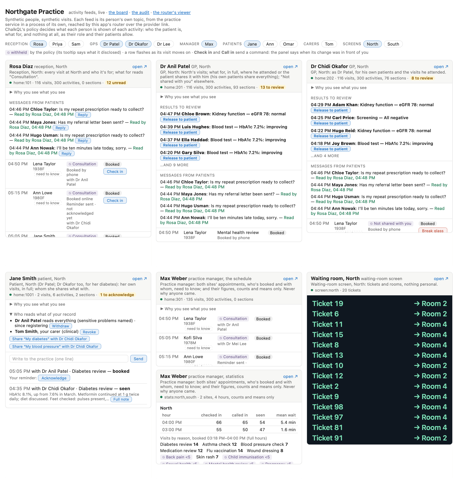

# ActivityFeed — privacy-preserving feeds

A hive of activity, the medical practice streams events (bookings, check-ins, calls to a room, what was found) live to
everyone in it, each from their own perspective: reception's, each GP's, the practice manager's, each patient's and
carer's, and each waiting-room screen's. Each person's feed is theirs alone, shaped by need-to-know access rules.

```bash
dotnet run --project samples/ActivityFeed.Sample
```

Then open `http://localhost:5950`: the board, several people's feeds side by side (see [The pages](#the-pages)).

<p align="center">
  
</p>

## Data protection and privacy? Glad you asked.

Enjoy streaming feeds in full fidelity, strictly on a need-to-know basis, without unauthorized (or inadvertent)
disclosures.

- **A feed per person, shaped by need to know.** ChalkQL's tenancy policy decides every row and value each person is
  shown. Reception and the manager see who's booked, when and with whom, never what for; a GP reads the clinical
  sections of the visits they attend, or that a patient shares with them; the manager counts what visits were for,
  never reads one; a screen shows only tickets. Each row says why its patient was disclosed to the reader: for their
  care, or need to know ([Entitlements](#entitlements)).
- **Work shared, privacy kept.** People entitled alike share one class's views, computed once and fanned out to each
  person's own topic, and every patient's feed runs on one prepared statement (a carer's, on its twin). What the feeds
  cost grows with the classes, not the people ([How the feeds are made](#how-the-feeds-are-made)).
- **A provider in another process, highly available.** The feeds come from the practice service, a data provider in a
  process of its own, reached over the provider link (`Tapline.MagicOnion.Providers`). Its instances share a write log:
  blue/green moves every feed, make before break, and a killed instance's feeds subscribe again on another
  ([High availability](#high-availability)).
- **Commands that read their own writes.** Check in, call in, acknowledge, reply: each is answered once its change is in
  front of whoever gave it, by a rendezvous ([The pages](#the-pages)).
- **Every disclosure on record.** An access log of who was shown which record, when and why, read only by the auditor
  role ([The access log](#the-access-log)).
- **Not just eye candy.** Backend dispatchers, themselves clients of the router, subscribe to the full stream and
  process each and _every_ notification in order. They reconnect seamlessly, without skipping (or repeating) a beat.

Run on its own, the app spawns the other two processes: the practice service at once, and the dispatcher once the app
listens. Each runs from its own build output, and its output goes to the app's console, each line marked with whose
(`service    |`, `dispatcher |`). Each is tied to the app by its standard input: it stops when that ends, which is when
the app stops, or dies, however it dies. The app spawns them only when no `--Practice` is named. To run each in a
terminal of its own instead (as for [High availability](#high-availability)), start the service and the dispatcher
yourself, and name the service to the app:

```bash
dotnet run --project samples/ActivityFeed.Service
```

```bash
dotnet run --project samples/ActivityFeed.Dispatcher
```

```bash
dotnet run --project samples/ActivityFeed.Sample -- --Practice http://127.0.0.1:5960
```

The headless verifier checks it all from a console:

```bash
dotnet run --project samples/ActivityFeed.Headless -- --verify 30
```

That spawns the practice (the service, on a write log of its own, then the app and the dispatcher) on ports the system
picks, subscribes every persona's feed, checks each against the policy, and runs the demo; 30 seconds on, it runs
blue/green, the checks at the end and a kill, and exits 0 if nothing failed. Without `--verify` it runs until Ctrl+C,
printing a line a second while batches come. `--stream http://localhost:5952` runs it against an app already running
instead.

It measures, too:

```bash
dotnet run -c Release --project samples/ActivityFeed.Headless -- --measure 300
```

That spawns the practice at ten times the pace, measuring itself (`Practice:Measure`), with no demo and no checks. It
opens every persona's feed and every patient's, one after another, each on a connection of its own signed in as its
person, and prints:

- step 1 for each, from its call to its answer and to its first state in front of the client;
- for 300 seconds, each activity's staleness, from its happening (the service's clock: the same machine's) to its
  arrival in each feed that shows it;
- the provider's own figures: its posts, and how many were whole; each turn's write and fan-out; each post's lateness
  behind the activity it carries; and each view's update;
- step 1 again, a receptionist's feed and a patient's dropped and asked for over and over.

Each view is incremental alone; `--twins` checks each against its recomputed twin, as the service does by default.
`--history 9` primes nine minutes' history at that pace, not ninety. `--green` starts a second instance once the feeds
are open, following the first through the window, and adds its replica lag: each turn from its append to its read and
its run on the follower (by the log's signal; `--green-poll MS` watches the log's file instead). `--logs DIR` keeps
each spawned process's output.

| Process | Ports (this machine only: sign-in is passthrough — each client says who it is, taken as given) |
|---|---|
| `ActivityFeed.Service`, the provider | 5960: gRPC (HTTP/2), the provider link (the topics' stream and the control stream) and the commands. 5961: `/livez`, `/readyz`, `/views` (how each feed's view is kept, and where it stands: its stamp, the engine's version it's at and its rebinds; and the dispatcher topics' pipes), `/oracle` (every open topic against its statements run whole), `/dispatches` (the dispatch log), `/access?activity=N` (who was shown a record), `/view` (the provider's view, which the router's viewer posts to), `/log` (the write log as this instance has it), `POST /drain` (see [High availability](#high-availability)) and, opted into, `/faults/lag` and `/measure` (`Practice:Measure`: its posts, turns, lateness and each view's update). A second instance takes other ports: `--GrpcPort`, `--HttpPort`. |
| `ActivityFeed.Sample`, the app and router | 5950: the pages, and the out-of-band fetches (`/_tapline/blob`). 5951: the router's viewer (`/ops/realtime`). 5952: the stream for .NET clients (gRPC), with the practice's step 1 and commands beside it. `--Practice` names the service's address, or its instances', comma-separated; none named, it spawns the service and the dispatcher, and the service is at `http://127.0.0.1:5960`. |
| `ActivityFeed.Dispatcher`, the push dispatcher | None: a client of the app's stream (`--stream`, default `http://127.0.0.1:5952`), holding both shards (`--shards 0,1`) as `dispatcher-1` (`--name`), signed in as that name. |

## Prerequisites

- .NET 10 SDK.
- NuGet packages `ChalkQL` and `ChalkQL.Sources` 0.6.x.
- A Java 21 runtime for ChalkQL's planner, which ChalkQL starts itself.

## Domain Model

> **Disclaimer:** Illustrative only.

- **Two sites,** North and South, each a partition of the service (`practice/north`, `practice/south`).
- **Staff:** Rosa Diaz and Priya Shah (reception, North), Sam Lewis (reception, South), Dr Anil Patel and Dr Chidi
  Okafor (GPs, North), Dr Mei Lee (GP, South), Max Weber (practice manager, both sites).
- **Patients:** 200, made from lists of names with a fixed seed. Each is registered with a GP at their site, and
  their registration shares everything with that GP. Jane Smith (North, Dr Patel) is the demo's: her check-in and call
  wait for staff's commands. She also sees Dr Okafor for her diabetes (a visit with him a quarter of an hour before the
  service starts), and her own tags, "My diabetes" and "My blood pressure", group her problems to share by.
- **Devices:** most patients have a phone registered for notifications, some none. Jane has an iPhone and the web,
  Tom an Android phone, and Ann Lowe an old iPad whose token the last mile no longer takes. One patient in ten has
  opted out of the practice's news.
- **Carers:** Tom Smith, Jane's son, is her carer in the clinical scope: her visits, and her results once released,
  never a sensitive one.
- **Screens:** one per site's waiting room.
- **The day, simulated:** patients book, are reminded, arrive, are called in and seen, at 12 activities a minute
  across both sites (`Practice:PerMinute`), with the last 90 minutes primed at start (`Practice:HistoryMinutes`). The commonest reasons come most
  often; a rare one (a pregnancy, say) stays under the manager's floor for hours. Now and then a patient
  acknowledges a reminder, or writes to the practice, and a test's result comes back for their GP to review (the
  practice's GPs release theirs eight minutes on; Jane's is Dr Patel's to release). A visit's activities share its
  booking's number.
- **Schedule and sections.** An activity is the schedule: who, when, with whom, and a note ("Booked online", "Called
  to Room 4"). What a visit is for, and what was found, is its clinical section, one per problem it addresses, written
  when it's booked and completed when the patient is seen.

## What each person is shown

| Who | Topic | Shown |
|---|---|---|
| Reception | `home:{id}` | Their site's newest 300 activities (`Practice:FeedRows`): who the patient is, and each activity's note, need to know. No clinical section: what for reads "Consultation". |
| A GP | `home:{id}` | Their site's newest 300 activities, and the sections they may read: those of the visits they attended, those patients share with them, and, while it lasts, the whole record of a patient they've broken the glass for. Elsewhere, what for reads "Not shared with you". Their own visits are for care, the rest of the site's need to know. |
| The manager | `home:{id}` | Both sites' newest 300 appointments (booked, reminded, checked in, called in, seen): who the patient is, when, and the GP attending, need to know. No note, no message, no clinical section. |
| The manager | `stats:north,south` | Their second feed (`"feed":"stats"` in step 1's parameters). Both sites' figures: by the hour, who was checked in, called in and seen, and the mean wait of those called; and visits by reason over the last twelve full hours, a count under five withheld. Counts and means only: the policy lets the manager count a reason, never read one. |
| A patient | `home:{id}` | Their own visits over 90 days, sections included, in full, but a result's finding only once their GP has released it ("Awaiting review by your GP"); and who reads what of their record. |
| A carer | `home:{id}` | The visits of whom they care for, as their designation's scope shows them: in the clinical scope, the schedule and the sections that aren't sensitive (a result once released). A sensitive visit isn't theirs at all: hidden, not masked. |
| A screen | `screen:{site}` | Tickets of the last two hours waiting, and called to a room. Its statement reads no column the policy protects. |
| The dispatcher | `notify:{shard}` | Its shard's pending entries of the dispatch log: per device, a send (its push token, and a text that says nothing personal or clinical) or a no-op (and why nothing's sent), with its deadline. Its policy reads a token, but nobody's identity. |

Each row says what the policy disclosed of the patient and of its content, row by row (ChalkQL's `__disclosure`
columns), and why its patient was disclosed (its basis: see [Need to know](#need-to-know)).

## Entitlements

ChalkQL's tenancy policy decides every value a feed holds. It's declared once, over the catalog, and every statement is
planned under it: a statement can't read past it.

> [!TIP]
> It's `PracticePolicy`, in [`ActivityFeed.Service/PracticeStore.cs`](../ActivityFeed.Service/PracticeStore.cs):
> `Declare` sets out its tables, realms, roles and rules; `GrantsOf` and `ForClass` work out what each person holds.

- **Each person is a principal:** their roles, each held somewhere (their grants), and who they are, worked out from
  the practice's own records, never from a request. Reception, the manager and a screen hold their role at each site
  they work at. A GP holds `gp` at their site, and `attending` on their own id as a clinician, anywhere. A GP a patient
  shares with, or a carer, holds their own id as a `grantee`. A GP who breaks the glass holds `emergency` on that
  patient, while it lasts. A patient holds nothing: their own rows are theirs as the resource owner (`patient_user`).
  The dispatcher, the release job (`notifier`) and the privacy officer (`auditor`) are principals too.
- **A row sits in the tenancies,** and a grant reaches it along a route. An activity is at its site, of its patient
  and of its GP, owned by its patient, and granted to a carer through `activity_grants`. A section is the same, and
  shared through `section_grants`; an acknowledgement goes with its activity. So Rosa's grant reaches her site's rows
  directly, and Dr Okafor's reaches a section Jane shared with him along a path of rows, a grant row down to him. What's
  shared is data: sharing or withdrawing rewrites rows, and nobody's grants change.
- **Which rows.** A row is visible to the roles that reach it. A table with a visibility rule admits fewer: a section
  admits the GP attending, a GP it's shared with, one in an emergency, a carer and the manager. Reception reads none.
- **What of a row.** Columns are grouped in realms: who the patient is (`pii`), the schedule's note (`admin`), what a
  visit was for and what was found (`clinical`), who at the practice acknowledged or read something (`staff`), and a
  push token (`device`). An access rule grants a role a realm, or one column, with a verdict. `Full` shows it.
  `AggregateOnly` lets the manager count a section's reason (`COUNT(*) FILTER (WHERE reason = …)`) but never read it,
  and a group under five is withheld. Otherwise the value is withheld, with a placeholder where one's given ("Awaiting
  review by your GP"). A rule may hold only while a condition does: a result's finding is the patient's once it's
  released.
- **Each row says what was disclosed,** value by value: ChalkQL's `__disclosure` columns (full, masked, aggregate,
  redacted). The page shows a withheld value as withheld.
- **Each request has a purpose and an actor:** `care`, or `emergency`, for a GP; `administration` for reception and
  the screens; `practice management`; `patient access`; `carer access`; `notification` and `notification release`;
  `audit`. A class's views run as the class (`class:gp:201@1`), a patient's statements as the patient. "Why you see
  what you see", on each panel, is ChalkQL's account of all of this for that person's statements.

### Need to know

Patients' names are disclosed to reception and the manager so they can run the day. They see the appointment schedule,
upcoming and past: who's booked, when, and the GP attending. That's need to know, not care: the manager reads no note
and no message, and neither reads a clinical section. Each row of a feed says why its patient was disclosed to the
reader, its basis:

| Basis | To whom |
|---|---|
| `care` | A GP: the visits they attend, and the sections they read. |
| `scheduling` | Reception, the manager, and a GP for the rest of their site's schedule: need to know. |
| `emergency` | A GP, for a patient they've broken the glass for, while it lasts. |
| `own record` | A patient. |
| `carer` | A carer, for whom they care for. |

The page marks a row disclosed for scheduling "need to know", and one for an emergency "emergency". The access log
records each entry's basis, and the audit page and `/access` show it.

ChalkQL's policy doesn't report the basis, so the practice's statements work it out, role by role, beside the policy
(`PracticeStore.StatementsOf`, in the same file).
Reception's and the manager's schedules say `scheduling`. A GP's says `care` where the visit is theirs, `emergency`
for a patient of their emergency, and `scheduling` otherwise: it's told who the GP is, and their emergency's patients,
as parameters of its own (`@gp`, `@emergency`), bound for the life of a class's views, so every GP's class still shares
one statement. A patient's and a carer's say their own. That duplicates the policy, and could drift from it.

## Who's asking

Every client signs in to the practice's realm, `practice`, before its step 1 — by Tapline's built-in passthrough
(`Tapline:Authentication:Passthrough:practice`, enabled by `AcceptAnyCredential` in the app's router): a person as
their id (`101`), a dispatcher or a follower of the log as its name. Passthrough takes the id as given, and the identity
it makes says so (insecure): this is a demo, on this machine. The practice service requires the sign-in — the router
refuses anyone else before step 1 reaches it (`Unauthenticated`) — and serves a connection its own person's feed alone:
asked for someone else's, it refuses (`Forbidden`: "Rosa Diaz's feed is theirs alone"). A connection is one person, so
each feed has a connection of its own: on the board, a frame each; in the headless verifier and measurer, a stream each.
The commands go through the app, which sends them as the person a page's connection signed in as.

## The pages

- **The board** (`/`) shows several people's feeds side by side. By default that's Rosa, Dr Patel, Dr Okafor, Jane,
  Max and the North screen: one check-in, as each of them sees it. Each panel is that person's page in a frame
  (`/as/{id}?embed=true`) — its own connection, signed in as them. The chips above toggle who's shown
  (`?show=101,201,…`), and each panel's ↗ opens that person alone. (Claude's built-in browser pane doesn't show frames:
  open the board in a browser, or each `/as/{id}` on its own.)
- **A person's page** (`/as/{id}`), signed in as them, shows their feed whole. On any feed, a visit's tooltip names its
  numbers — the visit, its activities and its clinical sections — and a reason, a note or a result names its section's:
  what the audit page looks up. Under it is every activity and every clinical section as it
  was sent, with what each row disclosed (`F`ull, `R`edacted).
- **Visits, not activities.** A feed's rows are activities (booked, checked in, called, seen). The page groups them by
  visit and shows each visit's latest step, newest first. A row flashes when its visit moves on.
- **Need to know.** A patient disclosed to a reader for scheduling, not for their care, is marked "need to know"
  beside their name; one disclosed for an emergency, "emergency". The tooltip says why.
- **Withheld values** are shown as withheld (⦸), with their placeholder where the policy gives one. A visit with no
  section the person may read says why: "Consultation" at reception and for the manager, "Not shared with you" for a
  GP. The tooltip says
  what the policy disclosed, for that row.
- **Why you see what you see,** folded at the top of each panel, is ChalkQL's explanation of the person's statements,
  asked for once it's opened: the principal and purpose they run as, each table's rows as the policy filters them
  (`site_id = 1 OR patient_user = …`), and each column the policy doesn't show in full, with its conditions,
  placeholder and floor. Nothing is run to produce it.
- **Full notes.** A row holds a note's first 120 bytes. A longer one ends "…" with **Full note**, which reads the rest
  as the person, there and then.
- **The audit page** (`/audit`) reads the access log as the practice's privacy officer, Nadia Bauer, whose role is
  `auditor`: its newest entries, and who was shown a record (an activity or a section). Its log is a page in a frame
  (`/audit/as/{id}`) whose connection signs in as the reader chosen, and is read as whoever it's signed in as: chosen as
  someone else (reception, say), the policy shows no line. A record looked up says whose it is, from the log: "section
  274 — Jane Smith's, visit 909, Dr Anil Patel attending". Each line says why its patient was disclosed to whoever was
  shown it (its basis: care, scheduling and so on). Never what it was for: that's clinical, and the auditor reads
  who was shown a record, not its content. An **activity** is a step of the schedule (booked, checked in, called, seen,
  a message); a **section** is a visit's clinical content, one per problem it addressed (its reason, its note, a
  result), numbered on its own. A record reaches the feeds of those the policy shows it to: the patient, the GP
  attending, a GP the patient shares it with (Jane's registered GP, Dr Patel, reads everything of hers by her consent),
  a carer in scope — and is logged for those whose feeds are open.
- **The manager's page** has two panels: their schedule, then their figures.
- **The manager's figures,** a site at a time: its latest hours, and its visits by reason, each count under five
  shown as withheld (`<5`). Under them, three notices to post to the site's patients: phone lines down (urgent),
  opening hours changing, flu vaccinations.
- **Replies.** Reception may **Reply** to a patient's message (one line). The reply is in the thread at reception and
  on the patient's page, and the receptionist who sent it sees how its notification went: "Delivered to 2 devices",
  or "Seen in the app: nothing pushed". A reply not delivered by its deadline is a task for every desk at the site.
- **Acknowledgements.** A visit's reminder says whether it was acknowledged, by whom and when. Patients' messages sit
  above the visits: at reception, those new to you are marked, and the page reports them read once it has shown them
  (a hidden tab shows nothing). Each says who read it first and how many at reception have; a patient's own page says
  "Read by the practice", never who. Each panel's badge counts what's open: a receptionist's unread messages, a
  patient's reminders to acknowledge.
- **Sharing.** A patient's page says who reads what of their record, and since when: their registered GP reads
  everything (each sensitive problem named), and anyone they've shared a tag with reads that tag's problems. Each has
  **Withdraw**; each tag has **Share** with each of the site's GPs.
- **Results.** A GP's panel lists the results waiting for them, each with **Release to patient**; a visit shows its
  results. A patient's own reads "Awaiting review by your GP" until it's released.
- **Carers.** A carer's page shows whom they care for, and their visits; they may **Acknowledge** a reminder for
  them, and reception's row then reads "Acknowledged by Tom Smith, for Jane Smith". A patient's sharing section lists
  their carers, each with **Revoke**.
- **Break glass.** A GP's visit rows they may read no section of have **Break glass**: the patient's whole record, for
  30 minutes (`Practice:BreakGlassMinutes`), the purpose of their statements' audit "emergency". A banner says whose
  record, until when; when it's over, the sections go.
- **Commands.** Reception's **Check in** works on any booked visit at their site; a GP's **Call in** works on their
  own patients' visits, once checked in, to their room. A patient may **Acknowledge** a reminder, and write to the
  practice (one line). Jane's visits wait for these: the simulated practice moves everyone else's on by itself. The page awaits a rendezvous before it sends the command, so it knows when the
  change is in front of it. The panel then says how long that took after the click, or why the command was refused.
- **Each panel is its own subscription** on the page's circuit: step 1 by the panel's component, step 2 by the
  page's script, which decodes the rows (`wwwroot/practice.js`). A feed that ends (the service gone, say) is asked for
  again once it recovers; meanwhile its last state is shown, marked stale. A feed whose instance drains (blue/green)
  moves, make before break: the panel asks for it again (step 1 goes to another instance), and the page swaps it in
  once it streams.

## How the feeds are made

- **A topic per person.** Every person's feed is a topic of their own, so the provider decides, per person, what it
  holds. All of their devices share it.
- **Staff work is shared by entitlement class.** Reception at a site is one class; a GP is a class of their own (their
  id is in their grants). A class's statements, its schedule and its sections, are kept as standing views, each binding
  the class's grants. Each member's topic reads them with cursors of its own: the views' changes are fanned out to
  them. Rosa and Priya are one class: one set of views, two topics, the same class rows.
- **One statement for every class of a shape.** The service prepares the classes' statements when it starts, once for
  each shape of grants (a GP's, a GP's with emergency access, a receptionist's, a screen's, the manager's): open in
  the lists those grants fill, every other role's folded as none. Every class of a shape makes its views from them, each
  view binding the class's own grants for its life (`ViewOptions.Context`), and a GP's its own parameters (see
  [Need to know](#need-to-know)). So the planner is asked once for every GP, not once a GP, and a class's first feed
  waits for its views alone.
- **Planning is deferred.** Every refresh publishes its rows and leaves the rest to ChalkQL's background
  (`DeferPlanning()`): the tables' statistics, the planner's numbers, and any statement whose tables have moved twofold
  planned again. So a turn's refresh only writes, and its planning runs off the service's loop; a new plan swaps in at a
  later refresh, and a view builds it beside the one it runs (below).
- **Planned on the practice's rows.** Statements prepared before the practice is seeded are planned on empty tables.
  Its first turn writes the history, then runs that deferred planning and awaits it (`engine.PlanAsync()`) before any
  feed opens: every statement held then is planned again on the rows, and no view starts on an empty table's plan.
- **What's shared with a GP is data.** A section reaches a GP who attended its visit (a grant on their own id, as a
  clinician), or one it's shared with: a row of `section_grants`, along the section's path to `grantees`, which the
  service writes as the section is written, from the patient's consents. A patient's registration shares everything
  with their registered GP. Sharing a tag, or withdrawing a consent, rewrites the patient's grant rows in one refresh:
  the GPs' views drain it as any change, and nobody changes class.
- **A carer's rows are data too.** A carer holds one grant, their own id; the service writes `activity_grants` and
  `section_grants` rows for what their designation's scope shows, as the patient's rows are written, and deletes
  every one when the designation is revoked (and the carer's topic is sent its state again). A carer runs the
  patients' statements, as themselves, and gets each change that concerns whom they care for.
- **The manager's schedule is their class's,** as reception's is, its statement keeping to the appointments.
- **The manager's statistics are a shared topic,** `stats:{sites}`, for every manager of those sites: their class's
  two statements, by the hour and by reason, kept as views. A section's reason is the manager's to count, never to
  read: ChalkQL refuses a statement of theirs that reads it, groups by it or matches it any other way than a count's
  `FILTER (WHERE reason = '…')`. The policy's floor guards a site's visits as a whole, not each reason's count, so the
  statement withholds a count under five itself. Its hours are full ones, so a count moves on the hour rather than with
  each booking.
- **Results are sections,** written unreleased, their finding withheld from the patient by the policy until their GP
  releases them (`ResourceOwnerSees.ByRules`: an owner's columns follow the rules written for the owner).
- **Break glass changes a GP's grants,** so it changes their class: a class of their own, with its own views, while
  the access lasts (`ForSubject(patient, …, emergency, Tenancy.Anywhere)`), and their topic is sent its whole state
  from it. When the access is over they move back, and the patient's sections leave their topic the same way.
- **Views are incremental, and validated.** A class's view, and a screen's, is maintained incrementally: an update
  costs what changed. At every update it's checked against a recomputed twin, its statement run in full at the same
  epoch: the same rows, by count and checksum. A view that differs from its twin, or fails, gives way to the recomputed
  view, and its readers are sent that whole. The log and the service's `/views` say which view and why.
  `Practice:Maintenance` (`Incremental`, the default, or `Recompute`) and `Practice:Validate` (`true` by default)
  choose. ChalkQL's incremental maintenance is experimental (`CHALK003`).
- **A new plan is built beside the view.** When ChalkQL plans a view's statement again (its tables have grown, say),
  an incremental view builds the new plan beside the one it runs, off the service's loop, and swaps it in once built,
  its readers sent only what differs (`ViewPlanSwap.LowJitter`). Its updates don't wait on the new plan, though the
  view holds both meanwhile. Classes that share a statement share its new plan, which moves all their views at once.
  `Practice:PlanSwap` (`LowJitter`, the default, or `AtNextUpdate`, each view computed whole at its next update)
  chooses.
- **A view ChalkQL can't maintain is recomputed,** from the start, and the log and `/views` say why. None of the
  practice's is, whatever its history at start. With a busy day's (5,000 activities, say, not 600), ChalkQL's planner
  builds a GP's schedule's join with acknowledgements as a right join (an acknowledgement is visible exactly when its
  activity is, so the policy joins `acks` to `activities`), and maintains it as the left join it mirrors.
- **Patients run one statement,** and carers its twin, which differs only in its basis. Each is prepared once, from
  a context's shape, so one plan serves every patient, and one every carer. Their shape leaves open only what a patient or carer may hold, every staff role's grants folded as none: a
  shape serves every principal it could bind, and a plan that could bind the manager could read no reason. It runs for
  a patient when they open their feed (its snapshot), and once for each change that concerns them (that row, or its
  deletion if they may no longer see it). A patient's topic exists only while they're subscribed.
- **Acknowledgements are records.** Each "seen" and "acknowledged" is a row of `acks`, entitled through its activity:
  visible exactly when the activity is. Who it was is a staff realm a patient doesn't read. The schedule's statement
  joins each activity's acknowledgements: who acknowledged it and when, who first read it and when (from that row),
  and how many receptionists have.
- **A person's own rows** sit beside their class's in their topic: a receptionist's tasks (each message they have yet
  to read: their own state, which the class's shared rows can't hold) and everyone's status row (the badge). One
  action's changes, class rows and own rows, go in one post: one frame.
- **Notifications are records too,** in ChalkQL: `devices`, `notifications` and the dispatch log, `dispatches`. A
  call in, a reminder, a released result and a reply each raise one, transactional, to the patient and to each carer
  who can see what it's about (an entitled read, as the carer). If a recipient's feed is open, it waits for them to see
  it in the app (`Practice:SeenGraceSeconds`, 30 by default): the page reports what it has shown, and a seen or
  acknowledged item ends their part unsent. Otherwise each of their devices gets an entry, numbered in its shard's
  sequence (the service's own, gapless): a send, or a no-op saying why ("seen in the app", "expired", "bundled",
  "designation revoked"). An urgent one must be handed off within five minutes, the rest within an hour; one still
  waiting at its deadline becomes a no-op ("expired"), recorded, never sent.
- **A dispatcher's topic is a view of the log,** `notify:{shard}`: its shard's entries no dispatcher has reported yet,
  under the dispatcher's own principal. Only the dispatcher role reads a push token (a `device` realm), and it has no
  rule for anyone's identity: what it's given to push says nothing personal, by policy. It reports each entry (handed
  off, failed, recorded), and the entry leaves its topic; a refused token deactivates its device. Each report has a
  rendezvous, so once the removal is in front of the dispatcher, a reconnect can't make it act on the entry again. A
  dispatcher started again is sent its topics' whole state: every entry still pending.
- **Every version of a dispatcher's topic is posted, off the loop.** Its view publishes every version
  (`ViewVersions.Every`), so an entry written and reported between two updates reaches the topic both times, never
  conflated away. The loop drains each version into a batch of its own and hands it to the topic's reader through a
  pipe of reusable batches (Tapline's `BatchPipe`); the reader posts it on a task of its own, then the rendezvous that
  waited for it. With every batch still with the reader, the view waits, ChalkQL holding its versions, and the loop
  goes on: a slow reader holds back only its own topic. 1,024 versions behind, the view gives way to a recomputed
  one, made afresh, and the topic is sent its whole state. The pipes' depth and use are in `/views`.
- **A dispatcher keeps each device's entries in order** (the device is their ordering key): one at a time, in their
  shard's order, so a push never overtakes one written before it; a failed one is tried again after a pause, still
  first, holding back that device alone. Across devices, the most pressing goes first: urgent transactional, then
  transactional, operational, informational. Within each, the sites take turns (an entry's site is a tenancy, not
  personal), so a notice to all of one site's patients doesn't hold the other's back; within a site, the earliest
  deadline first.
- **Notices count against budgets.** The manager's notices go to the site's patients seen in the past year, as each
  one's limits allow: three urgent pushes a day; two normal ones a day, four hours apart, never in quiet hours
  (`Practice:QuietHours`, `22-8` by default, in `Practice:TimeZone`, this machine's by default; `none` turns them off).
  A release job runs every minute (`Practice:ReleaseSeconds`): a ChalkQL query, as a `notifier` principal (who's in a
  cohort and what's been sent them, no note, nothing clinical, no token), that ranks each patient's waiting notices,
  operational before informational, then by deadline, with a window function. The top few of a queue go in one push,
  counted once; the rest are bundled into it. Informational ones skip patients who opted out. A notice still waiting at
  its deadline is recorded as expired, a no-op for each device.
- **Every topic has an oracle:** its statements run whole, as its principal, at the loop's epoch, give exactly what it
  must hold. A person's topic is checked against their class's statements (or a patient's own), with their own rows
  beside them; a screen's, the statistics' and a dispatcher's against theirs. By row count and checksum (Tapline's: the
  sum of the rows' hashes), so the views, the fan-out and the own rows are checked together. `/oracle` checks every
  open topic; in Development the service checks one now and then on its own (`Practice:OracleSeconds`, 30 by
  default). A topic that differs is sent its whole state again, and the log and `/views` say so.
- **One loop an instance.** It owns the instance's ChalkQL and topics. It runs each turn of the write log (see
  [High availability](#high-availability)): the commands, the simulator's activity, the refresh; it updates the views,
  posts their changes, answers step 1, and then asks for the commands' rendezvous.
- **Commands go through the app,** which forwards them to the service's command RPC, at the instance that writes the
  practice's records: another answers that it doesn't, and the app asks the next. A command acts as the person the app
  vouches for: on a page, the person its connection signed in as. It's checked with an entitled read as that person (they can act only on what they can see) and against
  the visit's step. Once it's done, the service asks for a rendezvous on each of that person's routes, so the page that
  sent the command has the change in front of it when the id comes back.
- **A command says what it's ordered with** (`CommandOrder`): its ordering key, its sender, and its number among that
  sender's commands with that key. A patient's messages and reception's replies to them are keyed by the patient's
  thread (`thread:{patient}`), check-in and calling in by the visit (`visit:{booking}`); an acknowledgement, a page's
  report of what it showed, and the rest are in no order but their arrival's. Each panel is a sender, numbering its own
  commands. The writer applies a sender's commands with a key in their numbers' order, whatever order they come in
  (a retry during a drain, two clicks at once): one that comes early waits for those before it, for up to
  `Practice:OrderHoldSeconds` (eight by default: the app's retries' window), and is refused then, saying which it waited
  for. A command retried is answered as it was. The numbers run are the log's, so every instance has them.
- **Step 1** posts a new topic's first state and waits for it to be applied before it accepts, so no route starts
  empty. A person's feed opens where the write log says: on the instance that writes, at once; on one that follows, at
  the writer's next turn, so every instance has it open from the same point (see [The access log](#the-access-log)).
- **The access log has a database of its own,** worked out from the write log, written off the service's loop, and
  read through ChalkQL as the auditor: see [The access log](#the-access-log).
- **The router's viewer shows a person's topic, and no more.** A person's topic tells the router to keep none of its
  records for the viewer (`RecordRetention.None`: their metadata alone), and gives a view URL on the service's own
  host. The viewer posts the topic's state there, and the service answers with the newest activity's full record as
  that person may see it, its visit and sections, and who was shown it (from the access log), shown sandboxed.
- **Sites are partitions,** `practice/north` and `practice/south`, and a person who works at one, or is registered
  there, has their topic in it. A site's system falling behind is simulated by fault injection (`POST
  /faults/lag?site=2&seconds=20`, in Development only, opted into with a reason: `--Practice:Faults "…"`). The
  service's health report then names that partition degraded, so the router holds only the routes under it and their
  clients show their last state as stale, while the other site's stream on. The site's topics are fed nothing
  meanwhile, and catch up once it's over. A command's rendezvous isn't asked for while its actor's site lags: the change
  isn't in front of them yet. Cross-site topics (the manager's, the dispatcher's) are in no partition, and stream on.
- **A killed service** keeps its feeds' last state, shown stale (`ErrorPolicy.ReplayLast`), until the router presumes
  it dead and its clients' subscriptions end (ServiceDown). Started again, it's a new instance: it replays the write log
  to its last entry and carries on from there, and the app's pages and the dispatcher subscribe again. With no write
  log named (`Practice:Log`), its records are in memory alone, and it starts its day afresh.
- **The explanation is ChalkQL's own** (`ExplainAsync`), computed by the pass that enforces the policy, from the same
  folded expressions, so it can't drift from what runs. The service names its columns (it gives them by position) and
  writes its operators as operators.
- **Full notes aren't streamed.** A note longer than a row's field is read on demand: an entitled read of the section,
  as the person (their emergencies too), from one plan every principal shares. It's refused if the section isn't
  theirs to see, and redacted if they see the section but not its note (the manager).

## High availability

Instances of the service share a write log, a SQLite file (`--Practice:Log`), and each builds the practice from it in
ChalkQL of its own: one writes the practice's records, the others follow, and any of them serves feeds. On one machine,
the practice survives an instance going (a deploy, a crash), not the machine.

- **The write log holds the writer's turns:** each turn's inputs (the commands and the dispatchers' reports taken in,
  whether the practice took a step, its time), logged before they're run. Every instance runs every turn, in the log's
  order, through the same code, so their records and their posts are the same. The practice's first turn primes it,
  with the settings it was started with: what the log says, every instance does. Each turn carries a digest of the
  writes of the turn before, for every other instance to check its own against; `/log` names any that differed.
- **Replay is deterministic.** A turn's time is the log's, the simulator's random numbers are seeded, and ids are made
  of the turn's time and a count (UUIDv7): the same turn makes the same notification ids on every instance.
- **One writer holds a lease,** a row beside the log, its term three seconds, renewed while it writes. Each of its
  appends is fenced by the lease's epoch: a writer that lost the lease (paused past its term, say) adds nothing, and
  steps down. One that stops or drains lets the lease go; one that dies, another takes once its term lapses.
- **Commands go to the writer.** Another instance answers that it doesn't write, and the app asks the next, for up to
  eight seconds. A command's answer is kept by its correlation id as every instance runs its turn, so a command retried
  (its writer gone after logging it) is answered as it was, not run again.
- **Followers hear the log's signal over Tapline.** The writer posts each turn's number on a topic of its own, `log` (a
  last value), as soon as it's logged; each follower holds it through the app's router (`--Practice:Stream`, the app's
  stream, `http://127.0.0.1:5952/` by default), and reads the log on when it hears one. Only the writer takes that
  topic's step 1, so a follower binds it wherever the writer is, and again whenever that changes. Failing the signal, a
  follower watches the log's file (`--Practice:LogPollMs`, 25 by default).
- **Whose feeds an instance holds open** it appends to the log too; every instance applies it where the writer's next
  turn says (see [The access log](#the-access-log)).
- **Blue/green is a planned handover.** Green starts on the same log: it replays it, follows blue, and serves once
  it's caught up. Then blue drains (`POST /drain?over=10&grace=5` on its health port): it lets the lease go, green
  writes at once, and the router moves blue's clients to green, make before break (the pages, the dispatcher, a .NET
  client), each given its grace. Blue stops once the drain's over.
- **A writer killed** is replaced once its lease lapses, by an instance already following: its feeds end with it
  (ServiceDown), and subscribe again on another. Started again, an instance replays the log to its last entry and
  carries on.
- **The store is behind an interface,** `IPracticeLog`: append (fenced, or not), read on, wait for more, take or renew
  the lease, let it go. SQLite serves instances on one machine, and memory one instance alone; a store across machines
  (PostgreSQL, say) would take the instances to more than one.

Blue/green by hand: two instances on one log, each named, then the app naming both, and the dispatcher, each in a
terminal of its own.

```bash
dotnet run --project samples/ActivityFeed.Service -- --Practice:Log practice.db --Practice:Name practice-blue
```

```bash
dotnet run --project samples/ActivityFeed.Service -- --Practice:Log practice.db --Practice:Name practice-green --GrpcPort 5962 --HttpPort 5963
```

```bash
dotnet run --project samples/ActivityFeed.Sample -- --Practice "http://127.0.0.1:5960,http://127.0.0.1:5962"
```

```bash
dotnet run --project samples/ActivityFeed.Dispatcher
```

Each instance's `/log` (on 5961 and 5963) says whether it writes or follows, how far it has read and run, whether it
hears the writer's signal, and how far behind the writer it runs. Then drain blue:

```bash
curl -X POST "http://127.0.0.1:5961/drain?over=10&grace=5"
```

The log outlives the instances: started again on it, the practice carries on. Delete both files, `practice.db` and
`practice.access.db` (each with its `-wal` and `-shm`), for a new day.

## The access log

Each record (an activity or a section, not a deletion) made available to a person's feed, whose record it is, when,
and why its patient was disclosed to them (its basis), in a SQLite database of its own (`access_log`). ChalkQL reads it as a source of its own, `audit`, under the
practice's policy: only the `auditor` role reads it. "Who was shown Jane Smith's check-in" is a query over it, as the
audit page's reader (`/audit`) or as the service's own auditor (`/access?activity=N`).

- **It's written off the loop.** Each refresh's entries go to a writer of its own as a batch, through a pipe of reusable
  batches (Tapline's `BatchPipe`), and the writer writes the batches waiting for it in one transaction. With every batch
  still with the writer, the loop waits: an entry is never dropped. The entries are structs, copied into batches that
  keep the room they grew to, and the writer's statements are reused, so in steady state neither side allocates.
- **Its file goes with the write log's.** Instances that share a write log's file share the access log's beside it
  (`practice.access.db`, or `--Practice:AccessLog`), each writing every entry, once, by its number. Whoever starts them
  removes both: the headless client when it's done, the preview once the app stops. A service on its own (no write
  log's file) keeps it in the temporary folder, and removes it when it stops.

- **It's worked out, not written as posts are made.** Every instance works it out from the write log, the same way: a
  person's feed open on any instance is open on every one, from the point in the log where it opened, and what it held
  then, and what each turn after changed in it, is what they were shown, at the time the log gives. The posts write
  nothing to it. Each instance's access log is the same (the turns' digests check it), and a new instance's replay
  rebuilds it.
- **So an opening is ordered by the log.** An instance appends that it opened a person's feed before it posts the
  feed's first state: the writer at once, a follower at the writer's next turn (the writer turns as soon as it reads
  one).
- **It assumes deterministic replay.** Every entitlement change (a consent, a share, break glass and its end, a
  carer's designation) is a turn's, appended to the log before it takes effect and played back in order, and the
  policy is the same for every turn replayed. The sample holds to both; a change of policy would need its version in
  the log.
- **It errs on the side of saying too much, never too little.** It says what was made available: the router may
  conflate a version away before a slow client gets it; a feed's closing reaches the log a moment after its last route
  goes; a site falling behind holds its posts, logged as shown when they were made.

### Where replay isn't available

When the systems a feed is made from can't replay their entitlement changes, the access log is written as posts are
made, in the usual shape:

- **An intent before** each post goes out: what's to be shown to whom, appended on the posting path.
- **An outcome after:** applied by the router (Tapline's `WhenApplied`), or in front of the client (its rendezvous),
  batched off the posting path.
- **A reconciliation on recovery:** an intent with no outcome is "possibly shown". A log that says too much can be
  explained; one with a gap can't.
- **A store of its own,** apart from the operational one: append-only, tamper-evident (its entries hash-chained, or
  written once), kept as long as policy says, and read only by the auditor role, whose reads are logged too.

The service has the hooks for it, `IAccessLog`: before each post to a person's topic, `Intend` (whose topic, and the
records the post carries); after, `Applied` once the router has applied it (the topic's version then) or `Refused` (its
whole state follows, intended anew); and `ReconcileAsync` as the service starts, before any post. The practice's own,
`ReplayedAccessLog`, keeps nothing there, and asks the router for no outcomes: its access log is the replay's. That's
also why its store can be a pipe and a writer off the loop: what's lost there can be worked out again. A system
that can't replay must make each intent durable before its post goes out.

## The headless verifier

`ActivityFeed.Headless` subscribes every persona's feed, each on a connection of its own signed in as its person
(and the dispatchers' topics as `observer`), and checks each record as it arrives:

- every row against what its persona may be shown (above), and every count of the manager's at least five, or
  withheld;
- every row's basis: reception's and the manager's for scheduling, a GP's own visits for care (the rest of their
  site's for scheduling, or an emergency), a patient's for their own record and a carer's as carer; and the manager's
  schedule only appointments, who in full, no note;
- every replica's checksum against the router's;
- sign-in: an anonymous connection refused Rosa's feed (by the router: `Unauthenticated`), and Jane's connection,
  signed in as her, refused it too (by the service: `Forbidden`);
- every entry of both dispatcher topics, watched as an observer: no name in its text, nothing clinical in a
  transactional one, a token only on a send.

Then it runs the demo, each step checked:

- South's reception can't check Jane in, a GP can't check anyone in, and South's GP can't call her: each is refused,
  saying why.
- Tom acknowledges Jane's reminder for her (reception can't). At its rendezvous his feed has it; Rosa's row then says
  "acknowledged by Tom Smith", and Jane's own says when, not who. Jane can't acknowledge it again.
- Rosa checks Jane in. At its rendezvous, Rosa's feed has the arrival and its ticket. Then Priya's feed, Jane's own and
  the North screen follow ("Ticket 51: please wait", say), and Max's figures count her in North's hour.
- Dr Patel calls her in. At its rendezvous, his feed has the call, and her visit's section in full (her registration
  shares everything with him). Then the screen ("Ticket 51 → Room 4") and her feed follow. Dr Okafor sees the call
  and no section: she hasn't shared it with him.
- The call notifies Jane and Tom, both of whose feeds are open. Jane's page reports she's seen it, so her two devices
  get no-ops ("seen in the app"). Tom's doesn't, so his phone gets a send once the grace is over. The dispatcher was
  killed as the call was made: the send waits in its topic, and the dispatcher, started again, hands it off.
- Jane's blood test comes back as she's called in: a task for Dr Patel, "awaiting review" in her feed, and not in
  Tom's. Dr Okafor can't release it; Dr Patel does, and its finding reaches her feed and Tom's.
- Jane writes to the practice. It's a task for Rosa and for Priya. Rosa reads it: her task closes, Priya's stays open,
  Rosa's row says she read it first, and Jane's says "read by the practice".
- Jane shares "My diabetes" with Dr Okafor: his feed gains her visit's section. She withdraws it: it leaves his feed,
  which keeps the section of the visit he attended.
- Dr Okafor breaks the glass for Jane: his feed holds her whole record until it's over (12 seconds, for the verifier),
  and then not.
- Jane revokes Tom's designation: within a second his feed holds none of her rows.
- Jane is away (her feed dropped) when Rosa replies to her message: her devices get sends at once, the dispatcher
  hands both off, and Rosa's row of the reply says "Delivered to 2 devices". Jane's page, open again, has the reply.
- Jane's note of the visit Dr Okafor attended is longer than a row's 120 bytes. Dr Okafor, Dr Patel and Jane read it
  whole; reception and South's GP are refused; the manager's is redacted.
- Max posts three notices to North's patients (reception can't). Each patient gets the urgent one as a push of its
  own, and one normal push of the opening hours with flu vaccinations bundled into it; flu reaches nobody who opted
  out of news.
- South's system falls behind for eight seconds: South's feeds are held and shown stale (their partition degraded)
  while North's serve on, and South's serve again once it's over.
- Jane's next two messages, numbered in her thread, are sent the second first: the writer holds it until the first has
  come, so her thread has them in her order. One whose predecessor hasn't come is refused once its hold is over, saying
  which it waited for; its predecessor sent, it's sent again and goes in after it.

Before the demo it checks the dispatcher's order on its own: an urgent call-in goes ahead of fifty notices, two sites'
notices take turns, and within a site the earliest deadline goes first.

Then blue/green. Green starts on blue's write log, catches up and follows blue, hearing each turn by blue's signal:
every turn it runs writes what blue's did, the access log's rows among them (their digests). Blue drains: green writes
at once; every feed and both observers move, make before break, none ending, each with its newest activity in its
first state on green; a command after is green's, at its rendezvous; and blue stops. The checks at the end are then
green's.

At the end:

- Rosa's and Priya's feeds hold the same class rows, byte for byte.
- Every activity reads the same in every feed that has it, but for what the policy withholds, and every section the
  same in every feed that reads it.
- Each feed's badge counts its own open tasks; no patient's feed names who acknowledged or read anything.
- No view gave way to its recomputed twin (the service's `/views`, when the verifier spawned it). A view ChalkQL
  couldn't maintain, recomputed from the start, is named with ChalkQL's reason.
- The GPs' schedules run on one statement, their sections on one, the receptions' on one and the screens' on one, each
  class's views binding its own grants.
- The access log names exactly the people whose feeds held Jane's check-in, each on their own topic and with their
  basis: reception and the manager for scheduling, Dr Patel for care, Jane her own record, Tom as carer. Read as the
  privacy officer (the auditor role), the audit page's query names the same people, with the same bases; read as
  reception, no line. The
  access log's database wrote every entry it was given.
- Every open topic holds exactly its statements run whole (the service's `/oracle`), and the oracle the service ran
  every two seconds through the demo found none wrong. With every replica's checksum the router's, record by record,
  that's every client holding what the policy says.
- Every persona's explanation comes back. The manager's reason is aggregate only, reception's statements read no
  section, and where a statement shows every reason in full, every section of that person's reads so.
- The dispatch log (the service's `/dispatches`) is complete: each shard's numbers gapless, one entry per notification
  and device, each reported but the last few seconds', and each device's reported in the order they were written. An urgent send was handed off by its deadline. Nothing seen in
  the app was sent to whoever saw it, a carer got only what concerns whom they care for, and nothing was sent to them
  once revoked. Ann's old iPad failed once and was let go. Nobody's budgets were exceeded.

Last, it kills the service (green, by then). Every feed keeps its last state until the router presumes the service dead
and the feed ends. Started again, the new instance replays the write log past the killed one's last turn, none of the
turns' writes differing, and carries on: every feed subscribes again and has its first state, checked as before, each
with its newest activity of before.

## Not yet

- An instance killed while it follows leaves the feeds it held open in the log: every instance goes on working them out,
  and the access log says too much. The writer closes those of a writer it takes the lease from, but nothing yet tells
  it a follower is gone.
- Instances on more than one machine need a store other than SQLite behind `IPracticeLog`.
- A row's basis is worked out by the practice's statements, beside the policy (see [Need to know](#need-to-know)).

