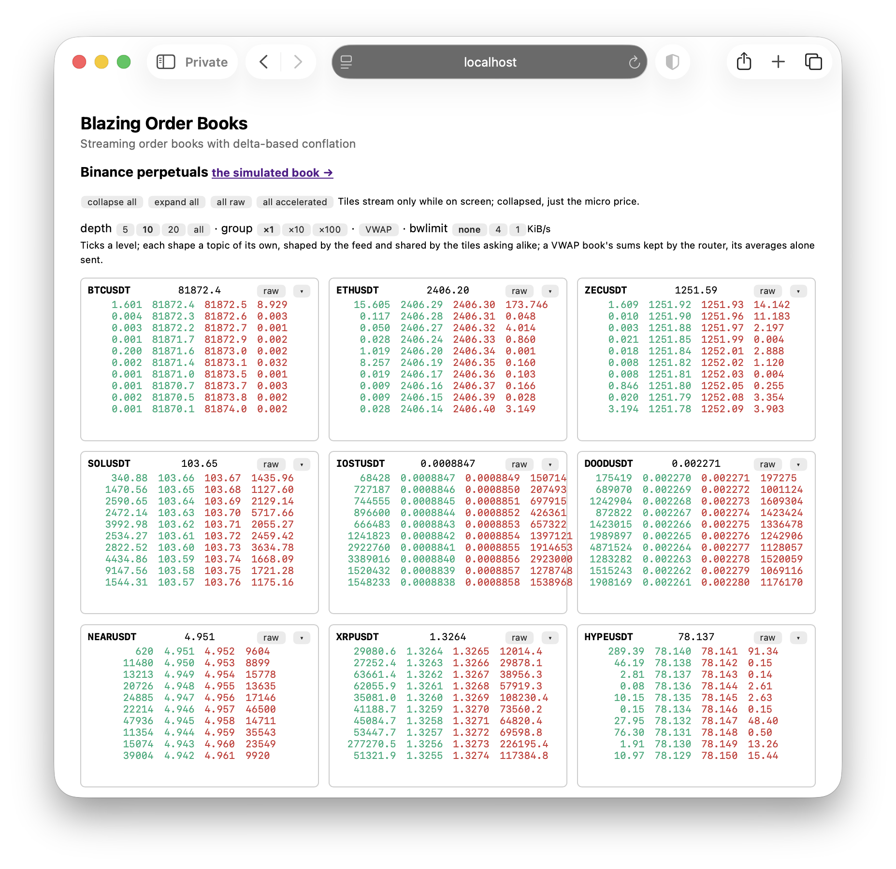

# Blazing Order Books

**Streaming order books with delta-based conflation**

*(The `BlazingOrderBooks.Sample` project.)*

A BTC-PERP order book, live in the browser: a feed handler builds the book from a simulated venue's depth and trade
feeds, a Tapline data provider (`market`) offers it as topics, and the router streams each Blazor circuit the levels
that changed since that client last heard — conflated to what its link can carry, encoded as fixed-width binary
records, checksummed end to end. This README follows a level change from the venue to the screen, and says at each
step what it costs and why it's done that way. The default page, `/`, does the same for Binance's 12 most traded
crypto perpetuals, live (see [Live: Binance perpetuals](#live-binance-perpetuals)); the simulated book is at `/simulated`. Why
Blazor needs Tapline to do this at all is in the main README's [Making Blazor Dance](../../README.md#making-blazor-dance).

> **Disclaimer:** Illustrative only.

```bash
dotnet run -c Release --project samples/BlazingOrderBooks.Sample
```

Then open `http://localhost:5898` for the live Binance grid (it reaches Binance over the internet;
`Binance__Enabled=false` turns it off), or `http://localhost:5898/simulated` for the simulated book. The router's ops
viewer is on its own port, `http://localhost:5899/ops/realtime`, on this machine only.

<p align="center">
  
</p>

- **Ports.** They're the BlazorRealtime sample's, so run one at a time, or pass `--urls`. `ORDERBOOKS_OPS_ENDPOINTS`
  (or `Market:OpsEndpoints`) puts the ops viewer on another network interface, an address or an interface's name
  (`en0`, `eth0`), or turns it `off`.
- **A slow link.** Add `?bwlimit=1` to either page (KiB/s, read as rsync's `--bwlimit`: 1 is 8 kbit/s), or use the
  page's bwlimit toggle (none, 4, 1) to cap the connection live. The books keep up at a lower rate, each update carrying
  everything since the last.
- **Stale tiles fade.** A tile fades while it waits for its first update (250 ms), or when it's been quiet a second, the
  router hasn't confirmed it's up to date (`tapline.sync`), and the wait is long for that tile's usual pace. A quiet book
  is confirmed at once; one its cap holds back, only once its update is delivered.
- **A failing connection.** Open `/test`: the simulated book, its connection failing for 2 s every 15 s.

## The page

- **Raw book** — the authoritative L2 book, from the venue's depth feed: twelve levels a side, its version and whether
  the client's checksum agrees.
- **Accelerated book** — the same book seen through the trade prints the depth feed hasn't caught up with yet (see
  [The accelerated book](#the-accelerated-book)).
- **The mark** (mid price) beside the title, and the feed's **alerts** below it.
- **The feed handler's figures** — decode and posting latency (p50, p99, p99.5, max), allocations per message, the
  accelerated book's lead and accuracy — then the ingest's (posts, folds, how many posts a fold took) and the circuit's
  flow control (round trip, delivery rate, bytes in flight, pacing).

## The path, end to end

```
Exchange ──binary wire──▶ SpscByteRing ──▶ BookBuilder ──Post(levels, size changes, seqs)──▶ TableIngest (staging)
 (venue)    (in place)    (SPSC)      (L2 book +          on the handler thread,              │
                                       acceleration)      never waits                         │ the router drains
                                                                                              ▼
 browser ◀──Tap.Frame(Table record)── Outlet (per circuit) ◀── per-tap cursor ◀── Table<Level, long> ◀── WASM fold
 tapline.js replica   over the        ready queue, flow        "rows changed       one version per drain
 bookView ladder      Blazor circuit  control, late binding     since my cursor"
```

1. **The venue** (`Exchange.cs`) publishes trades at once and depth conflated every 20 ms, as compact binary messages
   in a ring the handler reads in place (`FeedWire.cs`).
2. **The feed handler** (`MarketFeedHandler.cs`, `BookBuilder.cs`, `Ladder.cs`) keeps the book and posts each depth
   update's net change per level to the book's ingest — and returns at once.
3. **The router** folds whatever was posted since it last looked, in one WebAssembly call, and applies it to the book
   table as one version.
4. **Each subscriber's tap** is sent the rows changed since its own cursor, when its circuit can take them.
5. **The browser** applies them to a generic replica of the table, checks the checksum, and draws the ladder.

The provider never waits for the router, the router never waits for a client, and a slow client never holds up a fast
one. The sections below take the steps in turn.

## The provider: topics through a service

The handler is the `market` service's data provider (`IDataProvider`), in process, at an endpoint of that name. The
page subscribes through the service, not to a table it can see (`Components/Ladders.razor`):

```csharp
var tap = await Publisher.SubscribeAsync(Outlet, "market", "book?depth=10&group=1", Market.ForEyes, ct);  // 50 ms at most
await Js.InvokeVoidAsync("bookView.attachBook", ct, tap.Binding, element);   // the page activates it (step 2)
```

| Parameter | Topic | Source | What a client gets |
|---|---|---|---|
| `book` | `book:BTC-PERP` | `Table<Level, long>` | a snapshot, then deltas |
| `book-accelerated` | `book:BTC-PERP:accelerated` | `Table<Level, long>` | a snapshot, then deltas |
| `mark` | `mark:BTC-PERP` | last value (`i64`) | the newest mid only |
| `book?depth=10&group=10` | `book:BTC-PERP:depth10:group10` | `Table<Level, long>` | a shape of the book: a snapshot, then deltas |
| `book?group=10&price=vwap` | `book:BTC-PERP:group10:vwap` | `Table<Level, VwapRow>` | a VWAP shape: cumulative size, and the average price of filling it |

**Shapes: depth and grouping.** A book may be asked in a shape after its parameter (`book?depth=10&group=10`, each
part optional): its best levels a side (`depth`: 5, 10, 20, or `all`), each spanning some of the venue's ticks
(`group`: 1, 10 or 100). A request is rounded up to the next served (`depth=12` is 20), so subscribers asking alike
share a topic: one per shape, made the first time it's asked for, named after it, folded by the same module. The pages
ask `depth=10` and toggle both. After each message the handler computes each shape with subscribers from the book as it
stands and posts its size changes since the last: a level entering the shape its size, one leaving minus its size.
Grouping is a plain mapping of the book's changes (a group's size is the sum of its levels', so a level moving within
its group changes nothing, and nothing is sent); depth needs the whole book (which level enters as one leaves depends on
those outside the shape), which is why the shapes are computed here, where it is. Bids are grouped down and asks up, so
the spread never looks crossed. Nothing is allocated per message (`BookShapes.cs`).

**VWAP.** With `price=vwap` (the pages' VWAP toggle), a shape is cumulative: each level shows the size from the best
price down to it, at the volume-weighted average price of filling all of it — what sweeping the book that far would
cost, a share. An average doesn't conflate, but its sums do, so the router keeps them: the handler posts each level's
changes to two running sums, its size and its notional (price × size, `Sums`), and the router folds them
(`Market.VwapFold`) and finalizes each into the row subscribers see (`Market.VwapFinalizer`: size, and notional over
size with two more places, `VwapRow`) — one WebAssembly module, exporting both. Being cumulative, a change near the top
moves every level's sums below it (up to the depth's), and a level moving within its group moves the notionals alone;
a sum moving while its average rounds the same sends nothing. The sums are never sent. The pages give a VWAP's two
extra places room only as a book needs them: as many as any of its averages has used so far, their trailing zeros left
as figure spaces so prices stay aligned. See the field manual's
[finalize](../../docs/provider.md#reference-tables-folds-and-ingest).

The pages are for eyes, so each book and price subscription asks for a state at most every 50 ms
(`SubscribeOptions.MinInterval`: 20 a second), the state as it stands then, whatever changed meanwhile conflated into
it. The router holds each subscriber to its own rate; the provider still posts every change, and sees the rate asked
on the request (`SubscribeRequest.Limits`). The alerts are messages, never held.

Subscribing is two-phase. In **step 1** the router asks the provider, which accepts with the topic's source, its error
policy and its payload format (`request.Accept(...)` in `MarketFeedHandler.SubscribeAsync`); the format is data — the
key's and row's field layouts, plus the URL of the provider's own views — so the router's viewer can render the book
without the provider's types. In **step 2** the page's JavaScript registers its handlers and activates the tap, so
nothing streams before the page can draw it.

The handler produces for a topic only while it has subscribers. A post answered `202 NoListeners`, for the epoch it last
accepted a subscriber on, stops it; the next subscriber has the whole book posted first. See the main README's
[Two-phase subscribe](../../docs/architecture.md#two-phase-subscribe) and
[Data providers](../../docs/provider.md#reference-the-protocol-nchan-style).

## Posting: size changes, chained by exchange sequence

The book is a Tapline table keyed by `Level` (`Market.cs`) with the size there as its row:

```csharp
[StructLayout(LayoutKind.Sequential, Pack = 1)]
public readonly record struct Level(byte Side, long Price);   // 9 bytes: side (0 bid, 1 ask), price in ticks of 0.01
```

A depth update states each changed level's size as it now stands. The handler applies it to its own book and posts the
**difference** from what it held (`BookBuilder`: `level.Size - was`), because the table's fold adds:

```csharp
ingest.Post(changes.LevelSpan, changes.DeltaSpan, expectedUpstream: chain, upstreamVersion: version);
```

- **Spans, not objects.** A post is two spans — levels and size changes — copied into the ingest's staging buffer, so
  the handler reuses its buffers at once. Nothing is allocated per message: the change sets, the snapshot buffers and
  the journal are kept and reused.
- **Chained by the venue's sequence numbers.** Each post names the exchange sequence it follows and the one it brings
  the book to. The router checks the chain, so a lost post faults the table rather than corrupting it, and it keeps the
  venue's numbers as the table's upstream versions, which the viewer shows and sends back to the provider's views.
- **Behind? A snapshot.** If the router has fallen so far behind that the staging is full (`507`), or the table has
  faulted, the handler posts the whole book instead (`PostSnapshot`). It supersedes whatever is still staged, so
  catching up costs one book, not the backlog.
- **A journal.** The handler keeps its last 16,384 level changes by sequence (`ExchangeJournal`). When the viewer asks
  for a record the router keeps only in part, the provider's view finds its changes there.

The handler posts on its own thread, straight after decoding; a post costs about as much as copying its few levels.

## Folding: one WebAssembly call per drain

The router drains each ingest on the thread pool. Everything posted since it last looked is folded in **one** call to
the book's fold, outside the table's lock, and applied as one update — one version, however many posts it held. On an
idle machine that's a post or two a fold; when the router is busy, more, and the cost per post falls.

The fold (`Market.BookFold`, `SizeChangesWat` in `Market.cs`) is a WebAssembly module of a few dozen instructions,
metered by fuel and sandboxed under Wasmtime. Each change is added to its level's size, and a level is gone at zero.
Its C# equivalent is in the doc comment beside it. It runs on the router alone; the browser never needs it, because
clients are sent state, not operations.

The page's "Book feed" line shows the ingest's side of this: posts, folds, posts a fold, fuel a level change, and any
posts superseded by a snapshot or refused.

## Distribution: state, not operations

Every subscriber's tap has a cursor: the table version that subscriber last received. When the tap is due, it's sent
**every level changed since its cursor, with its current size** — never the individual changes in between. So:

- Any number of changes to a level squash into one entry. A client that falls behind gets fewer, fuller updates, each
  ending on the latest book, rather than a queue of stale ones.
- The browser needs only a generic upsert/delete replica, never the fold.
- Finding those levels costs no more than a snapshot would. Close behind, the router walks the table's change log from
  the cursor; once that walk would cost more than one pass over the rows, it makes the pass instead. A client gets a
  whole snapshot only when that's no bigger, or when its cursor is past the log's horizon (64 Ki changes).

Each circuit has an `Outlet` that decides when its taps' records go:

- **Oldest-dirty-first.** A tap joins its outlet's ready queue once, when it goes from clean to dirty, and further
  changes coalesce into it while it waits. A hot book can't starve the mark or the alerts.
- **Bound late.** A frame's records are filled in when the transport serializes it, so what leaves is as fresh as the
  moment it leaves.
- **Flow control, after BBR.** The client acks every frame. From the acks the outlet measures the round trip and the
  delivery rate, caps the bytes in flight, and paces frames once the path is the bottleneck. A fast client gets every
  change as it happens; a slow one's taps conflate more, and nothing queues in buffers the client can't see.
- **One frame, several taps.** A frame carries a record for each dirty tap: the raw book, the accelerated book and the
  mark together, in one circuit message.

See the main README's [Streaming](../../docs/architecture.md#streaming-ready-queue-rate-limit-timing-wheel) and
[Flow control](../../docs/architecture.md#flow-control--after-bbr-steered-to-the-shortest-queue).

## Encoding: fixed-width records on the Blazor circuit

Nothing is serialized per client as JSON or objects. A table's changes go out as a **Table record**, little-endian,
inside a `Tap.Frame(seq, bin)` message on the circuit's existing SignalR connection (BlazorPack), interleaved with
Blazor's own render traffic but never reordered with it:

```
Table  u8 0x04 | u32 tapId | u8 flags(bit0 reset, bit1 degraded) | i64 fromSeq | i64 toSeq | u32 checksum | u32 n
       | u16 keySize | u16 rowSize | n × ( u8 op(0 upsert, 1 delete) | key | row )
```

For this book the key is 9 bytes (`u8 side | i64 price`) and the row 8 (`i64 size`), so:

| Record | Bytes |
|---|---|
| Header | 34 |
| Each level changed | 18 (op, key, row) |
| A typical depth update (2–4 levels) | 70–106 |
| A whole book (25 levels a side) | 934 |
| The mark (a `Value` record: `u8 0x03 \| u32 tapId \| u16 len \| i64`) | 15 |

- **Fixed width, read in place.** The browser reads keys and rows with a `DataView` at fixed offsets; nothing is parsed
  or allocated per field.
- **The layout is generic.** The library knows nothing about markets: the same record carries any table of fixed-size
  unmanaged keys and rows. The provider's `PayloadFormat` (`Market.BookFormat`) only describes the fields to the
  router's viewer, so it can show side names and decimal prices.
- **Compression where it pays.** Blazor deflates the circuit's WebSocket messages. Deflate costs a few µs a message, so
  messages under 256 B go uncompressed: a fast client's small deltas skip it, while a slow client's conflated updates
  and snapshots, hundreds of bytes and up, stay compressed.
- **In band.** A whole book is under 1 KB, well below the 16 KB at which Tapline would send a record out of band (as a
  handle the client fetches over HTTP), so everything here rides the circuit.

See the main README's [Wire format](../../docs/wire-format.md#wire-format-inside-tapframeseq-bin-little-endian) for every record
type and the client's messages.

## Prices, ticks and gaps

**On the wire, spacing doesn't matter.** Every entry carries its own price, so a level two ticks from the last costs the
same 18 bytes as one 2,000 ticks away; nothing is encoded as an offset into a run of equally spaced levels. What a
change costs is the number of levels it touched, not how far the price moved.

**Prices are fixed-point integers.** A price is an `i64` in units of 0.01: 65,000.00 is 6,500,000. That makes it exact.
The key is hashed and compared byte for byte on the server and in the browser, which a binary floating-point price
couldn't be relied on for (0.1 + 0.2 ≠ 0.3). The provider declares the decimal places in its format (`Scale = 2` on the
key's `price` field). The router's viewer and the page both read the scale from there; the wire carries the raw
integer. The unit is fixed per table: an instrument quoted in finer steps than 0.01 needs a larger scale, which means
different keys, and so a new table.

**The venue's tick is a multiple of the unit.** `Market:TickSize` (1 by default; 10 for a venue quoting in tenths) is the
grid prices sit on. The handler checks every price against it: a depth update or snapshot with a price off the grid
isn't the venue's book, and is treated as a gap.

**Equal spacing matters only inside the feed handler.** Its book (`Ladder.cs`) is an array indexed by tick, so adjacent
levels sit in adjacent slots and a level update is a load and a store:

- **Indexed by the venue's tick**, not by 0.01: with a tick of 10, adjacent levels are 8 bytes apart, not 80. A tick
  that's a power of two indexes by a shift, any other by a division.
- **A window, not the whole price range.** The array covers `Market:WindowTicks` ticks (16,384 by default: 128 KB of
  sizes a side, of which the levels near the touch use a few cache lines). An occupancy bit per tick finds the best and
  next level by bit scans, and a summary bit per 64 of those keeps a scan across an empty stretch to a few words.
- **The window follows the touch.** It's placed with the best price a quarter of the way in from its better edge, which
  leaves room for the price to improve and three quarters for depth behind it. It moves only when the touch would leave
  it: a better price beyond its edge, the touch drifting within an eighth of its worse edge, or the side's last level in
  it gone. Moving it clears the slots that fall out and nothing else moves.
- **Far levels are kept, not dropped.** A level worse than the best and beyond the window — a deep order, or what's left
  behind when the market jumps — is kept aside in a short sorted list (64 levels a side, more than the venue's 25), and
  comes back into the window when the window reaches it. It never displaces the touch. Only when that list is full is a
  level lost, and then the handler resyncs.

Size the window for the instrument: at least twice the published depth's span, plus the largest jump you expect between
two depth updates. The tick and the window together decide how far that is: at the default tick, 16,384 ticks is
$163.84.

**An instantaneous gap, step by step.** With `Market__JumpEveryMs=5000` the venue jumps 2,000 ticks (`Market:JumpTicks`)
every 5 s, up and down in turn. The jumping side's book is swept, every resting order is pulled, and the book is rebuilt
2,000 ticks away, where the sweeper trades again:

1. **The trade feed** prints each fill of the sweep at once, then the trade at the new price. The accelerated book applies
   them: everything the sweep went through is gone. The other side still shows its old levels until the depth update,
   because a trade feed says nothing about orders pulled.
2. **The next depth update** carries the whole move, about 100 levels: the old ones at size 0, the new ones with their
   sizes. The handler applies the removals first, so nothing of the old book is in the way, then the additions. The
   first new best price beyond the window moves the window to it, once.
3. **The posts.** The authoritative book's ~100 changes go to its ingest as usual. If a window moved, the accelerated book
   is posted whole for that one update, since a window move changes which price each slot stands for, and a snapshot of
   at most 50 levels is cheaper to get right than to patch.
4. **Distribution.** For each subscriber the router compares the ~100 changed levels (1.8 KB) with the whole book (934 B)
   and sends whichever is smaller, so a gap costs each client at most one book. Each update is applied as one version,
   so no client sees a book half-moved or crossed.
5. **The browser** upserts and deletes the levels and re-sorts at most 50 rows. Nothing there depends on spacing.

The benchmark measures the handler through gaps too: `--bench-feed 10 20 5000` jumps every 5 s of the venue's time. The
page's feed line counts the jumps, how often a window moved, and any levels lost, prices off the grid, or snapshots too
wide to hold. A snapshot the handler can't hold whole — a book wider than its window and overflow — fails the topics,
logs an error saying to raise `Market:WindowTicks`, and asks again a second later rather than in a tight loop.

## In the browser: a replica, verified

`tapline.js` keeps a replica of each tap's table: a map from key bytes to row bytes, upserted and deleted as records
arrive. For each record it:

- **checks the chain:** the record's `fromSeq` must be the version the replica holds;
- **checks the checksum:** a sum of a hash of each live row's key and row bytes, mod 2³². It's independent of order and
  O(1) to maintain on both ends, with 32-bit operations only (`Math.imul`);
- **acks the frame**, which feeds the server's flow control.

On a break in the chain or a checksum mismatch it asks for a resync (`Tap.Resync`), and the router sends the whole book.
The page's ladder footer shows `✓ checksum` while the replica agrees, and `✗ resyncing` while it doesn't.

The ladder itself (`bookView.attachBook`, in `Components/App.razor`) decodes each level from its key and row bytes, sorts
the twelve best a side and redraws at most once per animation frame (`requestAnimationFrame`), however many records
arrived since. It shows prices with the decimal places the provider declared, which the component reads from the
source's format and passes in.

## Faults and staleness

- **A gap on the venue's wire.** The handler sees a sequence number skipped, fails the three topics (`SourceFailed`),
  asks the venue for a snapshot, and posts it to recover them.
- **What viewers see meanwhile.** The book's error policy (`Market.BookPolicy`) has the router send each subscriber a
  degraded state: the last best bid and ask, sizes zero (prices known, no liquidity claimed). The page dims the ladder,
  shows why, and subscribes again once the source recovers.
- **The server out of reach.** The same policy is a WebAssembly function (`TopOfBookWat`, with its C# equivalent beside
  it), which the page runs itself on the replica it holds, so the ladder shows the same degraded top of book while the
  connection is down.
- **To try it:** `Market__DropEvery=25` drops every 25th depth update on the wire, so you can watch the gaps and
  recoveries; `Market__JumpEveryMs=5000` makes the price jump (see [Prices, ticks and gaps](#prices-ticks-and-gaps));
  `/test` injects connection outages.

## The accelerated book

The trade feed is faster than the depth feed, so the handler also keeps a speculative book: the authoritative one with
each print since the last depth update applied (a buy at price p for q: asks below p swept, the ask at p down by q; sells
the same on the bid side; never crossed). When a depth update arrives, it says which prints it already reflects; those
are absorbed, and only later ones stay applied. The accelerated book is its own table and topic, posted from prints as
well as depth, and distributed exactly as above. The page shows its lead over the raw book and how often the next depth
update confirmed it.

## Live: Binance perpetuals

The default page, `/`, shows Binance's 12 most traded crypto perpetuals (`Binance:Symbols`), live, as a grid of tiles: each a book of the top 10 levels a
side (raw or accelerated, per tile; its depth and grouping toggled for all, as shapes above) and its micro price. The same handler code runs the books; what's new is where the
data comes from, and that the page subscribes only to what's on screen.

**The instruments.** At startup the feed reads Binance's `exchangeInfo` and 24-hour tickers over REST, keeps the USDⓈ-M
perpetuals on crypto quoted in USDT (contract type `PERPETUAL`, underlying type `COIN`: Binance also lists equity,
commodity and FX perpetuals, which it leaves out), and takes the 12 with the most quote volume. Each instrument's tick
(`PRICE_FILTER.tickSize`) and lot step (`LOT_SIZE.stepSize`) set its fixed point: prices in units of its tick's decimal
places, on a grid of that tick (`0.25` is a tick of 25 at two places), sizes in units of its step's. The provider
declares those places in each topic's format, and the page reads them from there: a `1000PEPEUSDT` price has seven,
`BTCUSDT` one.

**Three streams an instrument,** on WebSockets of combined streams (`wss://fstream.binance.com/public/stream`, connected to
bare and subscribed by request), subscribed and unsubscribed as listeners come and go:

| Stream | What it is | Used as |
|---|---|---|
| `depth20@100ms` | The top 20 levels a side, every 100 ms, with the last book update id it reflects (`u`) | The raw book |
| `bookTicker` | The best bid and offer as they change, in real time, numbered in the same sequence (`u`) | The fastest accelerator |
| `trade` | Each print as it happens (`X` = `MARKET` only, not insurance-fund or ADL trades) | An accelerator, by time |

(`aggTrade` is served on `/market`, not `/public`, and arrives about 150 ms late, so it isn't used.)

**A few connections, not one.** One connection carrying every instrument doesn't last: Binance closes it, without a close
frame, once it carries much more than a few hundred `bookTicker` updates a second. By trial, a connection at about 750 a
second was cut within one to two minutes, and at 950 within half a minute, while ones at 450 or fewer held. Depth and
trades alone held at 680 messages a second, so it's the best bid and offer stream's rate that matters. So the instruments
are dealt round over several connections by volume — two each by default (`Binance:InstrumentsPerConnection`), the
busiest paired with quieter ones — each opened when its first instrument is wanted. A connection lost fails only its own
instruments' topics. Messages from every connection are handled one at a time, so the books and stats keep one writer.

**Binary would be better.** Binance also publishes market data in SBE (Simple Binary Encoding): fixed little-endian
layouts that a handler reads in place, as this one reads its own wire, with no JSON at all. It would be the endpoint to
prefer, but it needs an API key; the public JSON streams need none, so the sample parses those, without allocating.

**Normalized into the wire format.** Each WebSocket message is parsed in place with `Utf8JsonReader` — the instrument found
by comparing the stream name's bytes, prices and sizes parsed straight from their digits into fixed point, no strings or
objects — and written as one of the sample's own binary messages (`Wire`) into a pinned scratch buffer, which the same
`BookBuilder` handles. A depth update becomes the changes from the previous one: a merge of the two sorted lists, giving
the levels whose size moved, the new ones, and the ones it no longer shows (size 0). The first update after subscribing
or reconnecting is posted whole, as a snapshot. A best bid and offer becomes a `Top` message: the accelerated book shows
nothing better than either side and each at its size, until a depth update catches up.

**Reconciliation is exact where Binance allows it.** A depth update's `u` says which `bookTicker` updates it reflects
(those numbered no later), so those are dropped from the overlay and only later ones replayed. Prints carry no update
id, so a print counts as reflected once a depth update's transaction time reaches its own. A top states the top outright,
so it supersedes every earlier entry in the overlay: a busy instrument's hundreds of tops between two depth updates
replay as one.

**The micro price** is the mid weighted by the size on the other side, (bid × ask size + ask × bid size) / (bid size + ask
size), from the accelerated book's top, the freshest there is. It's a last value of 8 bytes, at two places past the
tick's, posted when it moves. (Stoikov's micro-price refines this with a model of how the imbalance predicts the next
move; the weighted mid is its usual first approximation.)

**Subscribed while on screen.** The page's `IntersectionObserver` tells the component when a tile scrolls into view (or
within 200 px of it) and out. A tile on screen subscribes to its book and micro price through the `binance` service; one
that scrolls out lets go: the page drops the tap (`tapline.drop`), the router ends the route, and nothing more is sent for
it. A collapsed tile keeps its micro price alone, a 15-byte value record instead of a book's updates, so collapsing every
tile cuts the stream to the micro prices on screen.

**The grace period is the provider's.** When a topic's last listener goes, Tapline tells the provider (a post answered
202 for the epoch it last accepted a subscriber on), and the provider stops posting to it at once. It keeps the
instrument's Binance streams and its own copy of the book for `Binance:GraceSeconds` (30) after the instrument's last topic
has gone quiet. A listener back within that — a tile scrolled back to — has the book posted whole from that copy on the
instrument's next message (for a busy one, its next `bookTicker` update, milliseconds away). After it, the provider unsubscribes the instrument's streams,
and its next listener waits for the next depth update. The page shows how many books it displays, and how many Binance
instruments are active (listened to, by any page) and warm (within their grace period: scroll away and watch them move
from one to the other, and drop off 30 s later); the feed handler's telemetry is folded away beneath.

**Faults.** If a connection drops, its streaming instruments' topics fail (viewers get the degraded top of book), it
reconnects with back-off (1 s, doubling to 30 s; back to 1 s once a connection has held a minute), subscribes again, and
posts each book whole from its next depth update; tiles subscribe again once their topics recover. The log says each
lost connection's message rate. Binance closes connections after 24 hours, which takes the same
path.

**Measured** (live, 9 instruments on screen, a load average around 30): from a message's receipt to its changes posted,
p50 1.7 µs, p99 22 µs, p99.5 30 µs; 0 bytes allocated over about 35,000 messages (8 KB, within the counter's drift,
once tiles had been toggled); the accelerated top led the depth by
about 20 ms at the median, its price confirmed by the next depth update in nearly every case, since `bookTicker` states
the top rather than inferring it.

Binance's market data is subject to its terms of use; the sample only reads public streams, and holds nothing beyond the
books on screen.

## Measuring the feed handler

```bash
dotnet run -c Release --project samples/BlazingOrderBooks.Sample -- --bench-feed 10
```

`--bench-feed [seconds] [depthIntervalMs] [jumpEveryMs]` runs the venue, the ring and the book builder on one thread, in
compressed time and without the web host. It prints decode-to-book latency percentiles, the bytes allocated after
warm-up, the accelerated book's accuracy, and what gaps did to the windows. The handler's knobs are the `Market`
configuration section (`MarketFeedOptions`): `DepthIntervalMs` (20), `DepthDelayMs` (0), `Spin` (busy-poll the wire; on
by default with more than two processors), `TickSize` (1), `WindowTicks` (16,384), `WireBytes` (1 MiB), `DropEvery` (0),
`JumpEveryMs` (0) and `JumpTicks` (2,000).

## Files

| File | What it is |
|---|---|
| `Exchange.cs` | The simulated venue: zero-intelligence order flow, trade prints, conflated depth, snapshots |
| `FeedWire.cs` | The binary messages (fixed layouts), read in place from Tapline's `SpscByteRing` |
| `Ladder.cs` | One side of the book: a tick-indexed window in aligned native memory, with occupancy bitmaps, following the touch; far levels kept aside |
| `BookBuilder.cs` | Decodes the feeds, keeps the authoritative and accelerated books, detects gaps, gathers changes |
| `MarketFeedHandler.cs` | The `market` data provider: threads, topics, epochs, posts, snapshots, faults |
| `Market.cs` | `Level`, the book's fold and error policy (WebAssembly, with C# equivalents), formats, `BookFeed` |
| `ExchangeJournal.cs` | The changes posted, by exchange sequence, for the provider's views |
| `MarketViews.cs` | The provider's own HTML views of its topics, for the router's viewer |
| `FeedStats.cs`, `FeedBench.cs` | The handler's latency histograms and counters, and `--bench-feed` |
| `Components/Ladders.razor` | The page: subscribes through the `market` service, resubscribes after faults |
| `Components/App.razor` | The browser side: `bookView` and `marketGrid`, decoding records and drawing the ladders |
| `Binance/BinanceUniverse.cs` | The grid's instruments (crypto perpetuals by volume, with their ticks and lot steps), and fixed-point parsing |
| `Binance/BinanceFeed.cs` | The `binance` data provider: the WebSocket, the normalizer into the wire format, posts, the grace period |
| `Components/BinanceGrid.razor` | The grid: a tile an instrument, subscribed while on screen, collapsible to its micro price |
