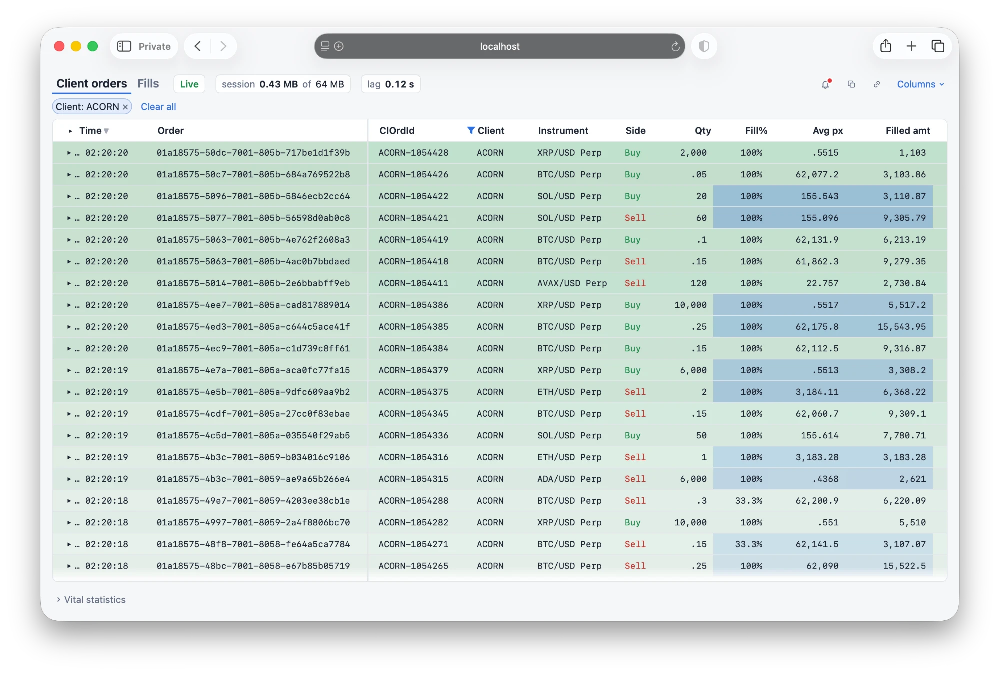
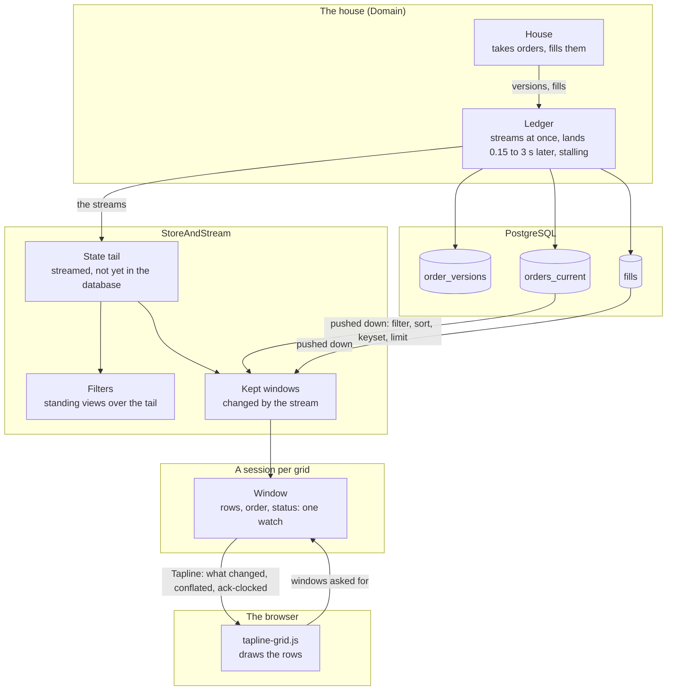
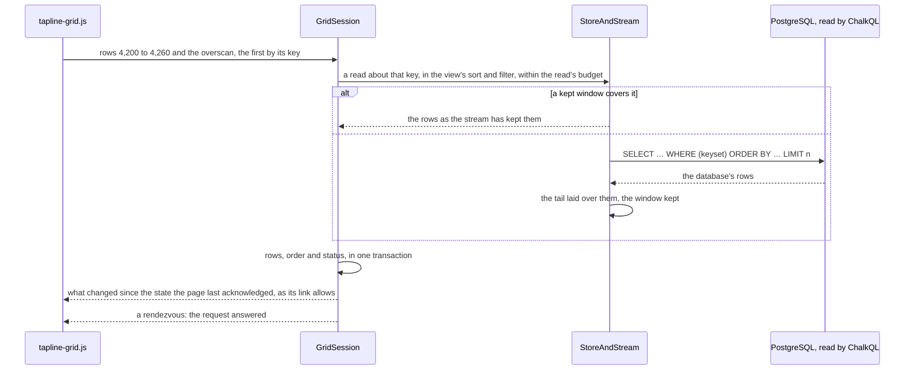

# LiveGrid.Sample — a streaming virtual blotter with alerts, bolted onto PostgreSQL

A trade blotter in Blazor over a million client orders and their fills in PostgreSQL, while the house keeps taking and
filling orders. Engineered for performance, this sample grafts the ChalkQL Blotter's market onto Tapline's `LiveGrid`.

Every tab scrolls through all its rows, sorts by any columns, filters on any column, opens an order's fills beneath it,
flashes what changed and drives alerts. The server maintains each reader's window, the rows in view and those either
side; Tapline carries it to the browser as binary rows, only what changed, conflated to what the reader's link can
carry; and the page draws the rows itself. Warm, a grid's session allocates nothing on an answer's way to the wire.

Its memory use is disciplined, and its footprint light. The provider keeps no copy of the corpus: only what the stream
has sent that the database hasn't landed, and the windows, filters and fills its readers hold, which the stream keeps
current, so the database is read for the rows a reader moves to, not again for every change. Each session's share is
counted against a budget of 64 MB, shown above the grid, and each read is held to a memory budget of its own and stopped
after 5 s.

```bash
dotnet run --project samples/LiveGrid.Sample
```

Then open `http://localhost:5970`. The sample starts its own PostgreSQL server, in a directory of its own, and deletes
it on stopping; the next run sweeps away any left by a killed one. See [Prerequisites](#prerequisites).

<p align="center">
  
</p>

| Option                                      | Default                                                  |                                                                                                                                                                                             |
|---------------------------------------------|----------------------------------------------------------|---------------------------------------------------------------------------------------------------------------------------------------------------------------------------------------------|
| `--store memory`                            | `postgres`                                               | where the orders are kept: PostgreSQL, or ChalkQL's tables in the process; `computed` keeps none, working each order out where it stands (client orders only: no fills, alerts or database) |
| `--postgres "Host=…;Username=…;Database=…"` |                                                          | use your own server: the sample makes schema `livegrid` there, refuses if it exists, and drops it on stopping                                                                               |
| `--pg-bin /path/to/postgresql/bin`          | found                                                    | the installation to start a server from                                                                                                                                                     |
| `--orders 5m`                               | `1m` (`5m` computed)                                     | the orders there at the start, spread over the five days before it, with their fills                                                                                                        |
| `--rate 400`                                | `200`                                                    | changes a second: new orders, fills and cancels                                                                                                                                             |
| `--burst-every 0`                           | `30`                                                     | seconds between bursts; `0` for none                                                                                                                                                        |
| `--burst-for 5`                             | `2`                                                      | seconds a burst lasts                                                                                                                                                                       |
| `--burst-factor 20`                         | `10`                                                     | a burst's rate, as a multiple of `--rate`                                                                                                                                                   |
| `--read-memory 64m`                         | `32m`                                                    | the most memory one of a grid's reads may take at the source (below); `computed` sorts a copy of the orders within it, so give it far more (`2g`)                                           |
| `--link-keys /path/to/folder`               | `LiveGrid.Sample/link-keys` under local application data | where the keys that shroud shared links live (below)                                                                                                                                        |
| `--urls http://localhost:5971`              | `http://localhost:5970`                                  | the sample has no authentication, and listens on this machine only unless told otherwise                                                                                                    |

## Prerequisites

- .NET 10 SDK.
- NuGet packages `ChalkQL` and `ChalkQL.Sources` 0.6.x.
- A Java 21 runtime for ChalkQL's planner, which ChalkQL starts itself.
- PostgreSQL 16 or later (`brew install postgresql@16`), found where it's usually installed or named by `--pg-bin`; or a
  server of your own (`--postgres`); or none (`--store memory`).

## Compared with the ChalkQL Blotter

The [ChalkQL QuickGrid Blotter](https://github.com/markhammond/chalkql/tree/main/dotnet/samples/Chalk.Sample.Blotter)
is this sample's twin: the same market and schema, the same tabs, filters, links, alerts and toggles, bolted onto the
same kind of database. It draws its grid with Blazor's QuickGrid, rendered on the server, and lists what holds QuickGrid
back over a live feed of millions of rows; its way forward, it says, is a virtual grid on Tapline. `LiveGrid`
(`Tapline.Grid.Blazor`) is that grid, and the Blotter's merge is a library here (`StoreAndStream`):

|                      | QuickGrid Blotter                                                                     | Tapline LiveGrid                                                                                 |
|----------------------|---------------------------------------------------------------------------------------|--------------------------------------------------------------------------------------------------|
| Bandwidth per update | **upwards of 250 KB** per refresh: Blazor render batches, structure and all           | **about 5 KB** an incremental update: binary rows, only what changed                             |
| Refresh latency      | **throttled**: one update in flight at a time, to bound Blazor queuing latency        | **as fast as the link allows**: conflated by Tapline's flow control, ack-clocked                 |
| Rows within reach    | **a view's first 500,000**: Chrome caps an element at 16,777,214 px                   | **every row**: past 8,000,000 px, the scroll surface is scaled                                   |
| Fetching ahead       | **as rows near the view**, after a 100 ms wait; one overscan for both sides           | **ahead by what the link carries**, both ways, further at the reader's pace                      |
| Database reads       | **a window re-read once its 4 s are up**, shared by readers of a tab, filter and sort | **read once, then kept current by the stream**; re-read after a minute, unless settled           |
| Memory               | **one budget for the host**, stepping from 8 MB to 64 MB, then refusing               | **64 MB a session**, and each read within a budget set for its reader                            |
| Scaling out          | **one process**: the host, its grids and every reader's circuit                       | **a path to clusters** of out-of-process providers, through Tappy (below); here, one process too |

### No pain, no gain

In exchange for a 50x improvement in bandwidth and latency, Tapline demands memory headroom; but readers of the same
subscription share it, and the Tappy protocol affords high scalability.

**Bandwidth.** The Blotter's minimum bandwidth is far greater: a refresh sends upwards of 250 KB of render batches,
where an incremental update of LiveGrid's weighs in at about 5 KB. For practical reasons, the Blotter's QuickGrid
refreshes are throttled, and limited to a single update in flight, to bound Blazor queuing latency; LiveGrid's are
*conflated* by Tapline's flow control instead, each reader sent the window as it stands whenever its link has room.

**Memory.** Each reader's grid has a session of its own on the server, and the provider keeps for it its kept
windows, its filter's standing views and its open orders' fills, within a budget of 64 MB a session; the Blotter's
host holds every reader's within one budget, of at most 64 MB. What a session holds is small and counted, as the chip
above the grid shows, but its budget is headroom a host plans for, reader by reader. Readers share what they can: the
provider's state tail and read arenas serve every session, and each alert's shape is evaluated once and sent, as one
Tapline value, to every page with a rule of that shape.

**Scale.** The Tappy protocol gives a straightforward migration path to massive scale: clusters of out-of-process
LiveGrid data providers. [Tappy](../../docs/provider.md) is the contract between Tapline's routers and the data
providers behind them, and nothing in it depends on sharing a process: a router reaches a provider over MagicOnion
(`Tapline.MagicOnion.Providers`), mirrors its topics, and fans them out, ack-clocked and conflated, to each reader. It
places each subscription by the instances' load, watches their health, and moves subscriptions, make before break, for
a drain, a blue/green deploy or a rebalance. A grid's window is already a Tapline watch, and each of its asks is
answered by a rendezvous, as a provider's mailboxes are; so readers of the same view, memory budget and size of view
could share one topic, streamed once from one provider to all of them.

### Under the hood

|           | QuickGrid Blotter                                            | Tapline LiveGrid                                                                                   |
|-----------|--------------------------------------------------------------|----------------------------------------------------------------------------------------------------|
| The grid  | QuickGrid's `Virtualize`, every row rendered on the server   | `LiveGrid`, its rows drawn on the page (`tapline-grid.js`), its cells written as .NET would        |
| The merge | the sample's own: its tail, live scopes, pages and positions | the library's (`StoreAndStream`, `Tapline.Grid.ChalkQL`), for any append-only store and its stream |
| Alerts    | a standing view per condition, shared by every rule with it  | the same views; each shape's firings one Tapline value, conflated to each rule's throttle          |

## What Tapline brings to the table

Tapline carries every grid and merges every source; ChalkQL states each filter once. What it does here that you would
otherwise write by hand:

- **A window kept by the server, streamed as state.** Each grid has a session on the server (`GridSession`) that keeps
  its window: the rows in view and either side, as a Tapline table, and their order, as a value, written together in
  one transaction per answer and read by the page through one watch, so the page never draws one answer's rows in
  another's order. A third member, the status (how many arrived above a held view, how many rows the link carries, why
  a read was refused), changes only when one of those does. Warm, an answer allocates nothing on the session's way to
  the wire.
- **Conflated to the reader's link.** Tapline's flow control clocks each client's frames by its acknowledgements: a
  reader on a slow link is sent the window as it stands when the link frees, never a queue of old ones, and a reader on
  a fast link isn't held back by it. Only what changed crosses: rows in or changed, and the keys of rows gone.
- **The live top without its keys.** Orders and fills have UUIDv7 ids, which rise as they're made, so newest first is
  greatest key first: at the live top of a view in that order, the order goes as its header alone, and the page sorts
  the rows by their keys itself.
- **An overscan the link can carry.** The session tells the page how many rows its link carries in a second, from the
  delivery rate Tapline measures (`GridOptions.OverscanFill`), and more while the reader rests and the link has room
  (`OverscanClimb`), up to the grid's own `OverscanCount` (150 rows either side). On a link slower than a view a second,
  the live top holds the view and a few rows below it.
- **Requests that don't wait on each other.** The page asks for windows as the reader scrolls, held to a least interval
  and a few answers outstanding, each answered by a rendezvous carrying its id, which settles every request before it.
  The server reads only the latest ask, cancelling a read under way only for a jump or a new sort or filter. A hold's
  first answer, the view and a view below, goes alone, and the rest once it has reached the page.
- **Holding still.** Scroll away from the top by any part of a row, and the grid holds its rows by key, wherever the
  live order moves them. Change the sort or a filter while held, and the new view is read about the row you were on, by
  its values, rather than from the top.
- **Each view an epoch.** A sort or filter is a new view, numbered: the page keeps the old view's rows until the new
  one's first rows come, greyed if they're late (after the lesser of 500 ms and two round trips), and the source is told
  once a view is done with (`IGridSource.Leave`), to let go of what it kept for it.
- **Passive out of sight.** Out of sight for 2 s, its browser tab hidden or the grid scrolled off the page, a grid is
  passive: its session reads nothing, and says only that the source has moved. Back in sight, it asks again, its rows
  greyed until the answer comes, or drawn as placeholders if the live top turned over meanwhile.
- **Flashes and lag from the rows' own times.** A row's arrival flash runs from its key's time (`ArrivedFromKey`), a
  changed cell's from its version's (`ChangedAt`), so pages side by side, or one reloaded, flash alike; the page's lag
  is measured from the same times, from a change being made to this browser drawing it.
- **Cells written on the page, as .NET writes them.** Columns take .NET format strings, as QuickGrid's do, applied by
  the page in the culture the grid renders in: the server never makes text, and the page's formatting is held to
  .NET's own output, in 27 cultures, by the tests.
- **Reads bounded, refusals saying why.** Each read is one statement bound by its `LIMIT`, stopped after 5 s (by
  ChalkQL, and by PostgreSQL's `statement_timeout`), within a memory budget the host sets for each reader
  (`GridOptions.MaxReadBytes`, `--read-memory`), counted as the source takes it, never estimated. A read past either is
  refused, the reason shown above the grid and its rows kept as they were.
- **A session's memory, accounted.** What the provider keeps for each grid's session (its kept windows, its filter's
  standing views, its open orders' fills) is counted against a budget of 64 MB a session; the chip above the grid shows
  it, and its tooltip the parts, and the provider's own, every session's.
- **Alerts shared by shape, conflated by throttle.** Rules alike in any browser (the same tab, condition and trigger)
  are evaluated once, their firings one Tapline value, and each page takes it no oftener than its rule's throttle
  (`Tap.MinInterval`), whatever fired meanwhile counted in (`Tapline.Alerts`).

To try a slow link, throttle the page's network in the browser's developer tools: the rows conflate, the overscan
shrinks to what the link carries, and the grid keeps its place.

## A streaming blotter as a bolt-on feature

The source is modelled on a conventional database, append-only, and a stream of its changes, merged as they're read.
The merge is Tapline's (`StoreAndStream`, in `Tapline.Grid.Provider`), and the database is read through ChalkQL
(`Tapline.Grid.ChalkQL`). Of the database it asks rows read from a key, sorted and filtered at source, the versions
since a stamp, and its newest stamp; of the stream, only that it's reliable and sends what is written after a reader
subscribes. It assumes:

- **Every change to an order is a new version**, numbered above the order's last and never changed once written; fills
  never change.
- **Nothing is deleted, and keys are never reused.**
- **Versions land out of order by no more than a haircut** (`AppendOnlyStorePolicy.Haircut`, 7 s here): one stamped
  that long before the database's newest is in it.

It doesn't assume a snapshot, a commit sequence on every row, that the stream and the database agree, or which of them
runs ahead. In exchange, the provider keeps:

- **A state tail**: one row a key, for what the stream sent that the database hasn't been seen to reach, forgotten once
  the database's newest stamp is a haircut past it. It's bounded (`MaxTailRows`): past it, the oldest go first, and the
  grids read again.
- **A merge**: each read is the database's rows with the tail laid over them, each order once, at the newest version
  either side knows. A filtered view keeps an order while its newest version passes or the database's row of it last
  did, as the Blotter's does, so a Partial view shows an order just filled until the database has it.
- **A gap fill**, for versions in flight as the stream was subscribed: once a haircut has passed, the database's
  versions from 30 s before the subscription, taken as if streamed.
- **Kept windows**: what a read brings from the database is kept, changed in place by everything the stream sends
  after, so the reads it covers ask the database nothing. A kept window is read again after a minute while it's read
  (`Refresh`), unless the store says its rows are settled (`IGridStore.SettledAsync`: here, every order in it filled or
  cancelled, and the database 10 s past them).
- **Continuous reconciliation**: at most once a second, and only while there are reads, the database's versions from a
  haircut before its newest are read again (`AppendOnlyStorePolicy.Recheck`). The merge learns as the database catches
  up with the stream (an order leaves a filtered view once the database has its newer version), and what the stream
  didn't carry is picked up: belt and braces should the two data sources drift apart.
- **Approximate counting**: a read that comes back short has found the end; past it, PostgreSQL's plan estimates a
  view's size (`EXPLAIN`, the filter's values written in), and a row's place is counted (in memory, both are counted).

## The domain model

> **Disclaimer:** Illustrative only.

Twelve clients trade the house's linear perpetuals on eight assets (`BTC/USD Perp` and seven others), in US dollars,
each in its region and through its channels, at its channel's markup. A **client order** is versioned: a fill or cancel
is a new version, numbered one higher, carrying its filled quantity, average fill price, filled amount and status. A
**fill** never changes, and carries its order's details (client, region, channel, instrument, side), so it can be
filtered without its order.

The **history** is the orders there at the start, a million over the five days before it, each worked out from its
number alone, the newest 2,000 left new for the house to work. The **house** then makes 200 changes a second: three in
ten are new orders, a quarter of those filled at once, and the rest fills and cancels of working orders; every 30 s, a
burst ten times as busy for 2 s.

Each version and fill is **streamed** at once, and **landed** in the database 150 ms to 3 s later by the ledger, a few
at a time, as ingestion jobs would, stalling for 3 s every 45 s; so the stream runs ahead of the database by varying
amounts, and versions land out of their order. **Out of order** (the page's toggle): of the rows each stream sends, 2 %
go late, after rows made after them, by a log-normal delay of about 400 ms, at most 10 s; and 1 % are written to the
database first, the stream sending them about 200 ms after. The alerts hear each row as the house writes it, either
way.

## The database

Three tables in schema `livegrid`, the Blotter's, `UNLOGGED`, text collated `"C"`:

- `order_versions`: every version of every order, keyed by order and version.
- `orders_current`: one row an order, at its newest version, indexed newest first, kept by upserts: a late, older
  version changes nothing. The client orders tab reads this.
- `fills`: every fill, keyed by fill, indexed by order and newest first.

The history is written by binary `COPY`, a table to a connection side by side, each order as it's made from its number,
before the keys and indexes are built.

## What you see

**The grid**

- **Two tabs**, client orders and fills, each with its own sort, filters, columns and place. The tab out of sight reads
  nothing, its session stopped, and comes back about where it was held.
- **Fills nested under orders.** An order's chevron opens its fills beneath it, as rows of the one list (→ and ← on the
  focused order); the Time heading's chevron, or `*`, opens every order's. They're read from the database with those the
  ledger hasn't landed yet, and kept as fills arrive.
- **An order, described.** Click an order's id (its ↗ shows on hover), or press Enter on its row, for a line above the
  grid describing it.
- **Time first, and frozen.** Each tab leads with its time, when the order was placed or filled, then its id; both stay
  put as the grid scrolls sideways. Times show as `… 02:20:20`; hover for the instant.
- **Columns**, above the grid, shows or hides any column; Ver, Region, Channel and Filled start hidden.
- **Numbers as the Blotter writes them:** quantities and prices to six significant figures, amounts grouped, a dash for
  nought; hover, or copy, for a value whole. Fill % is worked out on the page from the row: shown, never sorted or
  filtered by.
- **Flashes.** A new row flashes whole, and a changed cell on its own, each from the change's own time.
- **Selection.** Click a row to select it, with ⌘ or Ctrl to add it; rows stay selected, by key, as they scroll away and
  back.

**Sorting and filtering**

- **Any columns.** Click a heading to sort descending, again for ascending, and again to go back to the tab's own order,
  newest first, which Time shows with a muted arrow. Shift-click to do the same within a sort by several columns.
- **A filter on every column.** The funnel by a heading filters its column; filters show as pills above the grid.
    - Ids: typed or pasted; matched exactly.
    - Text (ClOrdId, client, instrument): picked from the column's most frequent values over the period of interest, or
      typed; matched exactly, or by what they start with.
    - Region, channel, side, status: ticked. Numbers: at least, at most. Times: from, to (UTC).
- **Stated once, in SQL.** A filter is one SQL condition, its values bound: ChalkQL pushes it into PostgreSQL for the
  database's pages, and keeps it over the tail as two standing views, maintained incrementally.
- **Your place kept.** Change the sort or a filter while held, and the grid stays where you were: about the first row
  in view, where it sorts in the new view, whether it passes or not. At the live top, it stays live.
- **A time limit, and a budget.** A read past 5 s or past its memory budget is refused; the page says why above the
  grid and keeps its rows as they were.

**Live**

- **New rows push down at the top.** Scroll away and the rows in view stay put, while the "N new above" pill counts the
  arrivals you haven't seen. Scroll back up near the top to let them in above the rows in view, 30 at a time; with
  fewer than a view's worth unseen, the top, or a fast scroll up, follows the live top again, as the pill and Home do at
  once.
- **Above the grid**: whether the house is live; what the provider keeps for this page's grid against its session's
  64 MB (hover for the parts); and the page's lag, from a change being made to this browser drawing it, the worst in the
  last second (on the fills tab, each fill's). Each figure changes once it has moved by 5 %.
- **Vital statistics**, below the grid and closed at first: the feed (changes a second, the versions and fills sent,
  and, out of order, those sent late and after the database), the database (writing or stalled, how far behind, how
  much pending) and the host (its working set and managed heap). Closed, none of it is read.
- **Simulate burst** has the house take and work 3,000 orders at once; **Stall database 20 s** stops the database's
  writes while the streams go on; **Out of order** puts the streams out of order (above); **Outage** stops the house,
  so nothing new arrives. They show while the pointer is on the page.

**Copy and share**

- **Copy** (⧉) puts the rows in view on the clipboard under the headings shown, as tab-separated text, which a
  spreadsheet takes as cells, and as a table; each value whole (a number's every digit, a time's instant) where its cell
  may round it. With the grid focused, the browser's own copy gives the selected rows, or else the focused one.
- **Share** (the link icon) copies a link that opens the same view: its tab, sort, filters and hidden columns, and,
  away from the live top, the row it's held at, by its key, wherever the sort puts it then. Nothing is stored for a
  link; one that can't be opened opens the page as usual, saying why. For example:
  `/?tab=fills&sort=-client,qty&hide=region,channel&f.client=CEDAR&f.client=FERN&f.qty.min=44&at=…`.
- **Private or readable.** A private link shows none of the view's data: the filters' values and the row held at go in
  one opaque `s=`, encrypted and signed with ASP.NET Data Protection, while the tab, sort and hidden columns stay
  readable. The keys live in a folder (`--link-keys`, not encrypted at rest), so links open after a restart; they rotate
  every 90 days, the old ones kept to open what they shrouded.

**Alerts**

- **A condition in SQL, with a sound.** The bell opens the alerts: each a condition on a tab's rows, kept in this
  browser, with one of 22 short recordings and a throttle. A new one starts from the tab's filters, written as SQL
  (`client = 'CEDAR' AND qty >= 10`); each can be tried, muted or removed. A fill's condition can read its order along a
  path: `order.status = 'Partial'`.
- **An editor that knows the tab.** The condition is written in CodeMirror 6 (`wwwroot/condition-editor.js`, the
  Blotter's bundle). The server completes it (columns and paths, operators, values) and checks it, the names itself and
  the rest by asking ChalkQL to prepare it.
- **Three triggers**, as the Blotter's: a row coming to pass the condition; a passing row waiting longer than so long
  for the database; or the rows passing it in a sliding window coming to be enough, or none. Stall the database to hear
  a wait, and turn on Outage to hear a count of none.
- **Each shape evaluated once.** `StandingAlerts` keeps each distinct condition as ChalkQL standing views over what the
  ledger hears and lands. The alert desk (`Tapline.Alerts`) publishes each shape's firings as one value, shared by every
  page with a rule of that shape, each page taking it no oftener than its rule's throttle and counting in what fired
  meanwhile.
- **None missed.** What fired while none of this browser's pages was open is said in a line on the next one opened,
  within 10 minutes.
- **Sound, and unseen alerts.** Browsers allow sound only after a click, so with alerts set to sound the page opens
  asking for one. Unseen alerts show as a red dot on the bell; tick "Notify in the background" for system
  notifications. Held, the "N new above" pill shows a bell once an alert has fired on the tab.

## The code

| Folder       |                                                                                                                                                                                                                                                                                                                                       |
|--------------|---------------------------------------------------------------------------------------------------------------------------------------------------------------------------------------------------------------------------------------------------------------------------------------------------------------------------------------|
| `Domain`     | all that knows orders and fills: the rows (`OrderRow`, `FillRow`) and the database's records, the reference data, the history, the house and its ledger, the sources (`StoreOrders`, `StoreFills`, `PgOrders`; `Orders`, computed), the tabs (`Tabs`), the alerts' evaluator (`StandingAlerts`) and each tab's grid (`TabGrid.razor`) |
| (the root)   | what any tab needs, knowing the rows only by the catalog: `Catalog` (tabs, columns, paths), `Filters`, `ViewLink` and `LinkShroud`, `InlineText`, `Times`, `Figures`, `Listening` and `Sources`                                                                                                                                       |
| `Alerts`     | alert conditions in SQL over a tab's columns and paths, and their completion                                                                                                                                                                                                                                                          |
| `Components` | the page (`Home`), its chips, filter editor, alerts and vital statistics                                                                                                                                                                                                                                                              |
| `Postgres`   | the sample's own PostgreSQL server (`PgServer`)                                                                                                                                                                                                                                                                                       |
| `wwwroot`    | the page's script and styles, the alerts' glue, the condition editor's bundle and the sounds                                                                                                                                                                                                                                          |
| `editor`     | the condition editor's source, built with esbuild (it needs Node; the bundle is committed)                                                                                                                                                                                                                                            |

Outside `Domain`, the page knows the rows only by the catalog; `Program.cs` alone puts the two together.

The library's projects, in the `Tapline` package but the last:

| Project                 |                                                                                                                                                                                                                                                  |
|-------------------------|--------------------------------------------------------------------------------------------------------------------------------------------------------------------------------------------------------------------------------------------------|
| `Tapline.Grid.Provider` | the source's contract (`IGridSource`, `GridView`, `GridPage`, `GridAnswer`), and an append-only store merged with a stream (`StoreAndStream`: `IGridStore`, `IGridStream`, `IGridRows`, `IGridScopes`, `AppendOnlyStorePolicy`); no ASP.NET Core |
| `Tapline.Grid`          | the session: a grid's window for one client (`GridSession`, `GridWindow`), its order and status, its bounds and cadences (`GridOptions`); no ASP.NET Core                                                                                        |
| `Tapline.Grid.Blazor`   | the component (`LiveGrid`, `LiveColumn`, `LiveColumnChooser`), its formats, and the page's module and styles (`tapline-grid.js`, `tapline-grid.css`)                                                                                             |
| `Tapline.Alerts`        | alerts over any source, knowing nothing of grids: rules, shapes, the desk and each audience's inbox (`AlertDesk`), and the page's `tapline-alerts.js`                                                                                            |
| `Tapline.Grid.ChalkQL`  | a package of its own: the store's pages as ChalkQL statements (`ChalkStore`), filters as standing views over the tail (`ChalkScopes`), the tail's tables (`ChalkTail`), and arenas for the reads' budgets (`ChalkArenas`)                        |

**Another database.** ChalkQL's ADO.NET source reads any database with an ADO.NET provider (this sample picks Npgsql),
and `PgOrders` is where PostgreSQL is spoken directly: its tables, loading, landing and estimates. A store without
ChalkQL implements `IGridStore`, and its filters `IGridScopes`, itself.

## How it works

The house streams to the provider at once and lands in PostgreSQL late; the provider reads PostgreSQL as readers move,
lays its tail over what it reads and keeps it; each grid's session writes its window, and Tapline carries each window to
its page as that page's link allows.



A window, as the page asks for it:



**A window's life.** The page asks for rows by position, naming the row at the view's first position by its key, with
the overscan either side. The session plans the read (the live top, a hold on that key, a jump), reads it from the
source, and writes the answer to its watch. Between asks, it reads the source's changes again: at the live top at most
every 100 ms (`GridOptions.LiveEvery`), held every 500 ms (`HeldEvery`), passive not at all. A held window counts what
arrives above it, which the status carries, and lets rows in only as the reader scrolls up to them.

**What crosses the wire.** A row is the source's own unmanaged struct (`OrderRow`, `FillRow`), its text inline (UTF-8,
in fields of 24 or 16 bytes), sent as a fixed-width record that the page reads field by field where it lies, as
`LiveGrid` describes its columns. A row gone is its key alone, and a row a client never had is never deleted to it. The
order is the window's keys, in order, or, at the live top of a view ordered by its keys, its header alone; the status
is a small value of its own. So a held grid at rest, nothing in view changing, sends only its count of what arrived
above.

**The source's changes, whole.** The stream's batches are staged in the tail, evaluated by every view's filter (the
ChalkQL standing views), and published together, so every view sees a whole tail, never one ahead of another; a read
waits for what was sent before it.

**On a slow link.** The window conflates to its latest; the overscan shrinks to what the link carries in a second and
grows back while the reader rests; a hold's first answer, the view and a view below, goes before the rest; and the
circuit pings every 3 s (`startBlazor`), so a link full of rows isn't taken for a lost one.

## What correct means here

Each order shows once, at the newest version the provider knows of, sent by the stream since subscription or read from
the database. No order is missing or shown twice, and rows are in order.

- **The session** (`tests/Tapline.Tests`) keeps a window against an oracle worked out apart from the source: seeds of
  random scrolling, jumps, arrivals, updates, deletes, sorts of up to three columns and filters of up to two. Every
  window is a run of the view's order at its ranks, the rows each as the source has them; held still, every window is
  the oracle's exactly.
- **The store and stream** (`StoreAndStream`, same project) are held to the truth worked out apart: versions streamed
  in order and landed out of order within the haircut, the database behind, ahead and stalled; every page exactly what
  the source can know, in order, no key twice; quiet, every page the truth's.
- **Over ChalkQL** (`tests/Tapline.Grid.ChalkQL.Tests`, in a project of its own, as it starts the planner): the same,
  with the filters as SQL, and every refusal saying why.
- **The page's module** (`tests/js`, in Node): scrolling scaled past the browser's height cap, requests, the order
  value, and cells as .NET writes them, held to .NET's own output.

```bash
dotnet run --project tests/Tapline.Tests
```

```bash
node tests/js/test.mjs
```

```bash
dotnet run --project tests/Tapline.Grid.ChalkQL.Tests
```

`TAPLINE_TEST=Grid` runs only the grid's; the Node tests read fixtures the C# run writes.
[tests/README.md](../../tests/README.md) says what each test covers.

## Not here, yet

- **Entitlements.** Everyone is served everything, and the sample has no authentication. ChalkQL's policy layer would
  scope rows and columns to each reader, planned into every statement and standing view.
- **Providers out of process, and one view for many readers.** Each reader's grid has a session, and kept state, of its
  own, in the web server; the way to clusters of LiveGrid data providers, and to one topic for a view's readers, is
  Tappy's ([Scale](#compared-with-the-chalkql-blotter), above).
- **Watermarks per producer.** The haircut is the store's, one for all; a store fed by several producers would judge
  each one's liveness, and lag, apart.
- **Tabs defined in SQL.** Outside `Domain`, the page knows the rows only by the catalog: a step towards tabs a host
  defines in SQL rather than in code.
- **Exact places with every order open.** Then the window counts only the runs it has read, so the scroll bar settles
  as the reader goes.
- **Free-text search.**
