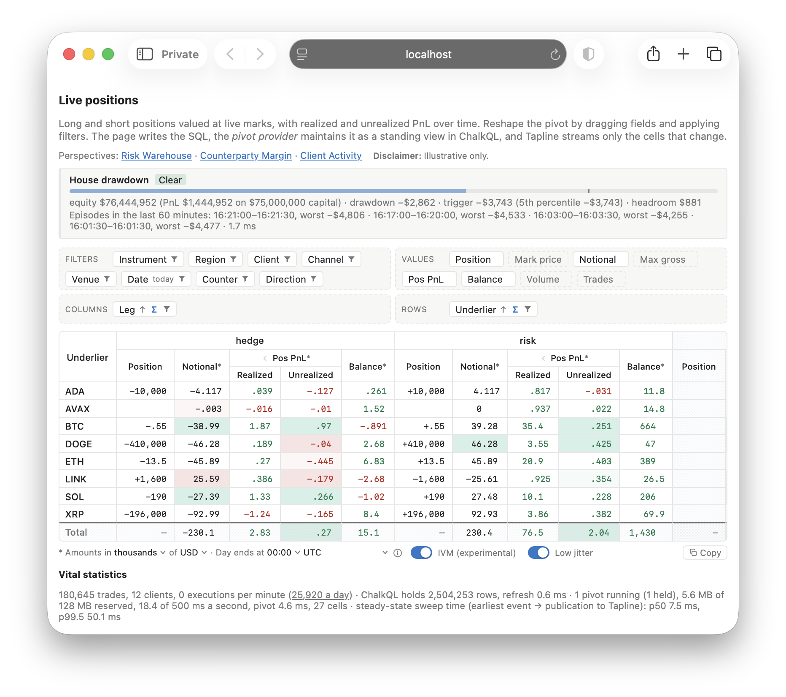

# PivotTable.Sample — a live position viewer, streamed

A treasure trove of simulated trades and market activity reflecting a brokerage's book: clients trade linear
perpetuals against the house, netting risk with any residual exhaust hitting external venues. The pivot is the house's
risk and hedges, by client and region, channel, instrument and venue, over time, valued at the marks, with realized
and unrealized PnL.

```bash
dotnet run --project samples/PivotTable.Sample
```

Then open `http://localhost:5900`. The router's ops viewer is on its own port, `http://localhost:5901/ops/realtime`,
on this machine only.

<p align="center">
  
</p>

## Friends don't let friends build data warehouses

Live pivots straight off the book: no extracts, no nightly loads, no stale cubes. Just SQL, kept current, streamed.

- **A coherent, consistent stream of a pivot whose dimensions and criteria change live.** Lay it out (rows nested,
  columns grouped, filters, the values shown) and it streams: each answer is posted whole, as one version, so the grid
  never shows half an update, and the router sends only the cells that changed, checksummed end to end. Change the
  layout and the new grid replaces the old one whole, never an empty one in between.
- **Idiomatic SQL, its rollups maintained incrementally.** The page writes the SQL (or you do), every level of totals a
  `GROUP BY ROLLUP`. ChalkQL keeps it as a standing view, maintained incrementally: an update works from what changed,
  totals included, not from the whole ledger.
- **Knowing precisely when a change has taken effect.** Each answer carries its stamp: the engine's version it was
  computed at. Reconfigure the pivot and its first answer is where the change took effect, nothing older following it:
  the page swaps in the new layout once that answer is in front of it, by a rendezvous. A change to the data answers
  with the stamp it took effect at, and a client can wait for the first answer that includes it, not poll or guess
  ([The page](#the-page), [A headless client](#a-headless-client)).
- **Self-describing, for any client.** Each pivot's cells come with their shape: the statement's columns and types,
  each cell field by field. The headless .NET client reads the stream by that alone, nothing compiled in: give it a
  page's address and it streams the pivot the page shows ([A headless client](#a-headless-client)).
- **Playing nicely with others.** Pages asking alike share one pivot: one topic, one query a run. Each new pivot is
  admitted against the provider's memory budget, or refused, saying why, with one correlation id in the provider's
  log, the router's and the page's ([How it works](#how-it-works)).

To try a slow link, add `?bwlimit=1` (KiB/s, read as rsync's `--bwlimit`), which caps that page's stream: the cells
conflate, each arriving as its latest when the link allows. To try a busier brokerage, add `?trades=10M` (client trades
a day: 25,920 by default, up to 100M), which sets the pace for every page, from then on.

The same pivots stream to .NET clients over MagicOnion (gRPC) on a third port, `5902`: see
[A headless client](#a-headless-client).

## Prerequisites

- .NET 10 SDK.
- NuGet packages `ChalkQL` and `ChalkQL.Sources` 0.6.x.
- A Java 21 runtime for ChalkQL's planner, which ChalkQL starts itself.

## How it works

- **The fields become SQL** (`PivotCriteria.ToSql`): the same layout always writes the same text. A filter's values are
  bound, a list named for its field (`logical_name IN @instrument`), not written in, so a layout is one prepared query
  whatever's kept. ChalkQL is the sandbox: a statement only reads, and only the brokerage's tables. Its `WITH` block is
  the house's book, a row for each position on each day asked for, as of the day's close, in two legs (abridged: the
  hedge leg's figures are written the same way):

  ```sql
  WITH days AS (SELECT * FROM trading_days('America/New_York', 17) WHERE days_ago < 1),
  instruments AS (SELECT instrument_id, logical_name, venue, underlying, quote FROM instrument),   -- filtered: … WHERE logical_name IN @instrument
  p AS (
    SELECT d.trading_day, CAST('risk' AS VARCHAR(32)) AS leg, i.logical_name AS instrument, i.underlying, x.region,
           x.cpty_name AS client, k.channel, CAST('House' AS VARCHAR(32)) AS venue, i.quote AS counter_symbol,
           CASE WHEN c.amt_signed < 0 THEN 'long' WHEN c.amt_signed > 0 THEN 'short' ELSE 'flat' END AS direction,
           -c.amt_signed AS qty,
           -c.amt_signed * m.price * q.usd_rate AS notional,
           -(c.cumulative_realized_pnl - COALESCE(o.cumulative_realized_pnl, 0)) * q.usd_rate AS realized,
           -c.amt_signed * (m.price - c.avg_prc) * q.usd_rate AS unrealized,
           -c.cumulative_realized_pnl * q.usd_rate AS balance,
           c.cumulative_volume - COALESCE(o.cumulative_volume, 0) AS volume,
           c.trade_count - COALESCE(o.trade_count, 0) AS trades
    FROM days d
    CROSS JOIN (SELECT account_id, channel FROM position_risk WHERE cpty_id <> 1 GROUP BY account_id, channel) k   -- the clients'
    ASOF JOIN position_risk c
      MATCH_CONDITION c.update_time <= d.closes
      ON c.account_id = k.account_id AND c.channel = k.channel
    LEFT ASOF JOIN position_risk o
      MATCH_CONDITION o.update_time < d.opens
      ON o.account_id = k.account_id AND o.channel = k.channel
    ASOF JOIN marks m
      MATCH_CONDITION m.ts <= d.closes ON m.instrument_id = c.instrument_id
    JOIN instruments i ON i.instrument_id = c.instrument_id
    JOIN cpty x ON x.cpty_id = c.cpty_id
    ASOF JOIN conversion_rate q
      MATCH_CONDITION q.ts <= d.closes ON q.symbol = i.quote
    WHERE NOT (c.amt_signed = 0 AND c.cumulative_realized_pnl = 0 AND c.trade_count = COALESCE(o.trade_count, 0))
    UNION ALL
    SELECT d.trading_day, CAST('hedge' AS VARCHAR(32)) AS leg, i.logical_name AS instrument, i.underlying,
           CAST('—' AS VARCHAR(32)) AS region, CAST('House' AS VARCHAR(32)) AS client,
           CAST('—' AS VARCHAR(32)) AS channel, i.venue,
           i.quote AS counter_symbol,
           …
    FROM … CROSS JOIN (SELECT account_id, channel, instrument_id FROM position_risk
                       WHERE cpty_id = 1 AND instrument_id IN (SELECT instrument_id FROM instruments WHERE venue <> 'House')
                       GROUP BY account_id, channel, instrument_id) k                                  -- the house's hedges
    ASOF JOIN position_risk h …  LEFT ASOF JOIN position_risk o …  ASOF JOIN marks m …
    JOIN instruments i …  ASOF JOIN conversion_rate q …
  )
  SELECT CASE WHEN GROUPING(instrument) = 1 THEN '' ELSE instrument END AS row_key,
         CASE WHEN GROUPING(leg) = 1 THEN '' ELSE leg END AS column_key,
         CASE WHEN MIN(underlying) = MAX(underlying) THEN SUM(qty) END AS quantity, SUM(notional) AS notional,
         SUM(realized) AS realized_pnl, SUM(unrealized) AS unrealized_pnl, SUM(balance) AS balance,
         SUM(volume) AS volume, SUM(trades) AS trades
  FROM p
  GROUP BY ROLLUP(instrument), ROLLUP(leg)                  -- every level of totals, in one pass
  ```

- **Trading days** come from `trading_days(zone, cutoff_hour)`, a SQL-bodied table function the provider registers
  (`PivotCriteria.TradingDaysSql`): a zone's last ten trading days, each named by the date it ends on, its open and
  close in UTC across daylight-saving changes, the current one closing now. A statement keeps the last n (`days_ago <
  5`), so it, and its topic, stay the same as days roll; or a range of dates.
- **A day's figures,** the house's side: the risk leg is the opposite of each client's position, so an instrument's
  total across the legs is what the house holds net in it. A day's position is its last row at or before the close
  (`c`). Its realized PnL, volume and trades are the running totals then, less those before the open (`o`). Its
  unrealized PnL is its quantity times the mark at the close (`m`), less its average entry; its balance, its realized
  PnL so far, the cash it's paid. Every amount is converted through the US dollar at the close, by its quote's rate
  (`q`) and the reporting currency's.
- **Totals, in the statement:** `GROUP BY ROLLUP` of the rows by `ROLLUP` of the columns, or, where a field's Σ is off,
  the `GROUPING SETS` that leaves. The statement says which totals there are, and the grid shows what it returns, a
  total's labels from `GROUPING()`. A figure that wouldn't add up (units across assets, a position across days) is null.
- **Max gross, a measure of margin utilisation:** in a cell, each client's positions netted by instrument, their long
  and short notional summed apart, the larger side kept, and that summed over the clients. It isn't a sum of the book's
  rows, so `ROLLUP` can't make it, and the statement groups the book a level at a time instead. It costs more, so the
  page asks for it only when it's shown.
- **Mark price, a rate:** the instrument's mark at the close, in its quote per unit of its asset, so not converted,
  scaled or summed. A cell averages each listing's mark once a day, and shows one only within a logical instrument ("—"
  across them). Off by default.
- **Step 1 carries the statement:** the page subscribes through the `pivot` service, with the statement and the lists
  it binds as the parameter (`{"sql": …, "bindings": {"instrument": ["BTC/USD Perp"]}}`). The provider (`PivotProvider`)
  prepares it with ChalkQL and checks it answers a pivot: one row a cell, totals included, `row_key` and `column_key` as
  text and the figures as numbers, null where they don't add up. Each figure goes into its cell as a fixed-point
  integer, to eight places (volume to two), so every row is one size and its checksum the same wherever it's computed.
- **Pages asking alike share a pivot:** one topic, and one query a run, for every page with the same layout and values.
- **Budgets, not a count:** a pivot's memory (its ChalkQL arena, its ingest's staging and its cells at the router) counts
  against the provider's budget, 128 MB by default (`Pivot:MemoryBudgetMB`). A run that needs more arena gets it while
  there's room, idle pivots let go to make it. A new pivot is admitted if it fits, and refused, with the figures, if it
  doesn't, or while the pivots already take more than half of each second. A pivot nobody watches stops, and is let go
  after a minute.
- **Refused, saying why:** whatever the provider can't serve (a ChalkQL error, a statement that doesn't answer a pivot,
  no room) it refuses with a reason, `request.Refuse(reason)`. The correlation id `Refuse` returns appears in the
  provider's log, the router's, the page's console and on the page beside the reason: search any for it to find the
  others.
- **Standing views, their changes posted:** each pivot is a ChalkQL standing view (`Chalk.Incremental`), recomputed, or
  maintained incrementally when the page asks, as it does by default. It runs again whenever what it reads has changed,
  once a backoff as long as its last run is over, so a pivot takes at most half a core and a heavy one backs off by
  itself. A run posts the view's changes since the pivot's cursor (`Post`, folded by `ReplaceOrDelete`), or after a
  reset the whole answer (`PostSnapshot`), each with the view's version and checksum.
- **Maintained incrementally (experimental, `CHALK003`):** a view runs its plan on what changed since its last update,
  keeping state between updates. A statement ChalkQL can't maintain is refused when its view is made, and that pivot is
  recomputed instead, the log saying why. It wins where an update touches a few cells, as at markets' volatility; where
  every cell moves with the marks, recomputing is faster. `Pivot:Validate=true` checks each update against the statement
  run in full at the same epoch.
- **A clock cell in every answer:** each post carries one more cell (`\u0001clock`), with the answer's watermark (the
  earliest change it answers) and its emission. It's in the same post, and the same checksum, as the cells it describes.
  The page's vital statistics, under the grid, show from it the steady-state sweep time: from the earliest event an
  answer covers to its publication to Tapline. A pivot's first answer carries none.
- **The router works out the difference:** it applies the newest snapshot, or the changes, against the table it holds,
  superseding any snapshot it hadn't got to. Only cells whose bytes changed, went away or are new become changes, and
  each page is sent those, conflated to what its connection carries.
- **Integrity:** the router checks its table against the provider's checksum after each update; a mismatch faults the
  table until the next snapshot. Each record it sends carries the checksum, and the page checks its copy against it,
  resyncing on a mismatch.
- **A statement that fails while running:** the provider fails the topic with the reason. Its pages keep the last
  state, marked, and the reason. The next answer recovers it, and the page subscribes again.
- **The grid** (`wwwroot/pivot.js`) decodes each cell's labels and nine fixed-point figures, builds the row and column
  trees, and draws what's expanded. Figures are rounded by what they're worth in US dollars, in one unit chosen under the
  grid (thousands by default); hovering shows a figure precisely, and a copy keeps every digit.
- **The router's viewer:** the cells' `PayloadFormat`, made of the pivot's shape and given in step 1, shows each
  cell's labels as text and its figures to eight places (volume to two).

## The page

- **The drawdown gauge,** above the fields: the house's equity and drawdown, the trigger, how close it is, and an alert
  (see [Drawdown gauge](#drawdown-gauge)).
- **Fields in four areas:** Filters, Columns and Rows hold the dimensions (leg, underlier, instrument, region, client,
  channel, venue, counter, date and direction), and Values the figures. Drag a field between the areas or along one:
  rows take one to three levels, columns up to two. Each field and value has a tooltip saying what it is.
- **Each field:** its arrow sorts it, by its labels or by up to three values, as a spreadsheet pivot's "sort by" does;
  its funnel filters it (Date's chooses the last n trading days, or a range of dates); its Σ shows or hides the totals
  across it. A hidden total isn't computed: its `GROUP BY` leaves the statement.
- **Each value:** shown or hidden, in every column or in one (its ⚙), and shown as itself, as a percentage (of its row,
  column or grand total, of the market or of what's shown), or, for Volume and Trades, as a running total in Date. The
  provider computes each form, so every client of the pivot reads the same figure.
- **The grid:** rows and columns nested in groups, each collapsing to its total, the grand total's row and column first
  or last, pinned as the grid scrolls. Under each column: Position, Mark price, Notional, Max gross, Pos PnL (realized
  and unrealized), Balance, Volume and Trades. Totals come from the statement, never summed by the page: a figure that
  doesn't add up across what a total spans shows "—".
- **Copy** puts the grid on the clipboard for a spreadsheet, as laid out, its figures precise.
- **The note under the grid is the setting:** the unit amounts are shown in, the reporting currency (any G10 currency),
  and when the trading day ends (a cutoff on the hour, in a time zone: 17:00 in New York, say).
- **Requested pivot query details:** the SQL the fields make and the values it binds, which you can edit and apply, and
  the plan ChalkQL prepared for it.
- **IVM (experimental)** and **Low jitter,** switches under the grid, both on by default: the pivot maintained
  incrementally rather than recomputed (above), and a new plan built beside the old one and swapped in at an update, so
  no update computes the view from nothing.
- **A link to the layout:** the address follows the layout, so a copy of it opens the same pivot, its fields, values,
  filters, days, sort, totals and currency included (`?rows=client&columns=leg&values=notional&days=5`, say).
- **Perspectives,** links to layouts to start from: **Risk Warehouse** (the house's open delta by underlier and
  instrument, net of its hedges), **Counterparty Margin** (max gross by client) and **Client Activity** (each region's
  and client's share of dealt volume, day by day).

Sorting, collapsing and the values shown are the page's alone. A change to the fields, filters, currency or maintenance
is a new subscription, swapped in without a gap:

- **Before the page subscribes,** the grid makes a correlation id and starts awaiting its rendezvous
  (`tapline.rendezvous`), so nothing can come first. The pivot shown keeps streaming, dimmed.
- **The provider hands the id back** once the new pivot's first answer is applied (`ingest.TryRendezvous`), after what
  it has posted.
- **Meanwhile the new subscription fills off-screen.** The rendezvous arrives after that answer, so the page swaps in a
  whole grid, never an empty one, and only then lets the old subscription go.
- **Refused or failing,** the pivot shown stays, and the reason is said. With no rendezvous within 5 seconds of the new
  pivot's first answer, it's shown anyway.

## Domain Model

> **Disclaimer:** Illustrative only.

Simulated: twelve clients trade the house's USD-priced perpetuals on five channels, paying a markup, in bursts of a few
assets at once, booked to a double-entry ledger (`cpty`, `account`, `ccy`, `posting`, `journal`, `position_risk`). The
house hedges its net risk with venue perpetuals (`fills`), each fill booked too.

- **Positions:** `position_risk` holds every position after each entry: a client's (by account and channel), the
  house's side of its clients' trades (one in each of its perpetuals, at its own average entry), and its hedges (one in
  each venue's perpetual it's traded).
- **Cash:** a client's realized PnL is paid to its US-dollar account, from the house's; a hedge's, less its fee, to the
  house's cash at its venue, in USDT, USDC or US dollars. The house's working capital comes from its treasury as the
  books open: $25M to its bank account, 5M to each of its venue accounts.
- **Instruments:** each perpetual is one, the house's own and each venue's in each dollar it quotes, named as its venue
  lists it (`BTC/USDT Perp @ Binance`) and by its logical instrument (`BTC/USDT Perp`, the same on every venue).
- **Marks** (`marks`) are each venue's: the asset's index plus the perpetual's premium there. The house marks its own at
  the index.
- **Hedging:** the hedger hedges each asset, not the clients' instrument, routing to the best venue after basis and
  fees. So it holds logical instruments its clients don't trade, and what basis it holds stays in the PnL.
- **The pace:** marks and rates tick every 250 ms, at markets' volatility (about 3% a day for the assets, 0.5% for G10
  currencies), or a demo's (`Pivot:Volatility=Demo`, about 2% an hour). A mark or rate reaches ChalkQL once it's moved
  1 bp (`Pivot:DeadbandBps`) or is 60 s old (`Pivot:Heartbeat`). The last seven days' history is primed at the chosen
  pace (`Pivot:TradesPerDay`, or a page's `?trades`), and ChalkQL's tables are compacted every 30 s
  (`Pivot:CompactEvery`), each position, mark and rate kept by its last row in each half minute.

## Drawdown gauge

Above the fields, a panel: the house's drawdown, live, and an alert when it runs deep.

- **The house's equity** is its cash, at each currency's rate, plus what its open positions would settle for at the
  marks: its side of its clients' positions, and its hedges. Its PnL is that less the working capital its treasury
  transferred.
- **Its drawdown** at a point is its equity less its high over the hour before, the points every half minute, and now.
- **The trigger** is the 5th percentile of the last seven days' drawdowns, less a haircut (`Pivot:DrawdownHaircutUsd`,
  in US dollars; none by default). Below it, the house is **breached**; breached five minutes on end, it's an **alert**.
- **The panel** shows the state, a meter (the drawdown as a fraction of the trigger), the equity, its PnL and capital,
  the drawdown, the trigger, the headroom left, and the last hour's episodes.
- **Two statements compute it** (`Drawdown.cs`), off the provider's loop, and only while someone watches the panel: the
  threshold, a query run every minute (`Pivot:DrawdownThresholdEvery`); and the live points, a standing view kept
  incrementally and rebound when the threshold moves. Should ChalkQL refuse to keep it incrementally, it's recomputed
  (or always, with `Pivot:DrawdownIncremental=false`). With `Pivot:Validate`, a recomputed twin is kept beside it and
  compared.

## A headless client

`samples/PivotTable.Headless` is a console client of the pivot: Tapline.Client over MagicOnion, through the app's
`IPivotService` (`PivotTable.Contracts`). Run with nothing, it needs nothing running: with no router named
(`--stream`), it spawns the app on ports the system picks, and stops it when it's done.

```bash
dotnet run --project samples/PivotTable.Headless
```

Through `IPivotService` it gets:

1. **The statement:** the one a page's address asks for (paste one from the browser's address bar), or one of your own
   from a file (`--statement`, its lists bound with `--bind`).
2. **Its shape** (`PivotShape`): what its pivot would stream, without subscribing, or why it can't be a pivot.
3. **Its step 1,** on the client's session; its stream then carries it.

**The shape is all the client knows of the cells:** the statement's columns and their types, and each cell's key and
row, field by field (labels as zero-padded UTF-8, figures as little-endian fixed-point `int64`s with their scale and
unit). The client reads the stream by it, with nothing of the cells compiled in.

**Tokens: where a change took effect.** ChalkQL numbers its engine's versions, one a refresh, and each answer's clock
cell carries its stamp, so a client knows where each answer stands. A token is (shard, version, generation), the shard
naming the engine that numbered it:

- **A change answers where it took effect:** `SetTradesPerDayAsync` (the pace) answers once a refresh has applied it,
  with that refresh's token.
- **Waiting for a token:** `WaitAsync` runs the pivot at once and answers the token it posted at; the client waits for
  the first batch at or after it on the same shard. Another shard's token is refused: each engine numbers its own.

It prints each batch of cells as it's applied, and once a second what came, with two times from the clock cell: post →
receipt, and the steady-state sweep time.

```bash
dotnet run --project samples/PivotTable.Headless -- --address "?rows=client&columns=instrument" --cells 5
dotnet run --project samples/PivotTable.Headless -- --statement pivot.sql --bind venue=Binance,venue=OKX --describe
dotnet run --project samples/PivotTable.Headless -- --stream http://localhost:5902 --verify 60s --quiet
```

Options (`--help` lists them all):

- `--verify 60s`: runs that long, then exits 0 if every record checked out and nothing failed, else 1.
- `--bwlimit 2`: the session's stream capped (KiB/s): a slow consumer, its cells conflated.
- `--drop-every 5s`: the call dropped that often: the session resumed from the last frame received, no snapshot.
- `--show volume.column,volume.running`: Show as forms, computed by the provider and described by the shape.
- `--pace 100000`, `--wait-every 2s`: the pace's token waited for, or the engine's current one that often, each timed.

## Files

- `Pivot.cs`: the dimensions, legs, clients, instruments, venues and currencies, the pivot's contract, and its cells.
- `Domain.cs`: the brokerage: its tables, clients, books, hedger, and the simulated market and rates.
- `TimeZones.cs`: the application's time zones, for the trading days.
- `PivotCriteria.cs`: the page's fields, the statement they make, and the body of `trading_days`.
- `PivotProvider.cs`, `PivotProvider.Shell.cs`: the `pivot` service's provider: step 1, ChalkQL's tables, each pivot run
  as what it reads changes, its posts and checksums; and a pivot whose cells carry Show as forms.
- `Drawdown.cs`: the drawdown gauge's two statements, and what it publishes.
- `PivotService.cs`: the pivot for clients of the stream (`IPivotService`).
- `Components/PivotExplorer.razor`, `wwwroot/pivot.js`: the page, and the grid.
- `Program.cs`: the app on 5900, its ops endpoints on 5901, and the stream on 5902.
- `../PivotTable.Contracts`: `IPivotService`, a pivot's shape, its cells, and Show as.
- `../PivotTable.Headless`: the console client.
- `../../tests/PivotTable.Tests`: the sample's tests (`dotnet run --project tests/PivotTable.Tests`).
