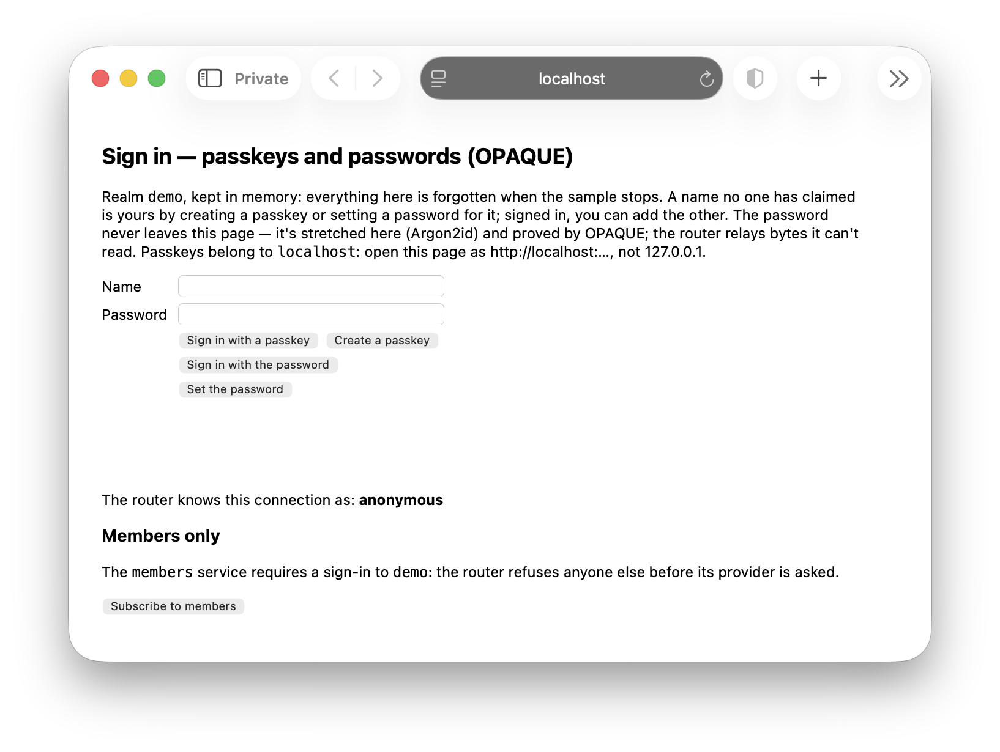

# Tapline sign-in sample

Tapline supports pluggable authentication. Sign in to a Tapline router from a Blazor page, using passkeys or by
password, and a service that serves only the signed in.

> **Disclaimer:** Illustrative only. Its password sign-in is OPAQUE by [opaque-ke](https://github.com/facebook/opaque-ke)
> 4.0.1, through Tapline.Authentication.Opaque. opaque-ke was reviewed by NCC Group in 2021, at v0.5.0 (its fixes in
> v1.2.0), for WhatsApp's encrypted backups. That review does not cover opaque-ke 4.0.1, nor the code of
> Tapline.Authentication.Opaque or of this sample, which has not been reviewed.

```bash
dotnet run --project samples/SignIn.Sample
```

Then open `http://localhost:5940` (passkeys belong to `localhost`: not `127.0.0.1`).

<p align="center">
  
</p>

## What it shows

- **A realm, `demo`, of two ways to prove who you are** (Tapline.Authentication): passkeys (WebAuthn), and passwords by
  OPAQUE (Tapline.Authentication.Opaque), the password stretched and proved in the page, never sent. Its users are kept
  in memory, gone when the sample stops.
- **Claiming a name.** A name no one has claimed is anyone's to claim, by creating a passkey or setting a password for
  it; once claimed, only someone signed in as it adds the other.
- **A service that requires a sign-in**, `members`: the router refuses anyone not signed in to the realm before its
  provider is asked, and the provider greets whoever subscribes, by name and by how they proved it.
- **The page keeps the password.** The form isn't bound to Blazor, so what's typed never travels over the circuit
  ([why](#design-record-the-password-field-isnt-blazors)).

The router relays each sign-in to the realm's authentication service a message at a time, and never reads them. How
it works: [Signing users in](../../docs/provider.md#signing-users-in) and the
[sign-in reference](../../docs/provider.md#reference-signing-in).

## Design record: the password field isn't Blazor's

**Context.** Password sign-in is OPAQUE: the password is stretched (Argon2id) and proved in the browser, and the server
learns only the proof. That holds only while the password never reaches the server: not over the circuit, not in a form
post, not in a log.

**Decision.** The password is typed into a plain HTML form that the component renders without binding: no `@bind`,
`@oninput` or `@onchange` on its inputs, and nothing submitted. The password field has no `name`, so no form submission
could carry it, and the page's policy allows none (`form-action 'none'`). The component hands its script an
`ElementReference` (`signInView.attach`), never a value. `wwwroot/signin.js` reads the field when a button is pressed
and passes it to `tapline-opaque.mjs`, which sends only OPAQUE's messages (KE1–KE3) through the router. The identity it
earns is held on the server, on the connection's `Outlet`, and the `members` service checks it there, not in the page.

**Alternatives rejected.**

- *An interactive Blazor input (`@bind`).* With Interactive Server rendering, its value travels over the SignalR circuit
  on every change and sits in the component's state on the server: the plaintext the protocol exists to keep away. TLS
  protects it only in transit.
- *A statically rendered form posted to the server*, as ASP.NET Core Identity's account pages are (static SSR,
  `SignInManager`, a cookie). That is right for passwords checked on the server; here it would post the plaintext.
- *An Interactive WebAssembly component.* The value stays in the browser, but in .NET strings that can't be wiped, and
  Auto rendering runs the component on the server until the WebAssembly runtime has loaded.

**Consequences.**

- Blazor's form features (`EditForm`, validation, its antiforgery token) aren't used for this form. It posts nothing,
  so antiforgery has nothing to protect.
- What's typed is exposed to any script the page runs, so the page sends a strict Content-Security-Policy
  (`ContentSecurity.cs`): scripts only from its own origin, plus its one inline module, admitted by a nonce minted for
  each response; WebAssembly allowed for Argon2id and OPAQUE; connections only back to its origin. Beyond `localhost`,
  serve it over HTTPS too. This sample, a local demo, serves plain HTTP.
- The form allows autofill by password managers (its `autocomplete` hints), and the policy disallows framing
  (`frame-ancestors 'none'`), to prevent clickjacking.
- JavaScript strings can't be wiped. The field is cleared after a successful sign-in, and `tapline-opaque.mjs` zeroes
  its encoded copies of the password and the module's.
- A sign-in belongs to the Tapline connection, not to an ASP.NET Core cookie, so `AuthorizeView` and `[Authorize]`
  don't see it. An app that signs in with cookies gives the router its users through the host instead
  ([Where identities come from](../../docs/design/authentication.md#where-identities-come-from)).

## Where to look

- `SignInDemo.cs` — the realm's authentication service and its modules, and the `members` provider.
- `Components/SignInDemoPanel.razor` and `wwwroot/signin.js` — the page: sign in, register, subscribe to `members`.
- `ContentSecurity.cs` — the page's Content-Security-Policy.

License: the [Elastic License 2.0](../../LICENSE), as the repository's.
