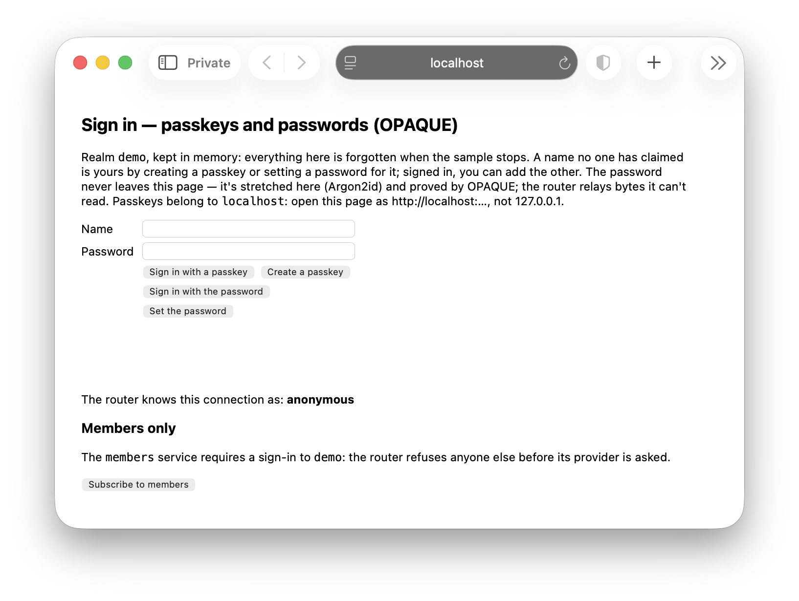

# Tapline sign-in sample

Tapline supports pluggable authentication. Sign in to a Tapline router from a Blazor page, using passkeys or by
password, and a service that serves only the signed in.

> **Disclaimer:** Illustrative only. Its password sign-in is OPAQUE by [opaque-ke](https://github.com/facebook/opaque-ke)
> 4.0.1, through Tapline.Authentication.Opaque. opaque-ke was reviewed by NCC Group in 2021, at v0.5.0 (its fixes in
> v1.2.0), for WhatsApp's encrypted backups. That review does not cover opaque-ke 4.0.1, nor the code of
> Tapline.Authentication.Opaque or of this sample, which has not been reviewed.

```bash
dotnet run --project samples/SignIn.Sample
```

Then open `http://localhost:5940` (passkeys belong to `localhost`: not `127.0.0.1`).

<p align="center">
  
</p>

## What it shows

- **A realm, `demo`, of two ways to prove who you are** (Tapline.Authentication): passkeys (WebAuthn), and passwords by
  OPAQUE (Tapline.Authentication.Opaque), the password stretched and proved in the page, never sent. Its users are kept
  in memory, gone when the sample stops.
- **Claiming a name.** A name no one has claimed is anyone's to claim, by creating a passkey or setting a password for
  it; once claimed, only someone signed in as it adds the other.
- **A service that requires a sign-in**, `members`: the router refuses anyone not signed in to the realm before its
  provider is asked, and the provider greets whoever subscribes, by name and by how they proved it.
- **The page keeps the password.** The form isn't bound to Blazor, so what's typed never travels over the circuit.

The router relays each sign-in to the realm's authentication service a message at a time, and never reads them. How
it works: [Signing users in](../../docs/provider.md#signing-users-in) and the
[sign-in reference](../../docs/provider.md#reference-signing-in).

## Where to look

- `SignInDemo.cs` — the realm's authentication service and its modules, and the `members` provider.
- `Components/SignInDemoPanel.razor` and `wwwroot/signin.js` — the page: sign in, register, subscribe to `members`.

License: the [Elastic License 2.0](../../LICENSE), as the repository's.
